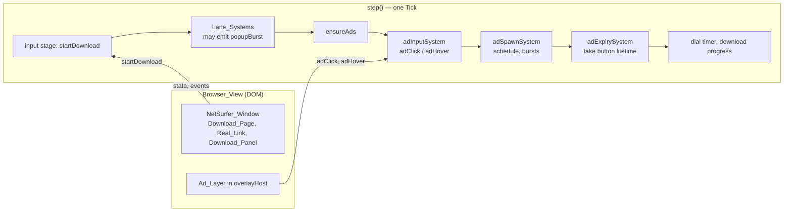

# Design Document: browser-front

## Overview

browser-front adds the top front: the NetSurfer window that opens on `connected`, the download
page with the Real_Link and the Download_Panel, and pop-up Ads with seven Close_Patterns.

It follows the connection-lane split:

- **Rules** in `src/game/ads/` as pure systems that run in `step()` after the Lane_Systems.
  Every Ad, its rectangle in Screen pixels and its pattern stage live in `GameState.ads`.
  Randomness comes from `ctx.random()`.
- **Tuning** in `src/game/balance/ads.ts`, including the page geometry, so the simulation and
  the DOM agree on where the Real_Link is.
- **Views** in `src/render/browser/`: the Browser_View opens the NetSurfer_Window through the
  Window_Manager and draws Ads in an Ad_Layer over the whole Ad_Field. It reads state and sends
  `startDownload`, `adClick` and `adHover` commands only.

Two small changes to earlier specs are needed:

1. **`TickContext.eventsSoFar()`** (game-core): a read-only view of the events emitted earlier in
   the current Tick. The ad systems need the Lane_Systems' `popupBurst` from the same Tick
   (Requirement 7.3). The director and economy specs need the same thing for
   `fakeButtonClicked` and `mobKilled`.
2. **`SessionContext.overlayHost`** (retro-shell): an element over the Desktop_Area and the
   Lane_Dock, below the Result_Screen, where the Ad_Layer mounts (Requirement 12.1).

Neither change alters an existing assertion (Requirement 14.4).

## Architecture



Ads opened by Ad_Mistakes are opened inside `adInputSystem`; scheduled and burst Ads inside
`adSpawnSystem`. Both go through one `openAd()` helper that applies the Ad_Cap and placement.
Interrupters add their Pause_Source in the same Tick they open, and the download stage runs
after the systems, so an interrupter freezes progress from its first Tick (Requirement 9.4).

### Screen geometry during a Session

All Ad numbers are Screen pixels from the top-left of the Screen (1024 × 768):

| Area | Rectangle (x, y, w, h) |
|---|---|
| Desktop_Area | 0, 0, 1024, 480 |
| Lane_Dock | 0, 480, 1024, 260 |
| Ad_Field | 0, 0, 1024, 740 |
| NetSurfer_Window | 0, 0, 1024, 480 (window chrome included) |
| Download_Page (page body inside the window) | 8, 92, 1008, 360 |
| Real_Link | 412, 300, 200, 16 |

The Browser_View places the page body and the Real_Link at exactly these rectangles (absolute
positioning inside the window content), so `adBalance.realLink` is the only source of truth.

## Components and Interfaces

### Types (`src/game/ads/adTypes.ts`)

```ts
export type AdKind = 'clutter' | 'fake' | 'interrupter';
export type ClosePattern =
  | 'plain' | 'decoy' | 'hidden' | 'swapped' | 'countdown' | 'confirm' | 'runaway';
export type AdControl =
  | 'close' | 'bigClose' | 'tinyClose' | 'ok' | 'cancel' | 'noThanks'
  | 'skip' | 'confirmYes' | 'confirmNo' | 'fakeButton' | 'body';
export type Rect = { readonly x: number; readonly y: number; readonly w: number; readonly h: number };
export type Corner = 'tl' | 'tr' | 'bl' | 'br';

export interface Ad {
  readonly id: number;
  readonly kind: AdKind;
  readonly pattern: ClosePattern | null;     // null for fake buttons
  readonly rect: Rect;
  readonly openTick: number;
  readonly copy: number;                      // index into the copy variants of its kind
  readonly laneCover: boolean;
  readonly stage: 'main' | 'confirm';         // confirm pattern only
  readonly corner: Corner | null;             // hidden pattern: where the tiny ✕ sits
  readonly closeAt: { readonly x: number; readonly y: number } | null; // runaway ✕, ad-relative
  readonly jumps: number;                     // runaway jumps so far
}

export interface AdState {
  readonly balance: AdBalance;
  readonly nextId: number;
  readonly ads: readonly Ad[];                // ascending id; later = drawn on top
  readonly connectedTick: number | null;      // first Tick the ad systems saw a non-dialing phase
  readonly openedFirstClutter: boolean;
}

export type AdClickCommand = { readonly type: 'adClick'; readonly adId: number; readonly control: AdControl };
export type AdHoverCommand = { readonly type: 'adHover'; readonly adId: number };

export type AdEventBody =
  | { type: 'adOpened'; id: number; kind: AdKind; pattern: ClosePattern | null; laneCover: boolean }
  | { type: 'adClosed'; id: number; kind: AdKind; rewardKb: number }
  | { type: 'adMistake'; id: number; control: AdControl }
  | { type: 'adStage'; id: number; stage: 'main' | 'confirm' }
  | { type: 'adCloseJumped'; id: number; jumps: number }
  | { type: 'adExpired'; id: number }
  | { type: 'adSkipped'; kind: AdKind }
  | { type: 'fakeButtonClicked'; id: number; penalty: number };
```

`InputCommand` gains `AdClickCommand | AdHoverCommand`; `GameEventBody` gains `AdEventBody`;
`GameState` gains optional `ads?: AdState` (absent until `ensureAds` runs, like `lane`).
`step()`'s input switch lists both new commands as "read by systems" (Requirement 14.1).

### Balance (`src/game/balance/ads.ts`)

```ts
export interface AdRow {
  readonly kind: AdKind;
  readonly startSecond: number;   // Run seconds from dial start
  readonly endSecond: number;
  readonly everySeconds: number;
  readonly patterns: readonly ClosePattern[]; // [] for fake
  readonly laneCover: boolean;
}

export interface AdBalance {
  readonly field: Rect; readonly desktop: Rect; readonly page: Rect; readonly realLink: Rect;
  readonly sizes: Readonly<Record<AdKind, { readonly w: number; readonly h: number }>>;
  readonly fakePenalty: number;        // 20
  readonly fakeLifetimeSeconds: number; // 8
  readonly fakeRange: number;          // 120
  readonly rewardKb: number;           // 2
  readonly countdownSeconds: number;   // 3
  readonly runawayJumps: number;       // 3
  readonly cap: number;                // 8
  readonly mistakeExtras: number;      // 1
  readonly firstClutterDelaySeconds: number; // 5, after connectedTick
  readonly schedule: readonly AdRow[];
}
```

Default sizes: clutter 300 × 180, interrupter 420 × 240, fake 220 × 64.

Default Ad_Schedule (Requirement 3.2; times are Run seconds, connect is at 20 s):

| Kind | Start | End | Every | Patterns | Lane cover |
|---|---|---|---|---|---|
| clutter | 33 | 44 | 8 | plain | no |
| clutter | 45 | 89 | 7 | plain, decoy, hidden, swapped | no |
| fake | 45 | 150 | 12 | – | no |
| interrupter | 55 | 89 | 18 | plain, decoy, hidden, swapped | no |
| clutter | 70 | 89 | 7 | countdown, confirm | no |
| interrupter | 70 | 89 | 18 | countdown, confirm | no |
| clutter | 90 | 114 | 6 | all but runaway | yes |
| interrupter | 90 | 150 | 15 | runaway | no |
| clutter | 115 | 150 | 3 | all but runaway | yes |

The first clutter Ad is also forced at `connectedTick + 5 s` with `plain` (Requirement 3.2),
whatever the rows say. `resolveAdBalance(overrides)` merges and validates like
`resolveLaneBalance`, throwing `AdBalanceError` with every problem (Requirement 2.3): finite
numbers, positive sizes that fit the field, `startSecond <= endSecond`, `everySeconds` rounding
to ≥ 1 Tick, known kinds and patterns, `runaway` only on interrupter rows, `patterns` empty for
fake rows and non-empty otherwise.

### Systems (`src/game/ads/*.ts`)

`createAdSystems({ balance?, scheduler? }): readonly System[]` returns
`[ensureAds, adInputSystem, scheduler ?? scheduleAds, adExpirySystem]` (Requirements 1.1, 3.3).

- **`ensureAds`**: adds `AdState` on first run; sets `connectedTick` on the first Tick the phase
  is not `dialing`.
- **`adInputSystem`**: for each `adClick` / `adHover` in `ctx.inputs` order, looks up the Ad and
  applies `resolveClick` / `resolveHover` (below). Unknown ids or controls the Ad lacks are
  ignored with no event (Requirement 11.2).
- **`scheduleAds`**: skipped while `dialing`. Opens the forced first clutter, then each row whose
  `(tick - startTick) mod everyTicks === 0` within its window, in row order, then one burst per
  `popupBurst` in `ctx.eventsSoFar()`, opening `count` clutter Ads with the patterns allowed by
  the newest started row (Requirements 3.2, 7.3, 7.4).
- **`adExpirySystem`**: removes fake buttons older than the lifetime with `adExpired`
  (Requirement 8.3).
- Phase `won`/`lost`: `step()` already returns early, so the Ad_State stays as it was
  (Requirement 1.6).

`openAd(ads, ctx, kind, patterns, laneCover)`:

1. If `ads.length >= cap` → emit `adSkipped`, return (Requirement 3.4).
2. Pick `pattern` uniformly from `patterns` with `ctx.random()`; `copy` from the variant count.
3. Place (below); `hidden` picks a `corner`; `runaway` starts `closeAt` at the title-bar ✕.
4. Interrupter → `ctx.addPauseSource('ad:' + id)` (Requirement 9.1).
5. Emit `adOpened`.

Placement (Requirement 4), all with `ctx.random()` and integer pixels:

- clutter: uniform inside `desktop`, or inside `field` when `laneCover`; for the first clutter
  of a Run, up to 8 draws that don't intersect `realLink`, then the top-left corner of the
  desktop (Requirement 4.5).
- fake: one of the four sides of `realLink` chosen at random, gap from 8 to `fakeRange - h`
  pixels, then clamped inside `field`; candidates that intersect `realLink` are redrawn, with a
  fixed fallback below the link (Requirement 4.3).
- interrupter: uniform inside `page` (Requirement 4.4).

### Close pattern rules (`src/game/ads/closePatterns.ts`)

A pure table drives both the rules and the view. For each pattern and stage it lists the
controls the Ad has, the Correct_Control and the Wrong_Controls. Any other control the Ad has is
neutral (no effect).

| Pattern | Stage | Controls the Ad has | Correct | Wrong | Neutral |
|---|---|---|---|---|---|
| plain | main | close, body | close | body | – |
| decoy | main | close, bigClose, body | close | bigClose, body | – |
| hidden | main | tinyClose, body | tinyClose | body | – |
| swapped | main | ok, cancel, noThanks, body | noThanks | ok, cancel, body | – |
| countdown | main | skip, body | skip (only once the countdown has passed) | body | skip before 0 |
| confirm | main | close, body | – (close → stage `confirm`, emits `adStage`) | body | – |
| confirm | confirm | confirmYes, confirmNo, body | confirmYes | body | confirmNo (→ `main`) |
| runaway | main | close, body | close | body | – |
| fake (no pattern) | – | fakeButton, body | – | fakeButton, body (the penalty) | – |

`resolveClick(ad, control, tick, balance)` returns one of `close`, `mistake`, `stage`,
`fakeHit` or `ignore`.

- `close`: remove the Ad, remove `ad:<id>` if it is an interrupter, emit `adClosed` with
  `rewardKb` (Requirements 7.2, 9.2).
- `mistake`: keep the Ad, emit `adMistake`, open `mistakeExtras` clutter Ads with the current
  patterns (Requirement 11.1).
- `fakeHit`: `ctx.penalizeDownload(fakePenalty)`, emit `fakeButtonClicked`, remove the fake
  button, no reward (Requirements 8.2, 8.4).

`resolveHover` on a `runaway` interrupter with `jumps < runawayJumps` moves `closeAt` to a new
spot inside the Ad at least 60 px from the old one, increments `jumps` and emits
`adCloseJumped` (Requirement 10.7). A click on `close` always closes, whether or not it has
jumped (Requirement 10.8).

### Browser_View (`src/render/browser/`)

| File | Contents |
|---|---|
| `browserView.ts` | `createBrowserView(): SessionView`; owns the window and the Ad_Layer. |
| `netsurferWindow.ts` | Builds the window content: toolbar, address bar, page body, status bar. |
| `downloadPanel.ts` | Pure `downloadView(state)` (percent, rate, time left, waiting) and its DOM. |
| `adLayer.ts` | Keyed DOM reconcile of `state.ads.ads` into `div.ad-layer`. |
| `adDom.ts` | One builder per kind and pattern, using the close pattern table. |
| `browserCopy.ts` (in `src/ui/`) | Every string: page text, ad copy variants, button labels. |
| `browserSounds.ts` | `adDing`, `interrupterAlert`, `adClose`, `mistakeBuzz`, `fakeBuzz`, `closeSkitter`. |

Lifecycle:

- `mount(ctx)`: create the Ad_Layer in `ctx.overlayHost`; nothing else until `connected`.
- On a `connected` event: `ctx.windows.minimize('dialer')`, then `ctx.windows.open({ id:
  'netsurfer', title, icon: 'browser', content, size: { w: 1024, h: 480 }, position: { x: 0, y: 0
  }, onCloseRequest: () => { showBusy(); return false; } })` (Requirements 5.1, 5.6).
- Real_Link click while `connected` → `ctx.send({ type: 'startDownload' })`, once
  (Requirement 5.4).
- `downloadStarted` → replace the link with the "started" line and show the panel
  (Requirement 5.5).
- `update(state)`: panel text through `textContent` only when it changes; `.is-penalty` for 30
  Ticks after `downloadPenalty` (Requirement 6); reconcile Ads.
- `unmount()`: `ctx.windows.close('netsurfer')`, remove the Ad_Layer, stop voices
  (Requirements 5.7, 13.3).

Download panel maths (Requirement 6.2): rate is shown as `3.2 KB/s` (2,048 KB × download rate %
per second ÷ 100, rounded to one decimal); time left is `ceil((100 - download) / rate%)` seconds
as `m:ss`. While any Pause_Source is active: "Waiting for server..." (Requirement 6.3).

Ad_Layer (Requirement 12):

- `div.ad-layer` fills `overlayHost` with `pointer-events: none`; each Ad element sets
  `pointer-events: auto` and is absolutely placed at `ad.rect` (Requirements 12.1, 12.6).
- Ads are drawn in id order, so later Ads sit on top. An open interrupter also draws
  `div.ad-modal-shield` over `page` (pointer-events auto, no handler) beneath itself, so the
  Real_Link and page can't be clicked (Requirement 9.3).
- Every control is a `<button>` with `data-control`; the Ad element itself handles `body`
  clicks; one delegated `pointerdown` listener on the layer maps the target to
  `{ adId, control }` and calls `ctx.send` (Requirement 12.3). A `pointerenter` on a runaway `close`
  sends `adHover` (Requirement 12.4).
- Lane_Cover Ads sit above the lane canvas in the DOM, so a press on them never reaches the
  canvas and no Hammer_Command is sent (Requirement 12.5).
- Countdown text: `max(0, ceil((openTick + countdownTicks - tick) / 60))` (Requirement 12.7).
- Blinking text uses a CSS animation of 0.5 s per state, 2 blinks per second (Requirement 12.9).
- Built with `h()`, text via `textContent`, art from CSS and constant inline SVG
  (Requirement 12.8).

### Copy (`src/ui/browserCopy.ts`)

Window title "MidnightNet Download Center - NetSurfer"; address
`http://files.midnightnet.example/homework/`; file `HOMEWORK.ZIP (2,048 KB)`; real link
"download HOMEWORK.ZIP (mirror 3)"; started line "Your download has started. Please do not hang
up."; busy "NetSurfer is busy. Please try again later."; swapped link "no thanks, I like slow
Internet"; at least 4 clutter, 3 interrupter and 2 fake button variants following the
`retro-copy` steering file (for example "YOU ARE THE 1,000,000th VISITOR!!", "Your modem may be
INFECTED", "FREE CURSOR PACK - 666 SKULLS", "DOWNLOAD NOW!!").

### Shell changes

- `src/dialup/session.ts`: `SessionContext.overlayHost: HTMLElement`.
- `src/scenes/desktop/desktopScene.ts`: a `div.session-overlay` after the window layer and lane
  dock and before the Result_Screen mount point, covering 1024 × 740, passed as `overlayHost`.
- `src/game/context.ts`: `eventsSoFar(): readonly GameEvent[]` returns a frozen copy of this
  Tick's events so far.
- `src/dialup/sessionRegistry.ts`: views `[lane, browser]`, systems `[...lane, ...ads]`
  (Requirement 14.2).
- `src/desktop/iconArt.ts`: a `browser` icon in constant inline SVG.

### Kiro artifacts

- `.kiro/skills/add-ad/SKILL.md`: front matter `name: add-ad`; steps to add an Ad_Kind or a
  Close_Pattern: types, close pattern table row, balance size or schedule, `adDom` builder, copy,
  sound, tests (Requirements 15.1, 15.2). `tests/skills.test.ts` gains the same path checks it
  runs for `add-mob`.
- Playtester run and `docs/kiro-log.md` note (Requirements 15.3, 15.4).

## Data Models

`AdState` is plain data (numbers, strings, booleans, `null`, arrays, objects). Invariants:

- `ads` sorted by id, ids unique, every id `< nextId`.
- `ads.length <= cap`.
- Every `rect` inside `field`; non-Lane_Cover rects inside `desktop`.
- `pauseSources` contains `ad:<id>` exactly for the open interrupters (plus other sources).
- `pattern === null` ⇔ `kind === 'fake'`; `runaway` only on interrupters; `stage === 'confirm'`
  only for `confirm`; `corner !== null` ⇔ `hidden`; `closeAt !== null` ⇔ `runaway`;
  `jumps <= runawayJumps`.

## Correctness Properties

The property tests run random Runs from `arbAdRun` in `tests/game/ads/adProperties.test.ts`: a
short download balance, random lane bursts, and random `adClick` / `adHover` commands that
target open Ads with random controls.

### Property 1: Ad runs are deterministic and plain data

*For any* seed, balance and command script, two Runs give identical states and events on every
Tick, and every state survives a JSON round trip.

**Validates: Requirements 1.2, 1.3, 1.4, 1.7**

### Property 2: Ad state invariants hold on every Tick

*For any* Run, every Tick's Ad_State satisfies the Data Models invariants, no Ad opens while the
phase is `dialing`, and the Ad_State does not change once the phase is `won` or `lost`.

**Validates: Requirements 1.5, 1.6, 3.4, 4.1, 4.2, 10.9**

### Property 3: Placement rules

*For any* Run, every fake button is within `fakeRange` of the Real_Link and does not intersect
it, every interrupter is inside the Download_Page, and the first clutter Ad of the Run does not
intersect the Real_Link.

**Validates: Requirements 4.3, 4.4, 4.5**

### Property 4: Interrupters freeze the download

*For any* Run and Tick, if an interrupter is open at the end of the Tick, download progress did
not increase on that Tick, and the Pause_Sources contain `ad:<id>` exactly for the open
interrupters.

**Validates: Requirements 9.1, 9.2, 9.4**

### Property 5: Exactly one way out per stage

*For any* Ad of any kind and pattern in any stage, the close pattern table lists exactly one
Correct_Control (none for fake buttons, and none in the `confirm` main stage, which advances
instead), and a scripted player who sends the Correct_Control (or `close` then `confirmYes` for
`confirm`) closes the Ad within 2 Ticks, or within the countdown plus 2 Ticks for `countdown`.

**Validates: Requirements 10.1, 10.2, 10.3, 10.4, 10.5, 10.6, 10.8, 10.10**

### Property 6: Clicks have exactly their table effect

*For any* Run, each accepted `adClick` produces exactly the events of its table row: a close
gives one `adClosed` with the reward, a Wrong_Control gives one `adMistake` and up to
`mistakeExtras` new clutter Ads, a fake hit gives one `downloadPenalty` and one
`fakeButtonClicked` with no reward, a neutral control changes nothing, and a command for a
missing Ad or control gives no event.

**Validates: Requirements 7.2, 8.2, 8.4, 11.1, 11.2, 11.3**

### Property 7: The runaway ✕ jumps at most 3 times

*For any* sequence of `adHover` commands on a runaway interrupter, it emits at most
`runawayJumps` `adCloseJumped` events, `closeAt` stays inside the Ad, and a `close` click always
closes it.

**Validates: Requirements 10.7, 10.8**

### Property 8: Bursts and schedule

*For any* Run, each `popupBurst` emitted while not `dialing` opens `min(count, room)` clutter Ads
on the same Tick and emits `adSkipped` for the rest, and scheduled Ads open exactly on their
rows' Ticks.

**Validates: Requirements 3.1, 3.2, 3.4, 7.1, 7.3, 7.4**

### Property 9: The download panel matches the state

*For any* state, `downloadView` shows `floor(download)` as the percentage, the bar fraction
`download / 100`, "Waiting for server..." exactly when a Pause_Source is active, and a time left
that never increases between two Ticks without a pause or penalty.

**Validates: Requirements 6.1, 6.2, 6.3**

### Property 10: The Ad_Layer mirrors the Ad_State

*For any* sequence of Ad_States, after each `update` the Ad_Layer has one element per open Ad at
its rectangle in id order, with exactly the controls the close pattern table lists for its
pattern and stage, and no element for a closed Ad.

**Validates: Requirements 10.3, 12.1, 12.2, 12.3**

## Error Handling

- Invalid ad balance → `AdBalanceError` listing every problem, thrown when the systems are
  created (fails loudly in tests and at Session start, like the lane).
- Unknown or stale `adClick` / `adHover` → ignored with no event.
- `openAd` at the cap → `adSkipped`, never an exception.
- Browser_View without `overlayHost` (old fixtures) → falls back to `ctx.laneHost.parentElement`
  and logs one warning.
- A window manager that refuses `open` (already open) → focus it; never throws.

## Testing Strategy

- `tests/game/balance/ads.test.ts`: defaults, merge, one example per validation rule, all
  problems listed.
- `tests/game/ads/*.test.ts`: examples for each pattern row, the forced first clutter at
  connect + 5 s, burst on the same Tick as `popupBurst`, cap and `adSkipped`, fake lifetime,
  interrupter pause and resume, mistake extras, unknown commands ignored.
- `tests/game/ads/adProperties.test.ts`: Properties 1–8.
- `tests/game/context.test.ts`: `eventsSoFar` returns this Tick's events in order and a copy.
- `tests/render/browser/*.test.ts` (jsdom): window opens on `connected` with the Dialer
  minimized; close refused with the busy text for 180 Ticks; Real_Link sends one
  `startDownload`; panel after `downloadStarted`; Properties 9 and 10; delegated clicks send the
  right command; runaway `pointerenter` sends `adHover`; interrupter shield blocks the link; a
  press on a Lane_Cover Ad reaches no lane canvas listener; unmount closes the window, removes
  the layer and stops voices.
- `tests/render/browser/browserSounds.test.ts`: each event maps to one recipe once per frame;
  Web Audio nodes only.
- `tests/scenes/desktop/desktopScene.test.ts`: `overlayHost` exists, sits below the
  Result_Screen and is passed to views. Existing assertions unchanged.
- `tests/skills.test.ts`: the `add-ad` skill checks.
- `runHeadless` with the ad systems only (no lane, so nothing damages the modem) and a script
  that starts the download at 21 s and closes every Ad with its Correct_Control 1 s after it
  opens reaches `won`, and the same script that also clicks every fake button ends later.
