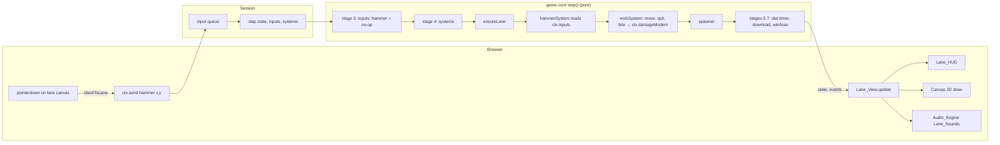

# Design Document: connection-lane

## Overview

connection-lane adds the bottom front of the game:

- **Pure lane rules** in `src/game/` as four game-core systems created by `createLaneSystems()`:
  lane setup, hammer, mobs (movement, ranged spit, bites) and a placeholder spawner. They run
  inside `step()` from tick 1 of dialing, keep all their data in an optional `GameState.lane`
  field and talk to the rest of the game through the tick context and events.
- **Lane tuning** in `src/game/balance/lane.ts`: Enemy_Stats from `docs/game-design.md` section 5,
  hammer, ranged, boss, lane geometry and the placeholder Spawn_Schedule.
- **game-core extensions**: a `hammer` input command, lane event types, and `ctx.inputs` so that
  systems can read the tick's commands. `createRun()` and every existing test stay unchanged.
- **Lane_View**: a Session_View that draws the lane on a Canvas 2D in the Lane_Dock, shows the
  Lane_HUD, plays small synthesized sounds and turns clicks into `hammer` commands.
- **Sprites**: a manifest built from `import.meta.glob`, a Placeholder_Generator for every frame
  the view needs, and a Sprite_Atlas that pre-rasterizes each frame once.
- **Kiro**: an `add-mob` skill written after the mobs exist, and a log note.

### Research notes

- **Vite glob import.** `import.meta.glob(pattern, { eager: true, query: '?url', import: 'default' })`
  is turned at build time into static imports of each matching file's URL. Patterns starting with
  `/` are resolved from the project root, and every argument must be a literal. A pattern with no
  matches gives an empty object. Small assets may be inlined as `data:` URLs during build.
  Source: [Vite features: Glob Import](https://vite.dev/guide/features#glob-import). Design
  consequence: one module (`spriteModules.ts`) owns the literal glob call, and the manifest
  builder is a pure function over its result, so it can be tested with made-up paths and works
  with zero files. Content was rephrased for compliance with licensing restrictions.
- **Kiro skills.** A workspace skill is a folder under `.kiro/skills/` holding a `SKILL.md` file
  that starts with YAML front matter. `name` is required, must match the folder name and uses
  lowercase letters, digits and hyphens; `description` is required and is what Kiro matches
  requests against. Source: [Kiro docs: Agent Skills](https://kiro.dev/docs/skills/). Content was
  rephrased for compliance with licensing restrictions.
- **SVG as canvas images.** An SVG drawn with `drawImage` keeps its `viewBox` aspect, but an SVG
  root without `width`/`height` can report a natural size of 0 in some browsers. Design
  consequence: the atlas sizes each raster from the natural size when it is above 0 and from the
  entity's box otherwise, and the placeholders always set `width` and `height`.

### Design decisions

| # | Decision | Choice | Why |
|---|---|---|---|
| D1 | Where lane data lives | Optional `GameState.lane`, created by the first lane system on tick 1 | `createRun()` and its exact-equality test stay unchanged (Req 1.2, 9.3). A run without lane systems has no lane. The state stays JSON-safe because the key is absent, never `undefined`. |
| D2 | Hammer input | `{ type: 'hammer', x, y }` in Lane_Units, hit-tested in pure code | A point is all a replay, the headless runner or the future MCP server needs. Targeting a mob id would put hit testing in the renderer and break when a target dies between click and tick. The point is tested against the state at the start of the tick, which is the state the player last saw. |
| D3 | How systems see inputs | New `TickContext.inputs` (defaults to `[]`) | The `System` signature and every existing system stay the same. `step()` treats `hammer` as a no-op in its own input stage (Req 9.1, 9.2, 9.4). |
| D4 | System order | `[ensureLane, hammer, mobs, spawner]` | The click applies to the positions the player saw. Newly spawned mobs start moving on the next tick. Bites land before game-core resolves win/lose, so a same-tick download finish still wins. |
| D5 | Spawn source | `scheduleSpawner` System over a Spawn_Wave table; `createLaneSystems({ spawner })` swaps it | Milestone 5's director replaces one system and reuses `addMob()` (Req 3.4). |
| D6 | Randomness | None in the lane this milestone | The placeholder schedule is fixed data, so every run and the demo video repeat exactly. `ctx.random()` is still there for the director. |
| D7 | Globs | A Glob is an Enemy kind with its own Enemy_Stats | Moving, hitting, killing and biting share one code path (Req 5.3). |
| D8 | Overlapping targets | Hit_Priority: lowest Lane_X, then lowest id; drawn on top | The mob closest to the modem is the most urgent, and what is on top is what you hit (Req 7.2, 11.3). |
| D9 | Lane geometry | 800 Lane_Units from Modem_Line to Manhole; the default Lane_Layout maps 1 unit to 1 canvas px | Numbers are easy to reason about in tests and tuning, and the renderer still maps through one function. |
| D10 | Screen mapping | `SessionContext.toScreenPoint` (Monitor's) plus the canvas rect origin | Accounts for the monitor's CSS scale and for the Lane_Dock slide (Req 9.6, 10.2). |
| D11 | HUD | DOM (`h()` + `textContent`), not canvas text | Testable in jsdom and follows the text rule (Req 12.4). |
| D12 | Pop-up bursts | `popupBurst` event only | The browser front (milestone 4) owns the ads. Tank and boss bites also request a burst, as `docs/game-design.md` sections 5 and 8 say. |
| D13 | Lane state updates | Lane systems mutate `draft.lane` in place through a `MutableLaneState` view | `step()` already works on a deep clone, so in-place edits are safe and cheaper than rebuilding arrays every tick. |
| D14 | Registry example test | Replace `registry starts empty` with a test that checks the lane view and systems | That example encoded retro-shell's "empty until milestone 3" rule, which this milestone ends. It is an updated requirement, not a weakened test. |

## Architecture

### Module layout

```
src/game/
  laneTypes.ts            MobKind, EnemyKind, Enemy, LaneState, HammerCommand, LaneEventBody
  balance/lane.ts         LaneBalance, DEFAULT_LANE_BALANCE, resolveLaneBalance, secondsToTicks
  laneState.ts            MutableLaneState, initialLane, laneOf, laneDraft
  lane.ts                 createLaneSystems, ensureLane (wiring only)
  mobs.ts                 enemyStats, addMob, damageEnemy, mobSystem
  hammer.ts               hitBox, hitTest, compareHitPriority, hammerSystem
  spawner.ts              scheduledSpawnsAt, scheduleSpawner
  types.ts                + HammerCommand in InputCommand, + LaneEventBody, + lane?: LaneState
  context.ts              + inputs on TickContext; createTickContext(draft, events, inputs = [])
  step.ts                 passes inputs to the context; `hammer` is a no-op case
src/render/
  laneLayout.ts           LaneLayout, createLaneLayout, laneToCanvas, canvasToLane, clientToLane
  laneEffects.ts          render-only effect memory (corpses, swing, shake, rattle), shakeOffset
  laneDrawList.ts         buildDrawList(state, effects, layout, atlas counts) → DrawItem[]
  laneView.ts             createLaneView(): SessionView (canvas, pointer, HUD, sounds, draw)
  laneSounds.ts           LANE_SOUNDS recipes, laneSoundsFor(events)
  sprites/
    entities.ts           SpriteEntity, AnimationName, ENTITY_LOOKS, ANIMATION_FPS
    frames.ts             frameIndex, enemyAnimation
    manifest.ts           buildManifest(modules) → { manifest, problems }
    spriteModules.ts      SPRITE_MODULES (the one import.meta.glob call)
    placeholder.ts        placeholderSvg, placeholderFrames
    atlas.ts              createSpriteAtlas, getDefaultAtlas, rasterSize
src/ui/
  laneCopy.ts             LANE_COPY
  laneHud.ts              integrityView, createLaneHud
src/styles/lane.css       lane view, canvas cursor, HUD
src/dialup/session.ts     + toScreenPoint on SessionContext
src/dialup/sessionRegistry.ts   views: [createLaneView], systems: createLaneSystems()
src/scenes/desktop/desktopScene.ts   passes monitor.toScreenPoint to the Session
src/main.ts               + import './styles/lane.css'
.kiro/skills/add-mob/SKILL.md
```

### Data flow



### Order inside one tick (with the lane)

1. game-core stages 1–3 as before. A `hammer` command changes nothing in stage 3 (Req 9.2).
2. **ensureLane**: if `draft.lane` is absent, set it to `initialLane(balance)` (Req 1.1).
3. **hammerSystem**: for each command in `ctx.inputs` in order, skip non-`hammer` commands, skip
   non-finite points (Req 7.5), skip while `tick < hammerReadyTick` (Req 7.3). Otherwise accept:
   `hammerReadyTick = tick + cooldownTicks`, hit-test, emit `hammerSwing`, and damage the target
   (Req 7.2, 7.4, 7.6).
4. **mobSystem**: for each Enemy in ascending id order (snapshot of the list): move, handle
   ranged arrival and spitting, and bite if `x ≤ 0` (Req 4, 5). Globs spat this tick are appended
   after the loop, so they start moving on the next tick.
5. **spawner** (default `scheduleSpawner`): add the Mobs scheduled for this tick (Req 3.2).
6. game-core stages 5–7: dial timer, download, then win before lose.

## Components and Interfaces

### `src/game/laneTypes.ts`

```ts
import type { LaneBalance } from './balance/lane';

export type MobKind = 'default' | 'fast' | 'tank' | 'ranged' | 'boss';
export type EnemyKind = MobKind | 'glob';
export const MOB_KINDS: readonly MobKind[] = ['default', 'fast', 'tank', 'ranged', 'boss'];
export const ENEMY_KINDS: readonly EnemyKind[] = [...MOB_KINDS, 'glob'];

interface EnemyBase {
  readonly id: number;
  readonly x: number;                    // Lane_X, 0 < x ≤ laneLength
  readonly hp: number;                   // 1..maxHp
  readonly spawnTick: number;
  readonly lastHitTick: number | null;
}
export type Enemy =
  | (EnemyBase & { readonly kind: 'default' | 'fast' | 'tank' })
  | (EnemyBase & {
      readonly kind: 'ranged';
      readonly nextSpitTick: number | null;  // null while walking
      readonly lastSpitTick: number | null;
    })
  | (EnemyBase & { readonly kind: 'boss'; readonly summonsDone: number })  // thresholds passed
  | (EnemyBase & { readonly kind: 'glob'; readonly sourceId: number });

export interface LaneState {
  readonly balance: LaneBalance;
  readonly nextId: number;               // starts at 1
  readonly enemies: readonly Enemy[];    // ascending id
  readonly hammerReadyTick: number;      // starts at 0
}

export type HammerCommand = { readonly type: 'hammer'; readonly x: number; readonly y: number };
export type SpawnSource = 'schedule' | 'bossSummon';
export type BurstCause = 'tankBite' | 'bossBite' | 'bossSummon';

export type LaneEventBody =
  | { readonly type: 'mobSpawned'; readonly id: number; readonly kind: MobKind; readonly x: number; readonly source: SpawnSource }
  | { readonly type: 'globSpat'; readonly id: number; readonly sourceId: number; readonly x: number }
  | { readonly type: 'hammerSwing'; readonly x: number; readonly y: number; readonly targetId: number | null }
  | { readonly type: 'mobHit'; readonly id: number; readonly kind: EnemyKind; readonly damage: number; readonly hp: number }
  | { readonly type: 'mobKilled'; readonly id: number; readonly kind: EnemyKind; readonly x: number; readonly dropKb: number }
  | { readonly type: 'mobBit'; readonly id: number; readonly kind: EnemyKind; readonly damage: number }
  | { readonly type: 'bossSummon'; readonly id: number; readonly threshold: number; readonly spawnedIds: readonly number[] }
  | { readonly type: 'popupBurst'; readonly count: number; readonly cause: BurstCause };
```

`mobSpawned.source` and `BurstCause` are open for later milestones to extend (for example a
`fakeButton` source in milestone 5).

### Changes to `src/game/types.ts`, `context.ts`, `step.ts`

```ts
// types.ts
import type { HammerCommand, LaneEventBody, LaneState } from './laneTypes';
export type InputCommand = { readonly type: 'startDownload' } | HammerCommand;
export type GameEventBody = /* existing core events */ | LaneEventBody;
export interface GameState { /* existing fields */ readonly lane?: LaneState }
// MutableGameState keeps `lane?: LaneState` (the mapped type preserves the optional modifier).

// context.ts
export interface TickContext { /* existing members */ readonly inputs: readonly InputCommand[] }
export function createTickContext(draft: MutableGameState, events: GameEvent[], inputs: readonly InputCommand[] = []): TickContext;

// step.ts, stage 3
case 'hammer':
  break; // lane input: read by the lane systems through ctx.inputs
```

All imports between `types.ts`, `laneTypes.ts` and `balance/lane.ts` are type-only except
`balance/lane.ts` importing the `TICK_RATE` value from `types.ts`, the same pattern as
`balance/core.ts`, so there is no runtime cycle.

### `src/game/balance/lane.ts`

```ts
export interface EnemyStats {
  readonly hp: number;      // integer ≥ 1
  readonly speed: number;   // Lane_Units per second, > 0
  readonly damage: number;  // modem damage per bite, ≥ 0
  readonly dropKb: number;  // integer ≥ 0
  readonly width: number;   // Hit_Box, > 0
  readonly height: number;  // Hit_Box, > 0
}
export interface SpawnWave {
  readonly kind: MobKind;
  readonly startSecond: number;   // ≥ 0
  readonly endSecond: number;     // ≥ startSecond
  readonly everySeconds: number;  // rounds to ≥ 1 tick
}
export interface LaneBalance {
  readonly laneLength: number;
  readonly hitPadding: number;
  readonly enemies: Readonly<Record<EnemyKind, EnemyStats>>;
  readonly hammer: { readonly damage: number; readonly cooldownSeconds: number };
  readonly ranged: { readonly stopX: number; readonly firstSpitSeconds: number; readonly spitEverySeconds: number };
  readonly boss: { readonly thresholds: readonly number[]; readonly summonCount: number; readonly summonSpacing: number };
  readonly popupBurstCount: number;
  readonly spawns: readonly SpawnWave[];
}
/** Nested partials for the tables; `spawns` and `boss.thresholds` are replaced whole. */
export interface LaneBalanceOverrides {
  readonly laneLength?: number;
  readonly hitPadding?: number;
  readonly enemies?: { readonly [K in EnemyKind]?: Partial<EnemyStats> };
  readonly hammer?: Partial<LaneBalance['hammer']>;
  readonly ranged?: Partial<LaneBalance['ranged']>;
  readonly boss?: Partial<LaneBalance['boss']>;
  readonly popupBurstCount?: number;
  readonly spawns?: readonly SpawnWave[];
}
export const DEFAULT_LANE_BALANCE: LaneBalance;   // deep-frozen
export class LaneBalanceError extends Error { readonly problems: readonly string[] }
export function resolveLaneBalance(overrides?: LaneBalanceOverrides): LaneBalance;
export function secondsToTicks(seconds: number): number;   // Math.round(seconds * TICK_RATE)
```

Default values (starting points for tuning; reasons in the decision table and
`docs/game-design.md`):

| Kind | HP | Speed (u/s) | Lane crossing | Damage | Drop KB | Hit_Box w × h |
|---|---|---|---|---|---|---|
| default | 2 | 40 | 20 s | 10 | 5 | 44 × 72 |
| fast | 1 | 110 | 7.3 s | 8 | 8 | 34 × 48 |
| tank | 4 | 24 | 33 s | 20 | 20 | 72 × 96 |
| ranged | 3 | 40 | stops at 400 after 10 s | 0 (never bites) | 15 | 48 × 76 |
| boss | 30 | 26 | 31 s (arrives about 2:29 if ignored) | 40 | 100 | 112 × 150 |
| glob | 1 | 150 | 2.7 s from mid-lane | 5 | 1 | 22 × 22 |

Other defaults: `laneLength 800`, `hitPadding 6`, `hammer { damage 1, cooldownSeconds 0.3 }`
(18 ticks), `ranged { stopX 400, firstSpitSeconds 1, spitEverySeconds 3 }`,
`boss { thresholds [0.75, 0.5, 0.25], summonCount 2, summonSpacing 36 }`, `popupBurstCount 3`.

Placeholder Spawn_Schedule (replaced by the director in milestone 5):

| Kind | Start s | End s | Every s | Matches chapter |
|---|---|---|---|---|
| default | 8 | 150 | 6 | Hook: first crawler at 0:08 |
| fast | 45 | 150 | 7 | Pinch 1 |
| tank | 70 | 150 | 12 | Midpoint |
| ranged | 90 | 150 | 15 | Pinch 2 |
| boss | 118 | 118 | 1 | Plot turn 2: boss at about 1:58 |

Economy sanity check for later: killing every mob up to 1:10 drops 11 × 5 + 4 × 8 = 87 KB, in
line with "saw by about 1:10".

Validation rules (Req 2.5), every problem collected before throwing: every number finite;
`laneLength > 0`; `hitPadding ≥ 0`; per Enemy_Stats the ranges in the interface comments; hammer
`damage > 0`, `cooldownSeconds ≥ 0`; `0 < stopX < laneLength`; `firstSpitSeconds ≥ 0`;
`secondsToTicks(spitEverySeconds) ≥ 1`; thresholds each in (0, 1) and strictly decreasing;
`summonCount` and `popupBurstCount` integers ≥ 0; `summonSpacing ≥ 0`; each Spawn_Wave with a
known kind, `startSecond ≥ 0`, `endSecond ≥ startSecond` and `secondsToTicks(everySeconds) ≥ 1`.

### `src/game/laneState.ts` and `src/game/lane.ts`

`laneState.ts` holds the helpers every lane module needs, so `mobs.ts`, `hammer.ts` and
`spawner.ts` do not import the wiring module:

```ts
// laneState.ts
/** LaneState with writable fields and arrays, for use on a step() draft only. */
export type MutableLaneState = { -readonly [K in keyof LaneState]: K extends 'enemies' ? MutableEnemy[] : LaneState[K] };
export function initialLane(balance: LaneBalance): LaneState;
/** The Lane_State of a Run, or null before the first lane tick or in runs without lane systems. */
export function laneOf(state: GameState): LaneState | null;
/** Writable view of draft.lane for lane systems. Throws if ensureLane has not run (a wiring bug). */
export function laneDraft(draft: MutableGameState): MutableLaneState;

// lane.ts
export interface LaneOptions {
  readonly balance?: LaneBalanceOverrides;
  /** Replaces the scheduled spawner (milestone 5 director). */
  readonly spawner?: System;
}
/** Resolves the balance now (throws LaneBalanceError) and returns [ensureLane, hammer, mobs, spawner]. */
export function createLaneSystems(options?: LaneOptions): readonly System[];
```

`MutableEnemy` is the writable form of each `Enemy` variant. The systems are plain functions with no closure state except the resolved balance used by
`ensureLane` (Req 1.5). After setup every system reads `draft.lane.balance` (Req 1.4).

### `src/game/mobs.ts`

```ts
export function enemyStats(lane: LaneState, kind: EnemyKind): EnemyStats;
/** Adds a Mob at x (capped to (0, laneLength]), emits mobSpawned, returns its id (Req 3.5). */
export function addMob(lane: MutableLaneState, ctx: TickContext, kind: MobKind, x: number, source: SpawnSource): number;
/** Applies damage, emits mobHit, then mobKilled or boss summons (Req 6, 8). No-op for unknown ids. */
export function damageEnemy(lane: MutableLaneState, ctx: TickContext, id: number, amount: number): void;
export const mobSystem: System;
```

`mobSystem`, per Enemy in ascending id order:

1. **Move** unless it is a stopped ranged Mob: `x -= speed / TICK_RATE` (Req 4.1).
2. **Ranged arrival**: if a walking ranged Mob has `x ≤ stopX`, set `x = stopX` and
   `nextSpitTick = tick + secondsToTicks(firstSpitSeconds)` (Req 5.1, 5.5).
3. **Spit**: if a stopped ranged Mob has `tick ≥ nextSpitTick`, queue a Glob at its `x` with the
   next id, emit `globSpat`, set `lastSpitTick = tick` and add the spit interval to
   `nextSpitTick` (Req 5.2).
4. **Bite**: if `x ≤ 0`, emit `mobBit`, call `ctx.damageModem(damage)` (which emits `modemHit`),
   emit `popupBurst` for tank (`tankBite`) and boss (`bossBite`) Mobs, and remove the Enemy
   (Req 4.2, 4.4, 4.5, 4.6).

Queued Globs are appended after the loop (Req 5.3). A ranged Mob's death leaves its Globs alone
(Req 5.4).

`damageEnemy(id, amount)`:

1. `newHp = max(0, hp − amount)`; `lastHitTick = tick`; emit `mobHit { damage: hp − newHp, hp: newHp }`
   (Req 8.1).
2. If `newHp === 0`: remove the Enemy and emit `mobKilled { x, dropKb }`; no summons (Req 6.3, 8.2).
3. Else, for a boss: while `summonsDone < thresholds.length` and
   `newHp ≤ thresholds[summonsDone] × maxHp`: add `summonCount` default Mobs at
   `min(laneLength, boss.x + k × summonSpacing)` with source `bossSummon`, emit
   `bossSummon { threshold, spawnedIds }` and `popupBurst { cause: 'bossSummon' }`, then
   `summonsDone += 1` (Req 6.1, 6.2, 6.4). Event order per summon: the `mobSpawned` events, then
   `bossSummon`, then `popupBurst`.

### `src/game/hammer.ts`

```ts
export interface Box { readonly left: number; readonly right: number; readonly bottom: number; readonly top: number }
/** Padded Hit_Box in Lane_Units (feet at (x, 0)). */
export function hitBox(enemy: Enemy, stats: EnemyStats, padding: number): Box;
/** Negative when a comes first in Hit_Priority (lower x, then lower id). */
export function compareHitPriority(a: Enemy, b: Enemy): number;
/** The first Enemy in Hit_Priority whose padded Hit_Box contains (x, y), edges included; or null. */
export function hitTest(lane: LaneState, x: number, y: number): Enemy | null;
export const hammerSystem: System;
```

### `src/game/spawner.ts`

```ts
/** Kinds scheduled on `tick`, in Spawn_Schedule order. Depends on tick and waves only (Req 3.6). */
export function scheduledSpawnsAt(tick: number, spawns: readonly SpawnWave[]): readonly MobKind[];
/** Adds each scheduled kind at x = laneLength with source 'schedule' (Req 3.2, 3.7). */
export const scheduleSpawner: System;
```

A wave spawns on tick `t` when `s = secondsToTicks(startSecond)`, `e = secondsToTicks(endSecond)`,
`n = secondsToTicks(everySeconds)`, `s ≤ t ≤ e` and `(t − s) mod n = 0`. Tick 0 is never stepped,
so a wave starting at second 0 first spawns on tick `n`. This keeps the rule a pure function of
the tick with no index stored in the state.

### Retro-shell changes

```ts
// src/dialup/session.ts
export interface SessionContext {
  readonly laneHost: HTMLElement;
  readonly windows: WindowManager;
  readonly audio: AudioEngine;
  readonly toScreenPoint: (clientX: number, clientY: number) => { x: number; y: number };
  send(command: InputCommand): void;
}
// `start(host: Omit<SessionContext, 'send'>)` now also needs toScreenPoint.

// src/scenes/desktop/desktopScene.ts
s.start({ laneHost: laneDock, windows, audio, toScreenPoint: (x, y) => monitor.toScreenPoint(x, y) });

// src/dialup/sessionRegistry.ts
export const SESSION_REGISTRY: SessionRegistry = {
  views: [() => createLaneView()],
  systems: createLaneSystems(),
};
```

Test fixtures that build a `SessionContext` or a Session host literally
(`tests/dialup/dialer.test.ts`) get a `toScreenPoint` field; no assertion changes.

### `src/render/laneLayout.ts`

```ts
export const LANE_CANVAS_W = SCREEN_W;        // 1024
export const LANE_CANVAS_H = LANE_DOCK_H;     // 260
export const MODEM_AREA_W = 112;              // canvas px left of Lane_X 0
export const MANHOLE_AREA_W = 112;            // canvas px right of Lane_Length
export const LINE_FROM_BOTTOM = 28;           // canvas px from the bottom to the phone line
export interface LaneLayout { readonly originX: number; readonly lineY: number; readonly scale: number }
export function createLaneLayout(canvasW: number, canvasH: number, laneLength: number): LaneLayout;
export function laneToCanvas(p: Point, layout: LaneLayout): Point;  // (originX + x·s, lineY − y·s)
export function canvasToLane(p: Point, layout: LaneLayout): Point;  // exact inverse
/** Client px → Lane_Units through Screen px (Req 10.2). */
export function clientToLane(
  clientX: number, clientY: number,
  canvasRect: { readonly left: number; readonly top: number },
  toScreenPoint: (x: number, y: number) => Point,
  layout: LaneLayout,
): Point;
```

`scale = (canvasW − MODEM_AREA_W − MANHOLE_AREA_W) / laneLength`, which is 1 at the defaults.
`clientToLane` subtracts `toScreenPoint(rect.left, rect.top)` from
`toScreenPoint(clientX, clientY)`, which handles both the monitor's CSS scale and a canvas that
is mid-slide. The canvas's CSS size is 1024 × 260 Screen px, so Screen px offsets equal canvas
px.

### `src/render/sprites/entities.ts` and `frames.ts`

```ts
export type AnimationName = 'idle' | 'walk' | 'attack' | 'hit' | 'die' | 'use';
export type SpriteEntity = EnemyKind | 'hammer' | 'modem' | 'manhole';
export interface EntityLook {
  readonly colour: string;                       // placeholder + loading box colour
  readonly box: { readonly w: number; readonly h: number };   // placeholder viewBox
  readonly animations: readonly AnimationName[]; // what the Lane_View asks for
}
export const ENTITY_LOOKS: Readonly<Record<SpriteEntity, EntityLook>>;
export const ANIMATION_FPS: Readonly<Record<AnimationName, number>>;   // idle 4, walk 8, attack 10, hit 12, die 10, use 20
export const LOOPING: ReadonlySet<AnimationName>;                       // idle, walk, use
export const HIT_FLASH_TICKS = 6;
export const ATTACK_TICKS = 12;
export const SWING_TICKS = 12;

export function frameIndex(animation: AnimationName, ageTicks: number, count: number): number;
export function enemyAnimation(enemy: Enemy, tick: number): { readonly animation: AnimationName; readonly age: number };
```

| Entity | Colour | Box | Animations | Placeholder silhouette |
|---|---|---|---|---|
| default | `#6b8e23` | 44 × 72 | idle, walk, attack, hit, die | hunched body, round head on the left, arms reaching left |
| fast | `#d4c21a` | 34 × 48 | same | low crawler, long flat body, head forward |
| tank | `#6a3d9a` | 72 × 96 | same | wide block body, small head, thick legs |
| ranged | `#e07b22` | 48 × 76 | same | tall body, big open mouth facing left |
| boss | `#b3122e` | 112 × 150 | same | huge body with two horns and a jaw |
| glob | `#9be22e` | 22 × 22 | walk, die | drip-shaped blob |
| hammer | `#8b5a2b` | 40 × 40 | idle, use | handle with a grey head |
| modem | `#d8cfb4` | 96 × 64 | idle, hit | flat box with three status lights |
| manhole | `#4a4a4a` | 88 × 24 | idle, attack | lid ellipse; `attack` lifts it (rattle) |

`frameIndex`: `raw = floor(age × fps / 60)`; looping → `raw mod count`; one-shot →
`min(raw, count − 1)`; negative ages count as 0 (Req 13.8).

`enemyAnimation` (Req 13.9): `hit` with age `tick − lastHitTick` when that is below
`HIT_FLASH_TICKS`; for a ranged Mob, `attack` with age `tick − lastSpitTick` below `ATTACK_TICKS`,
else `idle` while stopped; otherwise `walk` with age `tick − spawnTick`.

### `src/render/sprites/manifest.ts`, `spriteModules.ts`

```ts
export type SpriteManifest = Readonly<Record<string, Readonly<Partial<Record<AnimationName, readonly string[]>>>>>;
export interface ManifestResult { readonly manifest: SpriteManifest; readonly problems: readonly string[] }
export const SPRITE_PATH: RegExp;  // ^/assets/sprites/([a-z][a-z0-9-]*)/(idle|walk|attack|hit|die|use)/(\d{2})\.svg$
export function buildManifest(modules: Readonly<Record<string, string>>): ManifestResult;

// spriteModules.ts: the only glob call (Req 13.1)
export const SPRITE_MODULES: Readonly<Record<string, string>> =
  import.meta.glob<string>('/assets/sprites/**/*.svg', { eager: true, query: '?url', import: 'default' });
```

`buildManifest` (Req 13.2, 13.3): paths that fail `SPRITE_PATH` give one problem each and are
skipped. For each entity and animation, frame numbers sorted ascending must be exactly
`0..n−1`; otherwise the animation is dropped with one problem naming the missing number. Any
entity name that fits the pattern is accepted, so effect names need no code change.

### `src/render/sprites/placeholder.ts`

```ts
/** SVG markup built only from ENTITY_LOOKS constants and integers. */
export function placeholderSvg(entity: SpriteEntity, animation: AnimationName, frame: number): string;
export const PLACEHOLDER_FRAME_COUNT: Readonly<Record<AnimationName, number>>; // idle 2, walk 4, attack 3, hit 1, die 4, use 2
/** data:image/svg+xml URLs, one per placeholder frame. */
export function placeholderFrames(entity: SpriteEntity, animation: AnimationName): readonly string[];
```

Each SVG has `viewBox="0 0 w h"`, `width` and `height` equal to the box, the silhouette standing
on `y = h` centred on `x = w / 2`, facing left for Enemies, and a small
`<text font-family="monospace">` with the two-digit frame number. Frame variation: walk shifts the
legs, idle bobs 1 unit, attack opens the mouth, hit adds a white overlay, die sinks and fades,
hammer `use` rotates the head 30°. No `<script>`, `href`, `<image>`, `@font-face` or `url(`
appears (Req 13.5). The markup is never inserted into the DOM; it only becomes an image URL.

### `src/render/sprites/atlas.ts`

```ts
export interface RasterFrame { readonly image: CanvasImageSource; readonly aspect: number }  // width / height
export interface SpriteAtlas {
  frameCount(entity: SpriteEntity, animation: AnimationName): number;
  /** null until the frame is rasterized (Req 13.6). */
  frame(entity: SpriteEntity, animation: AnimationName, index: number): RasterFrame | null;
  colour(entity: SpriteEntity): string;
  /** Resolves once every load has finished or failed (for tests). */
  ready(): Promise<void>;
}
export interface AtlasDeps {
  readonly manifest: SpriteManifest;
  readonly loadImage: (url: string) => Promise<{ readonly image: CanvasImageSource; readonly width: number; readonly height: number }>;
  readonly createRaster: (w: number, h: number) => { readonly canvas: CanvasImageSource; readonly ctx: CanvasRenderingContext2D | null };
  readonly targetHeight: (entity: SpriteEntity) => number;   // raster px (box height × 2)
}
export function createSpriteAtlas(deps: AtlasDeps): SpriteAtlas;
/** Lazy singleton over SPRITE_MODULES, real Image loading and offscreen canvases. Logs manifest problems once. */
export function getDefaultAtlas(): SpriteAtlas;
export function rasterSize(natural: { w: number; h: number }, box: { w: number; h: number }, targetH: number): { w: number; h: number };
```

For every `(entity, animation)` in `ENTITY_LOOKS`, the source list is the manifest's frames when
present (Req 13.7), else `placeholderFrames()` (Req 13.4). Each URL is loaded and drawn into its
own offscreen canvas once (Req 13.6). `rasterSize` keeps the natural aspect when the natural
size is above 0, else the box aspect, at `targetH` px tall.

### `src/render/laneEffects.ts` and `laneDrawList.ts`

```ts
export interface Corpse { readonly id: number; readonly kind: EnemyKind; readonly x: number; readonly killTick: number }
export interface LaneEffects {
  readonly corpses: readonly Corpse[];
  readonly swingTick: number | null;
  readonly shakeUntilTick: number;
  readonly rattleTick: number | null;
  readonly modemHitTick: number | null;
}
export const EMPTY_EFFECTS: LaneEffects;
export const SHAKE_TICKS = 12;
export const MAX_SHAKE_PX = 3;
/** Pure: fold one frame's events in and drop corpses whose die animation finished. */
export function applyEvents(effects: LaneEffects, events: readonly GameEvent[], tick: number, dieTicks: (kind: EnemyKind) => number): LaneEffects;
/** Deterministic offset with |dx|, |dy| ≤ MAX_SHAKE_PX while tick < shakeUntilTick, else 0 (Req 11.7). */
export function shakeOffset(tick: number, shakeUntilTick: number): { dx: number; dy: number };

export interface DrawItem {
  readonly entity: SpriteEntity;
  readonly animation: AnimationName;
  readonly frame: number;
  readonly feet: Point;        // canvas px
  readonly height: number;     // canvas px
}
/** Pure: modem, manhole, then corpses, then Enemies in reverse Hit_Priority (Req 11.2, 11.3, 11.6). */
export function buildDrawList(state: GameState, effects: LaneEffects, layout: LaneLayout, frameCount: (e: SpriteEntity, a: AnimationName) => number): readonly DrawItem[];
```

Enemy height is `stats.height × layout.scale` (Req 11.2). The hammer cursor is added by the view
on top of the list (Req 11.8).

### `src/render/laneView.ts`

```ts
export interface LaneViewDeps {
  readonly atlas?: () => SpriteAtlas;            // default getDefaultAtlas
  readonly devicePixelRatio?: () => number;      // default window.devicePixelRatio, capped at 2
}
export function createLaneView(deps?: LaneViewDeps): SessionView;
```

- **mount(ctx)**: builds `div.lane-view > canvas.lane-canvas + div.lane-hud` with `h()`, sizes the
  canvas backing store to `1024 × 260 × dpr`, gets the 2D context (may be `null`, Req 11.5),
  attaches `pointerdown`, `pointermove` and `pointerleave` on the canvas, and appends to
  `ctx.laneHost` (Req 11.1).
- **pointerdown**: `button !== 0` → ignore (Req 10.4). Else
  `ctx.send({ type: 'hammer', ...clientToLane(e.clientX, e.clientY, canvas.getBoundingClientRect(), ctx.toScreenPoint, layout) })`
  (Req 10.2). `pointermove` stores the canvas point for the hammer cursor; `pointerleave` clears
  it. The canvas has `cursor: none` (Req 11.8).
- **update(state, events)**: fold events into `LaneEffects`; update the HUD; play
  `laneSoundsFor(events)` (Req 14.1, 14.2); if a 2D context exists, clear, apply
  `shakeOffset`, draw the background (line, ground) and every `DrawItem` with the atlas frame or a
  flat box in the entity colour, then the hammer cursor (`use` for `SWING_TICKS` after a swing).
  Layout comes from `laneOf(state)?.balance.laneLength ?? DEFAULT_LANE_BALANCE.laneLength`.
- **unmount()**: removes listeners and elements, stops its voices (Req 11.1, 14.4).
- The view never writes to the state (Req 11.4).

### `src/render/laneSounds.ts`

```ts
export type LaneSoundId = 'hammerThud' | 'hammerWhiff' | 'mobSplat' | 'modemCrunch' | 'globSpit' | 'manholeClank';
export const LANE_SOUND_SEC: Readonly<Record<LaneSoundId, number>>;
export const LANE_SOUNDS: Readonly<Record<LaneSoundId, SoundRecipe>>;
/** One id per matching sound, in order of first occurrence (Req 14.1, 14.2). */
export function laneSoundsFor(events: readonly GameEvent[]): readonly LaneSoundId[];
```

| Event | Sound | Synthesis (follows the `modemSounds.ts` recipe rules) |
|---|---|---|
| `hammerSwing` with a target | hammerThud | sine 140 → 50 Hz pitch drop plus a short low-passed noise tick, 120 ms |
| `hammerSwing` without a target | hammerWhiff | band-passed noise sweeping 2,000 → 600 Hz, 120 ms |
| `mobKilled` | mobSplat | low-passed noise burst plus a 90 Hz sine thump, 200 ms |
| `mobBit` | modemCrunch | 80 Hz square through a 600 Hz band-pass plus noise, 250 ms |
| `globSpat` | globSpit | sine blip 300 → 900 Hz, 150 ms |
| `mobSpawned` with source `schedule` | manholeClank | two triangle partials 420 and 637 Hz with a fast decay, 300 ms |

Noise buffers are generated in code (Req 14.3); `Math.random` is fine there because this is not
simulation code.

### `src/ui/laneHud.ts`, `laneCopy.ts`

```ts
export const LANE_COPY = {
  integrityLabel: 'MODEM INTEGRITY',
  percentSuffix: '%',
  criticalNote: 'Line noise detected. Something is chewing the cable.',
  canvasLabel: 'Phone line',
} as const;

export interface IntegrityView { readonly fraction: number; readonly percentText: string; readonly critical: boolean }
/** fraction = clamp(integrity / max, 0, 1); percent = ceil(fraction × 100), so 0% shows only at 0. */
export function integrityView(state: GameState): IntegrityView;
export interface LaneHud { readonly el: HTMLElement; update(state: GameState): void }
export function createLaneHud(): LaneHud;
```

The HUD is `div.lane-hud > span.lane-hud-label + div.lane-hud-bar > div.lane-hud-fill +
span.lane-hud-value + span.lane-hud-note`. `update` sets the fill's `style.width`, toggles
`.is-critical` and writes text through `textContent` only when it changes (Req 12.1–12.4).
`LANE_COPY` joins the trademark scan in `tests/copy.test.ts`.

### `.kiro/skills/add-mob/SKILL.md`

Front matter `name: add-mob` and a description such as "Add a new zombie mob type to the
connection lane: kind union, balance stats, behaviour, spawn entry, placeholder sprite, sounds
and tests. Use when adding or changing a mob kind." The body is a numbered checklist pointing to
the real files: `laneTypes.ts` (`MobKind`, `Enemy` variant), `balance/lane.ts` (stats row and
validation), `mobs.ts` (behaviour branch), `spawner.ts` defaults or the director, `entities.ts`
and `placeholder.ts` (look and silhouette), `laneSounds.ts` (optional), the tests to add, and
the `sprites` and `game-balance` steering rules (Req 15.1, 15.2).

## Data Models

| Model | Shape | Invariants |
|---|---|---|
| `GameState.lane` | `LaneState` or absent | Absent until the first lane tick; never `undefined` as a value. |
| `LaneState` | `{ balance, nextId, enemies, hammerReadyTick }` | `enemies` sorted by id with unique ids, all below `nextId`; every Enemy has `0 < x ≤ laneLength` and `1 ≤ hp ≤ maxHp`; a stopped ranged Mob has `x = stopX`. |
| `Enemy` | discriminated union on `kind` | `ranged.nextSpitTick` is `null` exactly while walking; `boss.summonsDone` in `0..thresholds.length`. |
| `LaneBalance` | see interface | Passes `resolveLaneBalance` validation; deep-frozen; copied into each Run's state. |
| `SpawnWave` | `{ kind, startSecond, endSecond, everySeconds }` | `0 ≤ start ≤ end`, interval ≥ 1 tick. |
| Lane events | `LaneEventBody` | Plain data. Per Bite: `mobBit` then `modemHit` (then `integrityCritical` if crossed, then `popupBurst` for tank and boss). |
| `HammerCommand` | `{ type: 'hammer', x, y }` | Lane_Units. Non-finite values are ignored by the sim. |
| `SpriteManifest` | entity → animation → URLs | Every animation's frames are numbered `00..n−1` with no gaps. |
| `LaneEffects` | corpses, swing, shake, rattle, modem hit | Render-only, held in the Lane_View closure, never in `GameState`. |
| `DrawItem` | entity, animation, frame, feet, height | `0 ≤ frame < frameCount(entity, animation)`. |

## Correctness Properties

*A property is a characteristic or behavior that should hold true across all valid executions of a system-essentially, a formal statement about what the system should do. Properties serve as the bridge between human-readable specifications and machine-verifiable correctness guarantees.*

PBT fits the pure parts of this feature: the lane systems, hit testing, the spawn rule, boss
summons, coordinate mapping, draw-list building, frame selection, the HUD numbers, the manifest
builder and the placeholder generator. Canvas pixels, CSS and how the sounds feel are covered by
example tests and manual checks.

Run generators share one helper (`tests/helpers/lane.ts`, see Testing Strategy): a seed, a
compressed Spawn_Schedule override so that every kind appears within about 1,200 ticks, a number
of ticks, and a list of player actions. An action either aims at the n-th Enemy of the current
state (the helper turns it into the point at that Enemy's Hit_Box centre) or clicks a raw point,
including non-finite ones. Aimed actions make hits, kills, boss summons and ranged kills common.

Reflection after the prework: movement criteria 4.1, 4.3, 5.1 and 5.5 are one invariant over
consecutive states; spawn ids (3.5), bites (4.2) and kills (8.2) are one lifecycle property; the
spawn rule, input independence and same-tick order (3.2, 3.6, 3.7) are one model comparison; the
hammer cooldown, event, non-finite and same-tick criteria (7.3–7.6) are one model comparison;
the three boss criteria (6.1–6.3) are one property over damage sequences; draw content and order
(11.2, 11.3) are one property; the HUD criteria (12.1–12.3) are one property; manifest grouping
and rejection (13.2, 13.3) are one property. JSON safety stays apart from determinism because
it checks a different failure (non-plain data) on single runs.

### Property 1: Lane runs are deterministic and lane systems hold no hidden state

*For any* seed, Spawn_Schedule override, tick count and action list, two runs with freshly
created Lane_Systems produce identical states and identical events on every tick, and a third
run that reuses the Lane_Systems of the first run after an unrelated run in between produces the
same result again.

**Validates: Requirements 1.5, 1.6**

### Property 2: Lane states and events survive a JSON round trip

*For any* generated lane run, every state and every event deep-equals
`JSON.parse(JSON.stringify(value))`.

**Validates: Requirements 1.3**

### Property 3: Enemies only move left, at their speed, and stay on the lane

*For any* generated lane run, every Enemy in every state has `0 < x ≤ laneLength`; for every
Enemy present in two consecutive states, its `x` in the later state equals its earlier `x` minus
`speed / 60` (within 1e-9) unless it is a ranged Mob, whose `x` is never below the stop point and
stays exactly at the stop point once reached.

**Validates: Requirements 4.1, 4.3, 5.1, 5.5**

### Property 4: Every Enemy enters once and leaves once

*For any* generated lane run, the ids announced by `mobSpawned` and `globSpat` are strictly
increasing by 1 across the run and each new Enemy starts with the maximum HP of its kind; every
id that disappears from the state disappears on a tick that has exactly one `mobBit` or exactly
one `mobKilled` for it (never both), its `mobKilled.dropKb` equals its kind's drop, and no id
ever reappears.

**Validates: Requirements 3.5, 4.2, 8.2**

### Property 5: Modem damage equals the sum of bites

*For any* generated lane run, every `mobBit` event is immediately followed by a `modemHit` event
whose amount equals the `mobBit` damage, and after every tick the integrity equals
`max(0, maxIntegrity − sum of all mobBit damages so far)`.

**Validates: Requirements 4.2, 4.5**

### Property 6: HP stays in range and hits account for every point removed

*For any* generated lane run, every Enemy in every state has `1 ≤ hp ≤ maxHp` of its kind, and
every `mobHit` event has `hp ≥ 0` and `damage` equal to the Enemy's HP before the hit minus `hp`.

**Validates: Requirements 8.1, 8.3**

### Property 7: Scheduled spawns follow the schedule and ignore the player

*For any* valid Spawn_Schedule (including waves that share ticks), tick count and action list,
the `mobSpawned` events with source `schedule` are exactly the expansion of the schedule up to
the last tick, as (tick, kind) pairs in tick order and Spawn_Schedule order within a tick, each
at `x = laneLength`, and the list is the same as in a run of the same schedule with no actions.

**Validates: Requirements 3.2, 3.6, 3.7**

### Property 8: The hammer hits the first Enemy in Hit_Priority under the point

*For any* set of Enemies and any point, `hitTest` returns `null` exactly when no padded Hit_Box
contains the point, and otherwise returns an Enemy whose padded Hit_Box contains the point and
that no other containing Enemy precedes in Hit_Priority.

**Validates: Requirements 7.2**

### Property 9: The hammer obeys its cooldown

*For any* lane run with a Hammer cooldown of at least 1 tick whose ticks each carry zero or more
Hammer_Commands (with finite and non-finite coordinates), the `hammerSwing` events equal those of a reference model that walks
the commands in arrival order, skips non-finite ones, accepts a command when its tick is at
least the model's ready tick and then sets the ready tick to `tick + cooldownTicks`; each
accepted swing's `targetId` equals the id `hitTest` returns for that point on the state the tick
started from (or `null`).

**Validates: Requirements 7.3, 7.4, 7.5, 7.6**

### Property 10: Boss summons follow the thresholds

*For any* sequence of positive damage amounts applied with `damageEnemy` to a lone boss, after
each hit that leaves the boss alive its `summonsDone` equals the number of Boss_Thresholds `t`
with `hp ≤ t × maxHp`; `bossSummon` events appear in descending threshold order with each
threshold at most once; each `bossSummon` comes with exactly `summonCount` `mobSpawned` events of
source `bossSummon` and one `popupBurst` with cause `bossSummon`; and the hit that kills the boss
adds no summon.

**Validates: Requirements 6.1, 6.2, 6.3**

### Property 11: step() itself ignores hammer commands

*For any* seed and any script mixing `startDownload` and Hammer_Commands, a run with no systems
produces the same states and events as the same run with every Hammer_Command removed.

**Validates: Requirements 9.2**

### Property 12: Lane coordinates round-trip through the screen

*For any* Lane_Length, canvas size large enough for the modem and manhole areas, monitor scale
above 0, canvas client origin and lane point, mapping the point to canvas pixels and back returns
it within 1e-6, and mapping it to client pixels (through the canvas origin and the scaled
`toScreenPoint` inverse) and back with `clientToLane` returns it within 1e-6.

**Validates: Requirements 10.3**

### Property 13: The draw list shows every Enemy where it stands, target on top

*For any* lane state and effects, `buildDrawList` contains the modem and the Manhole, exactly one
item per Enemy with feet at `laneToCanvas({ x, y: 0 })` and height `stats.height × scale`, a frame
index below the frame count of its entity and animation, and the Enemy items in reverse
Hit_Priority so that the last one drawn is the first in Hit_Priority.

**Validates: Requirements 11.2, 11.3**

### Property 14: Frame selection stays in range and loops or holds

*For any* animation, frame count of at least 1 and age of at least 0 Ticks, `frameIndex` returns
an integer in `[0, count)` equal to `floor(age × fps / 60) mod count` for `idle`, `walk` and
`use`, and to `min(floor(age × fps / 60), count − 1)` for `attack`, `hit` and `die`.

**Validates: Requirements 13.8**

### Property 15: The HUD shows integrity as a fraction, a percentage and a critical flag

*For any* maximum integrity above 0, critical integrity in `[0, max]` and integrity in
`[0, max]`, `integrityView` returns `fraction = integrity / max`, `percentText` equal to
`ceil(fraction × 100)` followed by `%`, and `critical` exactly when integrity is at or below the
critical integrity.

**Validates: Requirements 12.1, 12.2, 12.3**

### Property 16: The manifest keeps valid animations and reports broken ones

*For any* table of entities and animations with frame counts from 1 to 8, turning it into
`/assets/sprites/<entity>/<animation>/<NN>.svg` paths in shuffled order and calling
`buildManifest` gives back exactly that table with frames in number order and no problems; and
after adding paths that break the naming rule or removing one non-final frame from some
animations, only those animations and paths are missing and there is exactly one problem for
each.

**Validates: Requirements 13.2, 13.3**

### Property 17: Placeholders follow the sprite rules

*For every* sprite entity, each of its animations and each placeholder frame index, the SVG has
the entity's `viewBox`, `width` and `height`, contains the two-digit frame number, is under 20 KB,
and contains none of `<script`, `href`, `<image`, `@font-face` or `url(`; and no two entities
share a colour.

**Validates: Requirements 13.5**

### Property 18: Each lane sound plays at most once per frame

*For any* list of game events, `laneSoundsFor` returns each Lane_Sounds id at most once, exactly
the ids that some event in the list maps to, in order of first occurrence.

**Validates: Requirements 14.1, 14.2**

## Error Handling

| Situation | Behaviour |
|---|---|
| Invalid Lane_Balance overrides | `resolveLaneBalance` (called by `createLaneSystems`) throws `LaneBalanceError` listing every problem. No systems are created, so no Run starts with bad tuning. |
| Hammer_Command with `NaN` or `Infinity` | Ignored by `hammerSystem`, no event, no cooldown (Req 7.5). Player input never throws inside `step()`. |
| Hammer_Command during cooldown | Ignored, no event (Req 7.3). |
| `damageEnemy` with an unknown id | No-op (the target may have died earlier in the tick). |
| `damageEnemy` or `addMob` with a negative or non-finite amount or position | Throws `Error`: a bug in a lane system or the future director, caught by tests. Same rule as game-core's tick context. |
| `laneDraft` before `ensureLane` | Throws `Error`: wrong system order, a wiring bug. |
| A replacement spawner that adds no Mobs | Allowed; the lane is simply empty. |
| Canvas 2D context missing (jsdom, old browser) | The Lane_View skips drawing and keeps the HUD and input working (Req 11.5). |
| A sprite path that breaks the naming rule, or an animation with a gap | Left out of the manifest; one `console.warn` per problem on first atlas creation; the placeholder is used (Req 13.3). |
| A team frame that fails to load | `console.warn` naming the URL; that entity and animation fall back to placeholders. |
| A frame not rasterized yet | A flat box in the entity colour at the right size (Req 13.6). |
| Lane state absent in a view update (before tick 1) | The view draws the empty lane with the default layout; the HUD shows full integrity. |
| Audio locked or unavailable | `AudioEngine.play` returns a no-op voice; the lane runs silently. |
| `assets/sprites/` missing | `SPRITE_MODULES` is `{}`; every frame is a placeholder (Req 13.4). |

## Testing Strategy

### Tools and configuration

- Vitest with jsdom (`npm test`) and fast-check. No new dependencies.
- Each property is **one** fast-check test with at least `{ numRuns: 100 }`. Run-based properties
  keep runs to at most 1,200 ticks so that the suite stays fast.
- Each property test carries the testing-steering comment `// Property: Req X.Y <short rule>`
  and the spec tag `// Feature: connection-lane, Property N: <property title>`.
- Tests mirror `src/` paths: `src/game/mobs.ts` → `tests/game/mobs.test.ts`.

### Test helpers (new)

- `tests/helpers/lane.ts`:
  - `laneWith(enemies, overrides?)`: a `GameState` with a Lane_State holding the given Enemies
    (partial Enemy specs filled with defaults), for example tests.
  - `fastSchedule()`: a Spawn_Schedule override where every kind appears within 20 s.
  - `arbLaneRun()`: fast-check arbitrary for `{ seed, spawns, ticks, actions }`, where an action is
    `{ tick, aim: { kind: 'enemy', index } | { kind: 'point', x, y } }` with some non-finite
    points.
  - `runLane(spec, systems?)`: steps tick by tick, turning each action into a Hammer_Command from
    the state at that moment, and returns every state, every event and the commands sent.
- Existing helpers are reused: `stepN` and `scheduledDamage` (`tests/helpers/game.ts`),
  `trackListeners` and `fakeVisibility` (`tests/helpers/dom.ts`), `createFakeAudioEngine`
  (`tests/helpers/audio.ts`).

### Property test files

| Property | File |
|---|---|
| P1, P2, P3, P4, P5, P6, P7, P9 | `tests/game/laneProperties.test.ts` |
| P8 | `tests/game/hammer.test.ts` |
| P10 | `tests/game/mobs.test.ts` |
| P11 | `tests/game/step.lane.test.ts` |
| P12 | `tests/render/laneLayout.test.ts` |
| P13 | `tests/render/laneDrawList.test.ts` |
| P14 | `tests/render/sprites/frames.test.ts` |
| P15 | `tests/ui/laneHud.test.ts` |
| P16 | `tests/render/sprites/manifest.test.ts` |
| P17 | `tests/render/sprites/placeholder.test.ts` |
| P18 | `tests/render/laneSounds.test.ts` |

### Example and edge-case tests

- **Balance (`tests/game/balance/lane.test.ts`):** defaults match the section 5 table and the
  speed ordering; `secondsToTicks(0.3) === 18`, `secondsToTicks(8) === 480`; one test per
  validation rule; two invalid fields are both listed; nested overrides
  (`{ enemies: { tank: { hp: 6 } } }`) change only that value; overrides do not leak.
- **Lane setup (`tests/game/lane.test.ts`):** first step adds `initialLane(balance)`; `createRun`
  has no `lane` key; a state made with balance A and continued with systems of balance B behaves
  per A; a custom spawner replaces the schedule; mobs move in `dialing`, `connected` and
  `downloading`.
- **Spawner (`tests/game/spawner.test.ts`):** default schedule first spawns at ticks 480
  (default), 2,700 (fast), 4,200 (tank), 5,400 (ranged) and exactly one boss at 7,080; a wave
  starting at second 0 first spawns on its interval tick.
- **Mobs (`tests/game/mobs.test.ts`):** default walks 40/60 units per tick and bites for 10 after
  1,200 ticks; tank and boss bites emit `popupBurst` after `modemHit`; default bite has none;
  same-tick bites in id order; ranged arrives at 400 after 600 ticks and spits at +60, +240 and
  +420; one hammer hit kills a Glob with `dropKb` 1; a Glob bites for 5; Globs survive their
  ranged Mob; boss killed by one 30-damage hit summons nothing; summons placed at boss x + k × 36
  capped at 800.
- **Hammer (`tests/game/hammer.test.ts`):** a click on a default deals 1 damage; a second click 17
  ticks later is ignored and one 18 ticks later is accepted; a miss still starts the cooldown;
  `NaN` is ignored without starting the cooldown; padding edges count as hits; overlapping Enemies
  pick the lower x, then the lower id.
- **game-core regression:** every existing test in `tests/game/` passes unchanged;
  `createTickContext(draft, events).inputs` is `[]`; a probe system sees the tick's commands in
  order; `runHeadless` with lane systems and no input ends `lost`, and with a hammer script it
  records `hammerSwing` events.
- **Session and desktop:** `tests/dialup/session.test.ts` checks that `SESSION_REGISTRY` has one
  view factory and the four lane systems (replaces "registry starts empty", decision D14); the
  desktop scene test checks that views receive a `toScreenPoint` that delegates to the monitor.
- **Layout (`tests/render/laneLayout.test.ts`):** default anchors (0, 0) → (112, 232) and
  (800, 0) → (912, 232).
- **Lane view (`tests/render/laneView.test.ts`):** mount puts the canvas and HUD in `laneHost`;
  a primary `pointerdown` with a scale-2 fake `toScreenPoint` and an offset canvas rect sends the
  expected lane point; button 2 sends nothing; update with a deep-frozen state works and leaves it
  unchanged; with `getContext` returning `null` the HUD still updates; sounds play once per id per
  frame; unmount empties `laneHost`, leaves no listeners (`trackListeners`) and stops voices.
- **Effects (`tests/render/laneEffects.test.ts`):** `mobKilled` adds a corpse that expires after
  its die length; `hammerSwing` sets the swing tick; `modemHit` sets the shake window;
  `shakeOffset` is within ±3 px for every tick of the window and 0 after it.
- **Animation choice (`tests/render/sprites/frames.test.ts`):** hit at 5 ticks after a hit and
  not at 6; ranged attack inside 12 ticks of a spit, idle after, walk before arrival.
- **Atlas (`tests/render/sprites/atlas.test.ts`):** with an empty manifest every entity uses
  placeholder counts and `data:` URLs; team frames for `tank/walk` replace only that animation;
  `frame()` is `null` before `ready()` and set after; each URL is loaded once; a failing team
  frame falls back to placeholders; `rasterSize` keeps the natural aspect and falls back to the
  box when natural size is 0.
- **Sprite modules:** `SPRITE_MODULES` is `{}` while `assets/sprites/` is absent.
- **HUD (`tests/ui/laneHud.test.ts`):** fill width, value text and `.is-critical` toggle in the DOM.
- **Repository scans (`tests/copy.test.ts`):** `LANE_COPY` joins the trademark scan; the existing
  `innerHTML` and audio-file scans still pass.
- **Skill (`tests/skills.test.ts`, a repository scan next to `tests/copy.test.ts`):** `.kiro/skills/add-mob/SKILL.md` has front matter with
  `name: add-mob` and a non-empty `description`, and every backticked `src/` path in it exists.

### What is not automated

Sprite look, line and modem art placement, cursor feel and sound character are checked by hand
in `npm run dev`, and by a `playtester` smoke run that writes a report to `docs/playtests/`.
