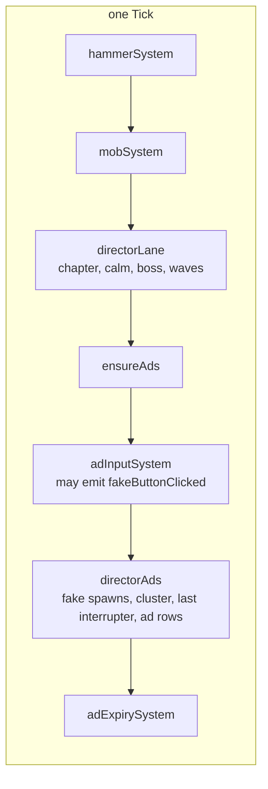

# Design Document: cross-front-and-director

## Overview

The Director replaces the two placeholder schedules with one data-driven chapter timeline and
adds the cross-front rule "fake button → fast zombie". It is two pure systems that share one
plain-data `DirectorState` in `GameState.director`:

- **`directorLane`** takes the lane Spawner slot (connection-lane Requirement 3.4). It updates the
  Current_Chapter, runs the Midpoint_Calm and Boss_Rise, and spawns Mobs from the current
  Chapter's waves.
- **`directorAds`** takes the ad scheduler slot (browser-front Requirement 3.3). It opens Ads from
  the current Chapter's rows, runs the Midpoint_Cluster and Last_Interrupter, and adds the
  Fake_Spawn for every `fakeButtonClicked` emitted earlier in the Tick.

```ts
export function createDirector(overrides?: ChapterTableOverrides): {
  readonly laneSpawner: System;   // pass to createLaneSystems({ spawner })
  readonly adScheduler: System;   // pass to createAdSystems({ scheduler })
};
```

The Session_Registry builds the director once and passes both slots. No other system changes.

### Two timing facts from `step()`

`step()` runs systems (stage 4) before the download stage (6) and the win/lose check (7). So:

1. `downloadHalfway` is emitted after the Director has run. The Director starts the
   Midpoint_Calm on the next Tick, when it sees `halfwayReached` (amended Requirement 4.1).
2. No system runs on or after the Tick the phase becomes `won` or `lost`. Resolution is a
   selector, `currentChapter(state)`, not an event (amended Requirement 1.3).

## Architecture



Fake_Spawns are added in `directorAds`, which runs after `adInputSystem`, so the fast Mob appears
on the same Tick as the click (Requirement 6.1). It reads the click through
`ctx.eventsSoFar()` from browser-front and adds the Mob with connection-lane's `addMob`.

## Components and Interfaces

### Chapter table (`src/game/balance/chapters.ts`)

```ts
export type ChapterId =
  | 'hook' | 'plotTurn1' | 'pinch1' | 'midpoint' | 'pinch2' | 'plotTurn2' | 'resolution';

export interface ChapterWave { readonly kind: MobKind; readonly everySeconds: number; readonly offsetSeconds: number }

export interface Chapter {
  readonly id: ChapterId;
  readonly number: number;          // 1..7
  readonly name: string;            // "Hook", "Plot turn 1", ...
  readonly startSecond: number;     // Run seconds from dial start; resolution has none (-1)
  readonly waves: readonly ChapterWave[];
  readonly ads: readonly AdRow[];   // AdRow from browser-front, times relative to chapter start
}

export interface ChapterTable {
  readonly chapters: readonly Chapter[];
  readonly bossSecond: number;              // 118
  readonly firstClutterAfterConnectSeconds: number; // 5
  readonly calmSeconds: number;             // 2
  readonly clusterCount: number;            // 4
  readonly lastInterrupterAt: number;       // 90 (percent)
}
```

A wave spawns on Ticks `chapterStart + offset + k × every` while its Chapter is current. Ad rows
work the same way, with the row's `startSecond`/`endSecond` relative to the Chapter start.

Default table (Requirements 1.1, 2.3, 3.3, 4.4):

| # | Chapter | Start | Mob waves (every, first at) | Ad rows | Patterns |
|---|---|---|---|---|---|
| 1 | Hook | 0 | default 6 s, at 8 s | – | – |
| 2 | Plot turn 1 | 20 | default 6 s | clutter 8 s (after the forced first at connect + 5 s) | plain |
| 3 | Pinch 1 | 45 | default 6 s, fast 7 s | clutter 7 s, fake 12 s, interrupter 18 s (first at +10 s) | plain, decoy, hidden, swapped |
| 4 | Midpoint | 70 | default 6 s, fast 8 s, tank 12 s | clutter 7 s, interrupter 18 s, fake 12 s | + countdown, confirm |
| 5 | Pinch 2 | 90 | default 5 s, fast 7 s, tank 12 s, ranged 15 s | clutter 6 s (lane cover), interrupter 15 s (runaway), fake 10 s | all; runaway on interrupters |
| 6 | Plot turn 2 | 115 | default 3 s, fast 4 s, tank 9 s, ranged 10 s | clutter 3 s (lane cover), fake 8 s | all but runaway |
| 7 | Resolution | – | – | – | – |

Plot turn 2 has no interrupter row; its one interrupter is the Last_Interrupter Beat. Boss_Rise
at 118 s is a separate field, not a wave (Requirement 2.4).

`resolveChapterTable(overrides)` validates (Requirement 1.5): seven chapters in id order, start
seconds strictly ascending for 1–6, known Mob kinds, Ad_Kinds and Close_Patterns, `runaway`
only on interrupter rows, finite numbers, intervals ≥ 1 Tick, `bossSecond` ≥ Plot turn 2 start.
It throws `ChapterTableError` with every problem. The table lives in the Run's balance as
`GameState.director.table` so headless overrides stay per Run (Requirement 1.4).

### Director state (`src/game/director/directorTypes.ts`)

```ts
export interface DirectorState {
  readonly table: ChapterTable;
  readonly chapter: ChapterId;            // hook .. plotTurn2
  readonly chapterStartTick: number;
  readonly calmUntilTick: number | null;  // Midpoint_Calm runs while tick < this
  readonly calmDone: boolean;
  readonly clusterDone: boolean;
  readonly bossDone: boolean;
  readonly lastInterrupter: 'waiting' | 'pending' | 'done';
}

export type DirectorEventBody =
  | { type: 'chapterStarted'; number: number; name: string; id: ChapterId }
  | { type: 'beat'; name: 'midpointCalm' | 'midpointCluster' | 'bossRise' | 'lastInterrupter' };

export function currentChapter(state: GameState): ChapterId; // resolution when won/lost
```

`SpawnSource` gains `'fakeButton'` (Requirement 6.2).

### `directorLane` (`src/game/director/directorLane.ts`)

Per Tick, in this order:

1. Ensure `DirectorState` (first Tick: chapter `hook`, start Tick 0).
2. Chapter advance: while the next Chapter's start Tick ≤ tick, switch to it and emit
   `chapterStarted` (Requirement 1.2).
3. Calm start: if `halfwayReached && !calmDone && calmUntilTick === null`, set
   `calmUntilTick = tick + 2 s` and emit `beat midpointCalm` (Requirement 4.1).
4. Boss_Rise at `bossSecond`: `addMob('boss', laneLength, 'schedule')` and `beat bossRise`, once
   (Requirement 2.4). It is scripted, so the calm does not hold it.
5. Waves of the current Chapter, in table order, unless the calm is active (Requirements 2.2,
   4.2). Runs in every non-final phase (Requirement 2.5).

### `directorAds` (`src/game/director/directorAds.ts`)

Skipped while `dialing` except for Fake_Spawns (none can happen then). Per Tick:

1. Fake_Spawn: one fast Mob at the Manhole, source `fakeButton`, per `fakeButtonClicked` in
   `eventsSoFar()`, calm or not (Requirements 6.1, 6.3).
2. Calm end: when `calmUntilTick !== null && tick >= calmUntilTick && !clusterDone`, open
   `clusterCount` clutter Ads with `openAd` (cap applies), emit `beat midpointCluster`, set
   `calmDone` and `clusterDone` (Requirements 4.3, 4.4).
3. Forced first clutter at `connectedTick + 5 s`, plain (Requirement 3.4).
4. Ad rows of the current Chapter, unless the calm is active (Requirements 3.2, 4.2).
5. Popup bursts from `eventsSoFar()` as in browser-front, using the current Chapter's clutter
   patterns, unless the calm is active.
6. Last_Interrupter: when chapter is `plotTurn2`, phase `downloading` and `download >= 90`, set
   `pending` once. While `pending` and the Ad count is below the cap, open one `runaway`
   interrupter, emit `beat lastInterrupter` and set `done` (Requirements 5.1–5.3).

Every Ad open goes through browser-front's `openAd`, so the Ad_Cap holds (Requirement 3.5).
Randomness only through `ctx.random()` (Requirement 7.1).

## Data Models

`DirectorState` is plain data. Invariants: `chapter` never moves backward; `calmDone ⇒
calmUntilTick !== null`; `clusterDone ⇔ calmDone`; `lastInterrupter` moves only forward;
`bossDone` is set at most once.

## Correctness Properties

### Property 1: Director runs are deterministic and plain data

*For any* seed, table override within valid ranges and command script, two Runs give identical
states and events on every Tick, and every `DirectorState` survives a JSON round trip.

**Validates: Requirements 7.1, 7.2, 7.3**

### Property 2: Chapters advance on the clock, in order

*For any* Run, `chapterStarted` events arrive in table order, each exactly on its start Tick,
`currentChapter` never moves backward, and it is `resolution` exactly when the phase is `won` or
`lost`.

**Validates: Requirements 1.2, 1.3**

### Property 3: Spawns and Ads come only from the current Chapter

*For any* Run, every `mobSpawned` with source `schedule` (other than the boss) is a kind and Tick
the current Chapter's waves allow, and every `adOpened` outside bursts, mistakes and Beats uses a
kind and pattern the current Chapter's rows allow.

**Validates: Requirements 2.2, 3.2, 3.3**

### Property 4: The calm is quiet, then the cluster lands

*For any* Run that reaches halfway, no scheduled Mob or scheduled or burst Ad opens during the
2 s calm, and the cluster opens `min(4, room)` clutter Ads on the Tick the calm ends, once.

**Validates: Requirements 4.1, 4.2, 4.3, 4.4**

### Property 5: Every fake click spawns one fast zombie

*For any* Run, the number of `mobSpawned` events with source `fakeButton` on each Tick equals the
number of `fakeButtonClicked` events on that Tick, each a fast Mob at the Manhole, calm or not.

**Validates: Requirements 6.1, 6.2, 6.3**

### Property 6: Boss and last interrupter happen at most once

*For any* Run, there is at most one boss spawn, on the boss Tick when the Run is still going, and
at most one `beat lastInterrupter`, only in Plot turn 2 at 90% or more, delayed only by the cap.

**Validates: Requirements 2.4, 5.1, 5.2, 5.3**

## Error Handling

- Invalid table → `ChapterTableError` listing every problem, thrown by `createDirector`.
- Beats that can't fit under the cap wait (`pending`) instead of throwing.
- A `fakeButtonClicked` during `dialing` cannot happen; if a test injects one, the spawn still
  happens, which keeps the rule simple.

## Testing Strategy

- `tests/game/balance/chapters.test.ts`: defaults match `docs/game-design.md` section 3; one
  example per validation rule.
- `tests/game/director/*.test.ts`: chapter events at 20, 45, 70, 90, 115 s; first default at Tick
  480; boss at 118 s; calm and cluster with a short-download override; last interrupter at 90%
  with a short-download override and when the cap is full; fake click spawns a fast Mob on the
  same Tick.
- `tests/game/director/directorProperties.test.ts`: Properties 1–6.
- `tests/game/director/timeline.test.ts` with `runHeadless` (Requirement 8):
  - no commands: first default at Tick 480, phase `lost` before 120 s;
  - download at 21 s and a script bot that kills each Mob within 0.5 s: `chapterStarted` for
    chapters 1–6 at their start seconds. The bot hammers each Mob's Hit_Box centre; it lives in
    `tests/helpers/bots.ts` and later moves to `zombie-sim-mcp`.
- `docs/game-design.md` section 3 is checked by hand against the table (Requirement 9.1).
