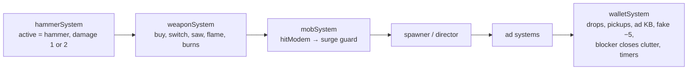

# Design Document: economy-weapons

## Overview

economy-weapons adds KB, Data_Packets, the shop, two more Weapons, two Items and the upgrades.
All rules are pure game-core systems over one plain-data `EconomyState` in `GameState.economy`.
The Lane_View and Lane_HUD send three new commands (`lanePointer`, `buy`, `switchWeapon`) and draw
the state.

Economy code has to run at three points in a Tick, because it reacts to events from other
systems and has to change damage before the modem takes it:

| Slot | System | Why there |
|---|---|---|
| after `hammerSystem`, before `mobSystem` | `weaponSystem` (shop, switch, saw, flame, burn) | Weapon kills must land before Melee_Hits (lane-melee Requirement 3.3). Buying a weapon this Tick lets it fire this Tick. |
| inside `mobSystem` and the glob impact | `hitModem()` | The surge protector must block a hit before integrity drops (Requirement 10). |
| after the ad systems | `walletSystem` (packets, pickups, ad rewards, fake loss, blocker, timers) | It reads `mobKilled`, `adClosed`, `fakeButtonClicked` and new `adOpened` from `ctx.eventsSoFar()`. |

Two small hooks in earlier code make this possible, with no change to their assertions:

1. `createLaneSystems({ weapons })` inserts an optional system between `hammerSystem` and
   `mobSystem`.
2. `mobSystem` and the Glob impact call `hitModem(draft, ctx, kind, amount)` from
   `src/game/economy/guard.ts` instead of `ctx.damageModem`. Without an `EconomyState` it is
   exactly `ctx.damageModem(amount)`.

The hammer reads two economy facts: it only swings while the hammer is the Active_Weapon, and it
deals 2 damage with the heavy head (Requirement 6).

## Architecture



## Components and Interfaces

### Types (`src/game/economy/economyTypes.ts`)

```ts
export type WeaponId = 'hammer' | 'saw' | 'flamethrower';
export type ItemId =
  | 'heavyHead' | 'saw' | 'highRpm' | 'flamethrower' | 'bigTank' | 'blocker' | 'surge';
export type ShopSlot = 1 | 2 | 3 | 4 | 5;

export interface Packet { readonly id: number; readonly x: number; readonly kb: number; readonly dropTick: number }
export interface Burn { readonly enemyId: number; readonly untilTick: number; readonly carry: number }

export interface EconomyState {
  readonly balance: EconomyBalance;
  readonly wallet: number;
  readonly gained: number; readonly spent: number; readonly lost: number;
  readonly packets: readonly Packet[]; readonly nextPacketId: number;
  readonly owned: readonly ItemId[];         // weapons and upgrades bought, in buy order
  readonly active: WeaponId;
  readonly pointer: { readonly x: number; readonly y: number; readonly down: boolean } | null;
  readonly sawTarget: number | null; readonly sawCarry: number;
  readonly fuel: number;                     // seconds
  readonly flameLatched: boolean;            // fuel ran out; wait for release
  readonly flameCarry: Readonly<Record<string, number>>; // enemy id → fractional damage
  readonly burns: readonly Burn[];
  readonly blockerUntilTick: number | null;
  readonly surgeHeld: boolean;
  readonly surgeUntilTick: number | null;
}

export type LanePointerCommand = { type: 'lanePointer'; x: number; y: number; down: boolean };
export type BuyCommand = { type: 'buy'; slot: ShopSlot };
export type SwitchCommand = { type: 'switchWeapon'; direction: 'next' | 'previous' };

export type KbReason = 'packet' | 'adClosed' | 'fakeButton' | 'purchase';
export type EconomyEventBody =
  | { type: 'kbChanged'; delta: number; reason: KbReason; wallet: number }
  | { type: 'packetDropped'; id: number; x: number; kb: number }
  | { type: 'packetCollected'; id: number; kb: number }
  | { type: 'packetExpired'; id: number }
  | { type: 'itemBought'; item: ItemId; price: number }
  | { type: 'buyRejected'; slot: ShopSlot; reason: 'tooExpensive' | 'owned' | 'held' }
  | { type: 'weaponSwitched'; weapon: WeaponId }
  | { type: 'blockerStarted' } | { type: 'blockerEnded' }
  | { type: 'adBlocked'; id: number }
  | { type: 'surgeStarted' } | { type: 'surgeEnded' }
  | { type: 'modemHitBlocked'; kind: EnemyKind; amount: number };
```

`InputCommand` and `GameEventBody` gain these unions (Requirement 13.3). The blocker and surge
are not in `owned`: the blocker starts on purchase and the surge sets `surgeHeld`.

### Balance (`src/game/balance/economy.ts`)

| Key | Default |
|---|---|
| prices | heavyHead 30, saw 60, highRpm 50, flamethrower 120, bigTank 60, blocker 40, surge 50 |
| `packetLifetimeSeconds` | 4 (fade in the last 1) |
| `pickupRadius` | 28 Lane_Units, measured from the packet at (x, 12) |
| `sawDps` / `highRpmFactor` | 5 / 1.5 |
| `flameDps`, `burnDps`, `burnSeconds` | 4, 1, 2 |
| `flameReach`, `flameHalfAngleDeg` | 220 Lane_Units, 18° |
| `fuelSeconds` / `bigTankFactor`, `fuelRefillPerSecond` | 6 / 1.5, 1.5 |
| `blockerSeconds`, `surgeSeconds` | 6, 5 |
| `fakeLossKb` | 5 |

`resolveEconomyBalance` validates like the lane (finite, ranges, prices whole numbers ≥ 0) and
throws `EconomyBalanceError` with every problem.

### Shop slots (`src/game/economy/shop.ts`)

```ts
export function nextItem(slot: ShopSlot, e: EconomyState): ItemId | null;
// 1: heavyHead       2: saw → highRpm       3: flamethrower → bigTank
// 4: blocker (rebuyable)   5: surge (rebuyable when not held)
export function slotStatus(slot, e): 'affordable' | 'tooExpensive' | 'owned' | 'held';
```

`buy`: if `nextItem` is null → `owned`; surge while `surgeHeld` → `held`; price > wallet →
`tooExpensive` (Requirement 4.3). Otherwise subtract, `spent += price`, add the item, emit
`kbChanged` (reason `purchase`) and `itemBought`. A Weapon becomes Active_Weapon
(Requirement 4.4); the blocker starts its window (Requirement 9.1); the surge sets `surgeHeld`.

### weaponSystem (`src/game/economy/weapons.ts`)

Per Tick, in `ctx.inputs` order: `buy`, `switchWeapon` (cycle over owned Weapons in the order
hammer, saw, flamethrower, wrapping, Requirement 5.3), and `lanePointer` (store the latest
pointer). Then:

- **Saw** (Requirement 7): while active and `pointer.down`, the target is the first Enemy under
  the pointer by Hit_Priority. Changing target resets the carry. `carry += dps / 60`; whole points
  `floor(carry)` go through `damageEnemy`, and the remainder carries over. 5 dps on a 4 HP tank is
  4 points after 48 Ticks (0.8 s); 7.5 dps is 4 points after 32 Ticks (≤ 0.54 s + 1 Tick).
- **Flame** (Requirement 8): while active, `down`, fuel > 0 and not latched. The cone starts at
  the pointer and opens toward the Manhole (+x), with reach 220 and a half-angle of 18°. An Enemy
  is hit when its Hit_Box overlaps the cone, tested against the box's nearest point. Each hit
  Enemy gets `4/60` added to its carry, whole points apply, and its Burn resets to 2 s. Fuel drops
  by 1/60 per Tick. At 0 fuel, latch until a pointer with `down: false` arrives. While not firing,
  fuel refills at 1.5 per second up to the maximum.
- **Burns**: each active Burn adds `1/60` carry and applies whole points; expired Burns are
  removed, and so are Burns on Enemies that died.

### hitModem (`src/game/economy/guard.ts`)

```ts
export function hitModem(draft, ctx, kind: EnemyKind, amount: number): void {
  const e = draft.economy;
  if (e && e.surgeUntilTick === null && e.surgeHeld) {
    e.surgeHeld = false; e.surgeUntilTick = ctx.tick + secondsToTicks(e.balance.surgeSeconds);
    ctx.emit({ type: 'surgeStarted' });
  }
  if (e && e.surgeUntilTick !== null && ctx.tick < e.surgeUntilTick) {
    ctx.emit({ type: 'modemHitBlocked', kind, amount }); return;
  }
  ctx.damageModem(amount);
}
```

`mobBit` is still emitted before `hitModem`, so the "bite then hit" order holds whenever damage
is dealt. A blocked hit emits `mobBit` and then `modemHitBlocked` (Requirement 10.2).

### walletSystem (`src/game/economy/wallet.ts`)

It reads `ctx.eventsSoFar()` once, in order:

- `mobKilled` with `dropKb > 0` → new packet and `packetDropped` (Requirement 2.1).
- `adClosed` → `+rewardKb`, reason `adClosed` (Requirement 3.1).
- `fakeButtonClicked` → lose `min(5, wallet)`, `lost +=`, reason `fakeButton` (Requirement 3.2).
- `adOpened` of a clutter Ad while the blocker runs → handled by the blocker step below.

Then it:

- picks up every packet within `pickupRadius` of the latest pointer, in id order
  (Requirement 2.2);
- expires packets past their lifetime (Requirement 2.3);
- while the blocker runs, removes every clutter Ad from `draft.ads` with `adBlocked` and no
  reward, using browser-front's `removeAd` helper, which leaves fake buttons and interrupters
  alone (Requirements 9.2, 9.3);
- ends the blocker and the surge when their windows end (Requirements 9.4, 10.3).

### Lane_View and Lane_HUD

- Pointer (Requirement 2.4): the view sends at most one `lanePointer` per Tick, and only when
  the position or the button changed since the last one sent. It batches in `update()`, so a
  pointer burst inside one frame sends one command. While the hammer is active, presses still
  send `hammer`. With another Weapon active, presses send only `lanePointer` (Requirement 5.4).
- Keys and wheel on `document` during a Session: `1`–`5` → `buy`, `Q` and wheel up →
  `previous`, `E` and wheel down → `next` (Requirements 4.5, 5.1, 5.2). The view ignores keys
  while focus is in a text field, and removes its listeners on unmount.
- Drawing: packets with the `drop` sprite, fading in the last second (Requirement 2.5). Saw and
  flame cursors use their `use` animation while firing, and the flame cone is drawn as a
  translucent wedge (Requirement 7.4).
- Lane_HUD (`src/ui/shopTray.ts`, Requirement 11): a `KB 000` counter in the lane-cctv OSD
  style, then five slots, each showing its hotkey, the next item's name, its price and a status
  class. A ring marks the active Weapon. The fuel gauge shows while the flamethrower is owned.
  The blocker and surge show their time left. Copy lives in `src/ui/economyCopy.ts`, set with
  `textContent`. Clicking a slot sends `buy` (Requirement 4.6).
- Tray placement (Requirement 11.5): the Shop_Tray is absolutely positioned at the top centre of
  `.lane-view` (a top offset, `left: 50%`, `transform: translateX(-50%)`), replacing its old
  bottom-left spot in `src/styles/lane.css`. It uses larger OSD text and a solid OSD backing with a
  stronger frame so it reads against the dark feed. The other OSD items keep their places: the
  `CAM 01  LINE TAP` label top left and `● REC` top right (both `top: 10px`), the timestamp bottom
  left, and the integrity Lane_HUD bottom right. If the top band is too short to stay clear of
  the Hit_Boxes, the tray collapses to one compact row.
- Sounds (`src/render/economySounds.ts`, Requirement 12): `coinBlip`, `buyChime`, `rejectBuzz`,
  `surgeHum`, `zap`, `blockerSweep` (once per frame each), and looping `sawWhine` and
  `flameRoar` that start and stop with firing.

### Skill

`.kiro/skills/add-weapon/SKILL.md` (Requirement 14) covers: the `WeaponId` / `ItemId` unions,
the price and stats in `balance/economy.ts`, the shop slot mapping, the firing rule in
`weapons.ts`, the cursor sprite entity, the HUD slot copy, the sounds and the tests.

## Data Models

Invariants on every Tick:

- `wallet = gained − spent − lost`, a whole number, and `wallet ≥ 0`
- `spent ≤ gained`
- packet ids are unique and sorted
- `0 ≤ fuel ≤ maxFuel`
- `active` is in the owned Weapons (the hammer always counts as owned)
- `surgeHeld` and `surgeUntilTick` are never both set while the shield runs
- each Burn's `enemyId` is an Enemy on the lane

## Correctness Properties

### Property 1: KB is conserved

*For any* Run with random kills, pickups, ad closes, fake clicks and buys, on every Tick the
wallet equals gained − spent − lost, is a whole number ≥ 0, spent ≤ gained, and the sum of
`kbChanged` deltas equals the wallet.

**Validates: Requirements 1.1, 1.2, 1.3, 1.4, 3.1, 3.2**

### Property 2: Packets are collected at most once

*For any* Run, every `packetDropped` is followed by exactly one of `packetCollected` or
`packetExpired`, expiry happens exactly 4 s after the drop, and a collected packet's KB is added
once.

**Validates: Requirements 2.1, 2.2, 2.3**

### Property 3: The shop matches its model

*For any* buy and switch sequence and wallet, the result of each `buy` (`itemBought` or the
`buyRejected` reason) matches `nextItem` and the price check. The Active_Weapon is always owned,
and switching cycles hammer → saw → flamethrower in owned order.

**Validates: Requirements 4.2, 4.3, 4.4, 5.3, 10.4**

### Property 4: Saw kills a tank on time

*For any* tank position and start Tick, holding the saw on it without a break kills it within
48 Ticks + 1, or within 32 Ticks + 1 with high RPM, and every HP point it removes is reported
by `mobHit`.

**Validates: Requirements 7.1, 7.2, 7.3**

### Property 5: Fuel stays in range and latches at empty

*For any* pointer sequence with the flamethrower, fuel stays in [0, max], it falls only while
firing and refills only while not firing, and after it hits 0 no flame damage is dealt until a
release.

**Validates: Requirements 8.3, 8.4, 8.5**

### Property 6: Surge blocks a 5 s window that starts at a hit

*For any* Run holding a surge protector, the first `mobBit` after purchase starts the shield,
every hit in the next 5 s is `modemHitBlocked` with integrity unchanged, and integrity outside
those windows drops exactly by the unblocked hits.

**Validates: Requirements 10.1, 10.2, 10.3**

### Property 7: The blocker clears clutter only

*For any* Run with the blocker bought, no clutter Ad is open at the end of any Tick inside the
window, no fake button or interrupter is removed by it, and no `adClosed` reward is given for
blocked Ads.

**Validates: Requirements 9.2, 9.3**

### Property 8: Economy runs are deterministic and plain data

*For any* seed and script, two Runs give identical states and events, and every `EconomyState`
survives a JSON round trip.

**Validates: Requirements 13.1, 13.2**

## Error Handling

- Invalid balance throws `EconomyBalanceError` listing every problem.
- Buys that are rejected emit `buyRejected` and never throw.
- A `lanePointer` with non-finite coordinates is ignored with no event.
- With no `EconomyState`, `hitModem` and the hammer behave exactly as before.

## Testing Strategy

- `tests/game/balance/economy.test.ts`: defaults and validation.
- `tests/game/economy/*.test.ts`: examples for each Item, upgrade, slot order and reject reason,
  heavy head damage 2 at the same cooldown, fake loss at a wallet of 3, pickup radius edge,
  packet expiry at Tick +240, flame cone hit and miss, burn refresh, latch and release, surge
  window edges, and blocker on an existing and a new clutter Ad.
- `tests/game/economy/economyProperties.test.ts`: Properties 1–8.
- `tests/game/economy/economyTarget.test.ts` (Requirement 13.4): `runHeadless` with lane, ads,
  director and economy, and a bot from `tests/helpers/bots.ts` that starts the download at 21 s,
  kills every Mob within 0.5 s and sweeps the pointer over each packet. Wallet + spent ≥ 60 by
  70 s.
- `tests/render/laneView.test.ts` and `tests/ui/shopTray.test.ts`: one `lanePointer` per Tick,
  only on change; hotkeys, Q/E and wheel; non-hammer presses send no `hammer`; HUD slot states,
  active ring, fuel gauge and timers; sound mapping. Existing assertions unchanged.
- `tests/skills.test.ts`: the `add-weapon` checks.
