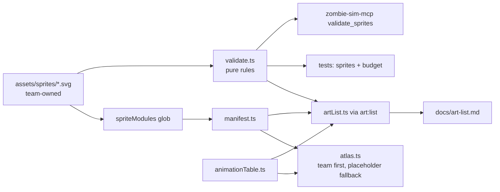

# Design Document: final-art

## Overview

final-art turns the team's SVG frames into the game's art with as little new code as possible.
The pipeline already exists from connection-lane: `spriteModules.ts` globs `assets/sprites/`,
`manifest.ts` groups and checks paths, `atlas.ts` rasterizes team frames first and placeholders
otherwise, and `entities.ts` holds `ENTITY_LOOKS` and `ANIMATION_FPS`.

This feature adds four things:

1. **One shared sprite validator** (`src/render/sprites/validate.ts`), pure and used by three
   callers: the tests, the art-list script and zombie-sim-mcp's `validate_sprites`.
2. **The Art_List** (`docs/art-list.md`), generated by `npm run art:list` from the renderer's
   own tables and the files present, with a test that fails when it is stale.
3. **Atlas fallback per animation**: a frame that fails to load drops that animation back to
   placeholders with one warning.
4. **The Animation_Table** (`src/render/sprites/animationTable.ts`): frame rate per entity and
   animation, replacing the single fps per animation name, so walk cycles can match each Mob's
   speed.

The agent never writes to `assets/sprites/`; the existing `guard-write` hook enforces it
(Requirement 2.4).

## Architecture



## Components and Interfaces

### Animation_Table (`src/render/sprites/animationTable.ts`)

```ts
export interface AnimationSpec {
  readonly fps: number;
  readonly loop: boolean;            // idle, walk, use loop; attack, hit, die hold the last frame
  readonly suggestedFrames: number;
}
export const ANIMATION_TABLE: Readonly<Record<SpriteEntity, Partial<Record<AnimationName, AnimationSpec>>>>;
export function animationSpec(entity: SpriteEntity, animation: AnimationName): AnimationSpec;
```

It lists every entity and animation the renderer uses (Requirement 1.1): the five Mobs and
the Glob (`walk`, `hit`, `die`; `attack` for every Melee_Kind and the ranged spit; `idle` for
Attackers and the stopped ranged Mob), `modem` (`idle`, `hit`), `manhole` (`idle`, `attack`),
`drop` (`idle`), and `hammer`, `saw`, `flamethrower` (`idle`, `use`). The starting values are
today's `ANIMATION_FPS`, so nothing moves until the art lands. `frameIndex` and
`animationTicks` take the spec instead of the animation name, and `ENTITY_LOOKS` keeps the
`viewBox` and anchor.

**Walk sync** (Requirement 4.1): for a walk cycle that covers `stride` Lane_Units per loop,
`fps = speed × frames / stride`. The table stores `stride` for Mob walks and derives `fps` from
the lane balance speed, so a speed change in `src/game/balance/` keeps the feet planted.

### Validator (`src/render/sprites/validate.ts`)

```ts
export interface SpriteFile { readonly path: string; readonly text: string; readonly bytes: number }
export interface SpriteProblem { readonly path: string; readonly rule: SpriteRule; readonly detail: string }
export type SpriteRule =
  | 'path' | 'frameGap' | 'viewBox' | 'script' | 'externalRef' | 'raster' | 'webFont'
  | 'size' | 'unknownEntity' | 'unknownAnimation' | 'budget';

export function validateSprites(files: readonly SpriteFile[]): {
  readonly problems: readonly SpriteProblem[];
  readonly present: Readonly<Record<string, readonly string[]>>; // "entity/animation" → frames
};
```

Rules, from the `sprites` steering file, all text checks on the SVG source (no DOM, so it runs
in Node):

| Rule | Check |
|---|---|
| path | matches `/assets/sprites/<entity>/<animation>/<NN>.svg` (same regex as `manifest.ts`) |
| unknownEntity / unknownAnimation | the entity and animation exist in `ANIMATION_TABLE` |
| frameGap | frames run `00, 01, …` with no gap |
| viewBox | every frame of an entity has the same `viewBox` attribute |
| script | no `<script`, no `on*=` attributes, no `javascript:` |
| externalRef | `href` / `xlink:href` only to `#id` |
| raster | no `<image`, no `data:image/` |
| webFont | no `@font-face`, no `@import`, no `font-family` outside the generic families |
| size | each file under 20 KB |
| budget | all files together within 1.5 MB (Requirement 3.3) |

### Art_List (`src/render/sprites/artList.ts` → `docs/art-list.md`)

The pure function `renderArtList(tables, validation)` builds the Markdown. It writes one table
row per entity and animation (Requirements 1.2, 1.3):

| Entity | Animation | viewBox | Anchor | fps | Frames (suggested / present) | Status |
|---|---|---|---|---|---|---|

The status is `placeholder` (no frames), `partial` (frames present but with problems or fewer
than suggested) or `done`.

The repo has no TypeScript runner outside Vitest, and no new dependency is wanted, so the
generator runs through Vitest. `tests/docs/artList.test.ts` reads `assets/sprites/`, renders the
list and compares it with `docs/art-list.md`. With `ART_LIST_WRITE=1` it writes the file instead
of failing. A new npm script `art:list` runs `ART_LIST_WRITE=1 vitest run tests/docs/artList.test.ts`
(Requirement 1.3). A normal `npm test` fails with "run npm run art:list" when the file is stale
(Requirement 1.4).

### Atlas fallback (`src/render/sprites/atlas.ts`)

The atlas already prefers team frames (Requirement 2.1) and uses placeholders where none exist
(Requirement 2.2). New: if any team frame of an animation fails to load or rasterize, the atlas
switches that whole animation to its placeholder frames, logs one
`console.warn('sprite failed: <path>')` per animation, and keeps running (Requirement 2.3).
Mixing team and placeholder frames inside one animation is never shown.

### Art_Integrator workflow (Requirements 2.4, 3.1, 4)

`.kiro/agents/art-integrator.md` is updated so the agent runs `validate_sprites` (or
`npm test -- sprites` when the MCP server is not running), writes
`docs/playtests/YYYY-MM-DD-art-check.md` with every problem, regenerates the Art_List, tunes
`ANIMATION_TABLE` strides and records each change in its report. Its write scope stays
`src/render/`, `docs/art-list.md` and `docs/playtests/`.

### Legal and docs (Requirement 5)

The README gains an "Art" section crediting BingFeng47 and Calvin and stating all sprites are
original. `docs/kiro-log.md` gets a dated note. Originality (5.1) is the team's responsibility;
the playtester report records a visual check for logos or trademark shapes.

## Data Models

`SpriteProblem` and the validator result are plain data. `ANIMATION_TABLE` is frozen. The
Art_List is generated text with no hand edits.

## Correctness Properties

### Property 1: The validator finds every broken rule

*For any* generated set of sprite files built from valid frames with zero or more injected
defects (bad path, gap, mismatched viewBox, script, external href, embedded image, web font,
oversize file), `validateSprites` reports exactly one problem per injected defect with the right
rule and path, and none for a clean set.

**Validates: Requirements 3.2, 3.3**

### Property 2: The Art_List matches the tables and files

*For any* table subset and set of present frames, `renderArtList` has one row per entity and
animation in the table, its present-frame count matches the files, and its status is
`placeholder`, `partial` or `done` by the rules above.

**Validates: Requirements 1.1, 1.2, 1.3**

### Property 3: Animations are all team or all placeholder

*For any* manifest and any set of frames that fail to load, the atlas draws each entity and
animation either entirely from team frames (none failed) or entirely from placeholders, and warns
once per failed animation.

**Validates: Requirements 2.1, 2.2, 2.3**

### Property 4: Walks don't slide

*For any* Mob speed in its valid range and walk spec, the Lane_Units covered per walk loop equal
the spec's stride within 1e-6.

**Validates: Requirements 4.1**

## Error Handling

- A broken frame drops that animation to placeholders with one warning; the game never stops.
- `npm run art:list` still writes the list when the validator finds problems, with `partial`
  statuses; `assets.test.ts` is the test that fails on them.
- An empty `assets/sprites/` is valid: every row is `placeholder`.

## Testing Strategy

- `tests/render/sprites/validate.test.ts`: Property 1 plus one example per rule.
- `tests/render/sprites/assets.test.ts`: runs the validator over the real `assets/sprites/` and
  fails on any problem or on the budget (Requirements 3.2, 3.3). Passes with an empty folder.
- `tests/docs/artList.test.ts`: Property 2 and the stale-file check (Requirement 1.4).
- `tests/render/sprites/atlas.test.ts`: Property 3 with a fake image loader.
- `tests/render/sprites/animationTable.test.ts`: Property 4; the defaults equal today's fps, so
  existing frame-selection tests keep their assertions.
- Playtester run with the final art: screenshots of each Mob under the CCTV grade to check
  silhouettes, and a full-run report (Requirements 4.2, 4.3).
