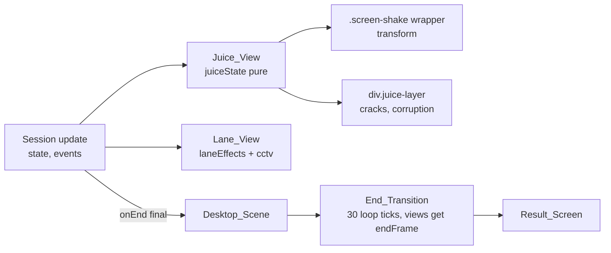

# Design Document: juice-and-endings

## Overview

juice-and-endings adds feel on top of both fronts. It changes no game rule. Every effect is a
pure function of the Run Tick and the events a view has seen, held in render-only state, so the
Session gives the same states and events with or without it (Requirement 9.2).

The work splits into four parts:

| Part | Where | Requirements |
|---|---|---|
| Juice_View: screen shake, cracks, corruption, alarm, stings, win fade | `src/render/juice/` | 1, 2, 3, 6.2, 6.3, 7.2 |
| Lane additions: hit flash, kill pop, "+N KB", boss rumble and roar, spawn groans, NO SIGNAL | `src/render/laneView.ts` and friends | 4, 5, 6.1, 7.1 |
| Audio_Engine: voice cap and limiter | `src/core/audio.ts` | 6.4, 6.5 |
| End_Transition: a 30-Tick hold before the Result_Screen | `src/scenes/desktop/desktopScene.ts` | 7.3 |

## Architecture



### Juice_View files

| File | Kind | Contents |
|---|---|---|
| `juiceTuning.ts` | data | shake limits, crack thresholds, corruption levels, transition length, voice cap, limiter settings. |
| `juiceState.ts` | pure | `JuiceState`, `EMPTY_JUICE`, `applyJuiceEvents`, `shakeOffset`, `crackStage`, `corruptionLevel`. |
| `crackArt.ts` | data | constant inline SVG markup for the three Crack_Stages (each a superset of the one before). |
| `juiceView.ts` | DOM | `createJuiceView(): SessionView` plus the `endFrame` hook. |
| `juiceSounds.ts` | audio | `glassCrack`, `modemAlarm` (loop), `chapterSting`, `bossRumble`, `bossRoar`, `kindGroans`. |

## Components and Interfaces

### Juice state (`juiceState.ts`)

```ts
export interface JuiceState {
  readonly shakeStartTick: number | null;
  readonly shakeMax: number;               // px for the current shake
  readonly crackStage: 0 | 1 | 2 | 3;
  readonly pendingCrackSound: boolean;     // play once this frame
  readonly corruption: 0 | 1 | 2;          // none, faint (pinch 2), strong (critical)
  readonly critical: boolean;
  readonly flashTicks: readonly number[];  // shared flash budget onsets (see Requirement 8.1)
  readonly fadeStartTick: number | null;   // win fade
}

export function applyJuiceEvents(
  s: JuiceState, events: readonly GameEvent[], state: GameState, shakeOn: boolean,
): JuiceState;

export function shakeOffset(s: JuiceState, tick: number): { dx: number; dy: number };
```

Rules:

- **Shake** (Requirements 1.1–1.3): on a frame with `modemHit`, take the largest `amount` in the
  frame. `max = amount < 10 ? 2 : 4`, plus 1 while integrity is critical. So the maximum is
  3 or 5 px at critical. The shake lasts 12 Ticks, and the offset is
  `round(max × sin-hash(tick))` clamped to `[-max, max]` on each axis. With Screen_Shake off,
  `shakeOffset` always returns 0. The offset is applied as a CSS `transform` on the
  `.screen-content` wrapper inside the Monitor. `toScreenPoint` already reads
  `getBoundingClientRect`, so clicks during a shake land on what is shown (Requirement 1.4).
- **Cracks** (Requirements 2.1, 2.4): `crackStage = max(previous, stageFor(integrity))` with
  thresholds 20, 10 and 5. When the stage rises, set `pendingCrackSound` once, even when it
  jumps several stages in one hit. The stage never goes down during a Session (Requirement 2.2).
- **Corruption** (Requirements 3.1, 3.2): `chapterStarted` for pinch 2 sets level 1. While
  integrity is critical, the level is 2, covering both fronts. When integrity leaves critical,
  it returns to the chapter level.
- **Flash budget** (Requirement 8.1): one shared budget module, `src/render/flashBudget.ts`, is
  moved out of lane-cctv's `cctvState`. The Juice_View, the Lane_View and the Browser_View each
  call `requestFlash(tick)` and get back `full` or `dim`. There is at most 3 `full` per 60 Ticks
  across the whole Screen. A crack stage change and the strong corruption onset count as flashes.

### Overlays (`juiceView.ts`)

```
div.juice-layer (in the Monitor screen, above the session overlay, below the Result_Screen;
                 pointer-events: none)
  div.crack-overlay[data-stage]   constant SVG from crackArt.ts
  div.corruption-overlay[data-level][data-front]
```

- The cracks are drawn as thin lines that leave the Real_Link rect and the middle half of the
  Lane_Dock clear (Requirement 2.3). The SVG paths are hand-placed in `crackArt.ts`, and a test
  checks their bounding boxes against those two rects.
- The corruption overlay is CSS only: glitch blocks from repeating gradients, a colour-bleed
  `mix-blend-mode`, and a garbled text strip from a constant string. It sits above everything
  but never captures clicks (Requirement 3.3). Each glitch block animates with a duty cycle
  where any spot is covered for at most 120 ms at a time, so no Ad_Control or link is hidden
  longer than 150 ms.
- With Screen_Shake off, the overlays get `.is-still`, which turns their animations off
  (Requirement 8.2).
- No canvas is used for the overlays (Requirement 8.3).

### Lane additions

- **Hit flash** (Requirement 4.1): `laneEffects` records `hitTicks[id]`. For 4 Ticks after a hit
  the draw list adds `flash: true`, and `drawSprite` draws the sprite once more with
  `globalCompositeOperation = 'lighter'` at alpha 0.6. Small, so it does not count toward the
  flash budget.
- **Kill_Pop** (Requirement 4.2): a corpse-like entry drawn as an expanding ring and debris for
  18 Ticks.
- **"+N KB"** (Requirement 4.3): on `packetCollected`, a canvas label rising 24 px over 30 Ticks
  in the OSD colour.
- All three are drawn under the camera grade, so they look like part of the feed
  (Requirement 4.4).
- **Boss_Rumble** (Requirements 5.1, 5.2): `bossSecond` comes from the director's chapter table
  (`currentDirector(state)?.table.bossSecond`). For 180 Ticks before it, the manhole cover drawing
  is jittered by up to 2 px and dust particles rise. A `bossRumble` loop plays and stops when the
  boss spawns. Without a director, there is no rumble.
- **Boss roar** (Requirement 5.3): one `bossRoar` per `mobSpawned` event of kind `boss`.
- **Spawn groans** (Requirement 6.1): `kindGroans[kind]` replaces the manhole clank for spawns,
  one recipe per frame.

### Audio_Engine (`src/core/audio.ts`)

- **Voice cap** (Requirement 6.4): the engine keeps a list of live sfx Voices. When `play` would
  exceed `VOICE_CAP` (24), it stops the oldest sfx Voice with a 20 ms fade first. Music voices and
  loops started with `{ keep: true }` (hum, alarm, rumble, saw and flame loops) are exempt.
- **Limiter** (Requirement 6.5): a `DynamicsCompressorNode` between the master gain and the
  destination: threshold −6 dB, knee 0, ratio 20, attack 3 ms, release 120 ms.
- The modem alarm (Requirement 6.2) is a two-tone square beep at 1 Hz on the Sfx_Channel. It
  starts when critical begins, stops when it ends, and stops on unmount.

### End_Transition (Requirements 7.1–7.3)

The Session already stops its loop and calls `onEnd(final)` on the Tick the Run ends, so no Run
Tick is added (Requirement 7.3). The Desktop_Scene changes `onRunEnd`:

1. It ends the Session but keeps the session views mounted.
2. It starts a short fixed loop for 30 frame ticks. On each tick it calls `view.endFrame?.(final,
   t)` on views that have the hook.
3. After 30 ticks it unmounts the views and shows the Result_Screen.

`SessionView` gains an optional `endFrame(final: GameState, t: number): void`.

- Lane_View `endFrame` on `lost`: it draws the feed cut. The picture is replaced by noise and a
  centred "NO SIGNAL" label (copy in `laneCopy.cctv.noSignal`). The OSD timestamp freezes.
- Juice_View `endFrame` on `won`: it fades the crack and corruption overlays from opacity 1 to 0
  over the 30 ticks.
- The page being hidden pauses this loop like every other fixed loop.
- replay-flow's Retry and Main menu are unaffected: they act after the Result_Screen appears.

## Data Models

`JuiceState` and the lane effect additions are plain data held in view closures, never in
`GameState`. Invariants: `crackStage` never decreases, `0 ≤ |offset| ≤ shakeMax`, and the flash
budget holds at most 3 `full` grants in any 60 Ticks.

## Correctness Properties

### Property 1: Shake stays within its limits

*For any* sequence of `modemHit` amounts, integrity values and ticks, `shakeOffset` is 0 when
Screen_Shake is off, 0 more than 12 Ticks after the latest hit, and otherwise at most 2 / 4 px on
each axis, or 3 / 5 px while critical.

**Validates: Requirements 1.1, 1.2, 1.3**

### Property 2: Cracks escalate and never heal

*For any* sequence of integrity values, `crackStage` equals the highest stage any value so far
reached, never decreases, and the crack sound is requested exactly once per stage rise, even when
one hit crosses several thresholds.

**Validates: Requirements 2.1, 2.2, 2.4**

### Property 3: Corruption level follows chapter and integrity

*For any* sequence of `chapterStarted` events and integrity values, the corruption level is 2
while critical, else 1 after pinch 2 started, else 0.

**Validates: Requirements 3.1, 3.2**

### Property 4: Flash budget holds across both fronts

*For any* interleaving of flash requests from the Juice_View, the Lane_View and the Browser_View,
at most 3 are granted `full` in any 60-Tick window.

**Validates: Requirements 8.1**

### Property 5: Voice cap drops the oldest

*For any* sequence of `play` calls, the engine never holds more than the Voice_Cap of uncapped sfx
voices, and each voice it stops is the oldest one then live.

**Validates: Requirements 6.4**

### Property 6: Effects never change the Run

*For any* seed and command script, a Session with the Juice_View and the lane additions gives the
same states and events as one without them, and the End_Transition leaves the Final_State
unchanged.

**Validates: Requirements 7.3, 9.2**

## Error Handling

- With no Web Audio, the engine returns no-op voices and the visuals still run.
- Without a director, there is no Boss_Rumble. Without ads, corruption still covers the browser
  window.
- If a view's `endFrame` throws, the transition logs the error and shows the Result_Screen at
  once.

## Testing Strategy

- `tests/render/juice/juiceState.test.ts`: Properties 1–3, plus examples (a hit of 8 at integrity
  50 gives max 2; a hit of 20 at integrity 15 gives max 5; one hit from 22 to 4 gives stage 3 with
  one sound).
- `tests/render/flashBudget.test.ts`: Property 4. The lane-cctv flash property keeps passing
  against the shared module.
- `tests/core/audio.test.ts`: Property 5, exempt loops, and the limiter node in the chain.
  Existing assertions unchanged.
- `tests/render/juice/juiceView.test.ts` (jsdom): layers have `pointer-events: none`; a click on
  an Ad_Control under the corruption reaches it; the shake transform is applied and cleared on
  unmount; `.is-still` with shake off; the alarm starts and stops with critical; one sting per
  chapter event; crack SVG boxes avoid the Real_Link and the Lane_Dock middle.
- `tests/render/laneView.test.ts`: hit flash for 4 Ticks, kill pop for 18 Ticks, "+N KB" for
  30 Ticks, rumble window, one roar per boss spawn, per-kind groans once per frame, NO SIGNAL in
  `endFrame`.
- `tests/scenes/desktop/desktopScene.test.ts`: the Result_Screen appears 30 loop ticks after
  `onEnd`, no `step` runs in between, and the Final_State passed is the same object. Existing
  tests gain 30 manual loop ticks before they look for the Result_Screen. Their assertions are
  unchanged.
- Property 6 in `tests/render/juice/juiceRun.test.ts`.
- Playtester full run with the Plot turn 2 frame rate in `docs/playtests/` (Requirement 8.4).
