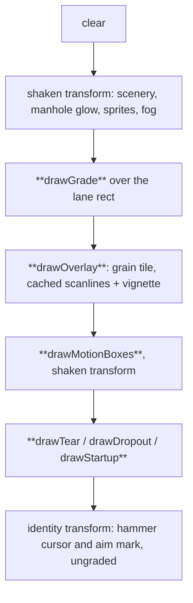

# Design Document: lane-cctv

## Overview

lane-cctv redraws the connection lane as a night-time security camera feed. Nothing in
`src/game/` changes. The Lane_View keeps drawing the scenery, sprites and hammer exactly as
today, and adds a camera layer around them:

1. **Camera_Grade** over the lane drawing: a green-grey tint and a slight darkening.
2. **Camera_Overlay**: scanlines, vignette and moving Grain.
3. **Camera effects**: Feed_Startup, Signal_Tear on modem hits, Signal_Dropout at critical
   integrity, Motion_Boxes on new Mobs.
4. **OSD** in DOM over the canvas: Camera_Label, REC_Indicator, Camera_Timestamp and the
   restyled Lane_HUD.
5. **Camera sounds**: Camera_Hum while the feed shows, Camera_Static with startup and tears.

All camera timing is a pure function of the Run Tick and the frame's events, kept in a
render-only `CctvState` beside the existing `LaneEffects`. It never feeds back into the Run, so
the Session gives the same states and events with or without the camera (Requirement 7.4).
No camera effect transforms the lane geometry, so clicks map to Lane_Units exactly as before
(Requirement 7.1).

## Architecture

New folder `src/render/cctv/`, matching the existing one-concern-per-file style:

| File | Kind | Contents |
|---|---|---|
| `cctvTuning.ts` | data | `CCTV_TUNING`: every camera number and colour token name (Requirement 10.3). |
| `cctvState.ts` | pure | `CctvState`, `EMPTY_CCTV`, `applyCctvEvents`, `tearActive`, `dropoutActive`, `grainFrame`, `recOn`. |
| `cctvTimestamp.ts` | pure | `cameraTimestamp(tick)`. |
| `noiseTiles.ts` | DOM | `createNoiseTiles(count, size, rng)` → offscreen canvases. |
| `cctvDraw.ts` | canvas | `drawGrade`, `drawOverlay`, `drawTear`, `drawDropout`, `drawStartup`, `drawMotionBoxes`. |
| `cctvOsd.ts` | DOM | `createCctvOsd()` with `update(state, cctv)` and `el`. |
| `cctvSounds.ts` | audio | `cameraHum`, `cameraStatic` recipes. |

Draw order in `laneView.draw` (new steps in bold):



The cursor is drawn last and outside the grade (Requirement 1.4). The OSD and the Lane_HUD are
DOM siblings of the canvas inside `div.lane-view`, with `pointer-events: none`
(Requirement 7.3).

## Components and Interfaces

### Tuning (`cctvTuning.ts`)

```ts
export const CCTV_TUNING = Object.freeze({
  startupTicks: 36,
  grainTiles: 4, grainTileSize: 128, grainEveryTicks: 4, grainAlpha: 0.09,
  scanlineStep: 3, scanlineAlpha: 0.18, vignetteAlpha: 0.55,
  gradeColor: '--c-cctv-grade', gradeAlpha: 0.85, darken: 0.12,
  tearTicks: 10, tearBands: 5, tearMaxCover: 0.3, tearAlpha: 0.45,
  dropoutEveryTicks: 120, dropoutTicks: 8, dropoutAlpha: 0.6,
  motionBoxTicks: 60,
  recHalfPeriodTicks: 30,
  flashBudget: 3, flashWindowTicks: 60,
  humLevel: 0.04, staticLevel: 0.18,
});
```

Colours are CSS custom properties in `src/styles/theme.css` (`--c-cctv-grade`,
`--c-cctv-osd`, `--c-cctv-osd-outline`, `--c-cctv-rec`, `--c-cctv-motion`), read once on mount
like the lane palette.

### Camera state (`cctvState.ts`)

```ts
export interface MotionBox { readonly id: number; readonly untilTick: number }

export interface CctvState {
  readonly startTick: number | null;      // first update's tick; startup runs from here
  readonly tearUntilTick: number;         // tear shows while tick < this
  readonly criticalSinceTick: number | null;
  readonly flashTicks: readonly number[]; // onsets of flash-class effects, last 60 ticks
  readonly motionBoxes: readonly MotionBox[];
}

export function applyCctvEvents(
  s: CctvState, events: readonly GameEvent[], tick: number, critical: boolean,
): CctvState;
export function startupActive(s: CctvState, tick: number): boolean;
export function tearActive(s: CctvState, tick: number): boolean;
export function dropoutActive(s: CctvState, tick: number): boolean;
export function grainFrame(tick: number): { tile: number; dx: number; dy: number };
export function recOn(tick: number): boolean;
```

Rules (all pure, no randomness except `hash32(n)`, a fixed integer hash):

- **Startup** (Requirement 3.1): `startTick` is set on the first call; startup shows while
  `tick - startTick < 36`. It counts as one flash onset.
- **Tear** (Requirements 4.1, 4.3): each frame with a `modemHit` sets
  `tearUntilTick = tick + 10`. A tear that starts while none is showing is a flash onset; if the
  flash budget is used up (3 onsets in the last 60 ticks) the tear still restarts, but is drawn
  at half alpha so it stays below the Flash threshold (Requirement 8.1). A restart during a
  showing tear is not a new onset.
- **Dropout** (Requirement 5): `criticalSinceTick` is set when `critical` turns true and cleared
  when it turns false. With `c = tick - criticalSinceTick`, cycle `k = floor(c / 120)`: a dropout
  shows while `c mod 120 < 8` and `hash32(k) mod 3 !== 0` (about two cycles in three, so it
  feels irregular), and never during startup. Each dropout is a flash onset and is skipped when
  the budget is used up. Length 8 ticks ≤ 9 (Requirement 5.2); at most one per 120 ticks
  (Requirement 5.1); derived from the tick only (Requirement 5.4).
- **Motion boxes** (Requirement 6): each `mobSpawned` adds `{ id, untilTick: tick + 60 }`;
  entries past `untilTick` are dropped. A box whose Mob is no longer in the Lane_State is not
  drawn and is dropped on the next update (Requirement 6.2).
- **Grain** (Requirement 1.2): tile `floor(tick / 4) mod 4`, offset from `hash32(floor(tick/4))`,
  so the grain changes 15 times per second.
- **REC** (Requirement 2.2): on while `tick mod 60 < 30`.

### Timestamp (`cctvTimestamp.ts`)

```ts
/** "11-23-98 11:59:07 PM" for tick 420; "11-24-98 12:00:00 AM" for tick 3600. */
export function cameraTimestamp(tick: number): string;
```

Seconds = 23 × 3600 + 59 × 60 + `floor(tick / 60)`; the day rolls over at 86,400 seconds to
`11-24-98`; 12-hour clock with `AM`/`PM`, hours `12` for 0 and 12, two-digit minutes and
seconds. Requirement 2.3.

### Drawing (`cctvDraw.ts`)

- `drawGrade(g, rect, palette)`: `globalCompositeOperation = 'color'` fill with the grade colour
  at `gradeAlpha` (desaturates and tints), then `'multiply'` fill at `darken`. Luminance is kept,
  so sprite silhouettes and placeholder frame numbers stay readable (Requirement 1.5). These
  blend modes work in every current browser; no `ctx.filter` (missing in older Safari).
- `drawOverlay(g, rect, tiles, cached, tick)`: grain tile pattern at `grainAlpha`, then the
  cached scanline + vignette canvas built once on mount. No `getImageData`/`putImageData` per
  frame (Requirement 1.3).
- `drawTear(g, rect, tiles, tick, alpha)`: `tearBands` horizontal strips of noise tile at
  `tearAlpha`, covering at most 30% of the height, positions from `hash32(tick)`. Drawn with the
  identity transform: the lane drawing underneath is not moved (Requirement 4.2).
- `drawDropout(g, rect, tiles)`: full-rect noise at `dropoutAlpha`; the OSD shows
  "SIGNAL WEAK".
- `drawStartup(g, rect, tiles, progress)`: full noise fading out over 36 ticks; the OSD shows
  "CONNECTING CAMERA...".
- `drawMotionBoxes(g, boxes, lane, layout, tick)`: a 1 px rectangle around each box's Hit_Box
  (from `laneToCanvas`, the Enemy's stats and the lane-melee attacker offset), label "MOTION"
  above it, blinking every 8 ticks. Drawn after the grade, in the motion colour (Requirement
  6.3).

Every effect only paints over pixels; none changes the transform used for the scenery and
sprites, so each Enemy stays within the shake plus the attacker offset of its Lane_Layout
position (Requirement 7.2).

Brightness bound: grain at 0.09 alpha and the REC dot (about 0.1% of the feed) change average
brightness by under 10% (Requirement 8.3). Tears at full alpha cover ≤ 30% × 0.45 ≈ 14%, so they
count as flashes and go through the flash budget.

### OSD (`cctvOsd.ts`) and Lane_HUD

```
div.lane-view
  canvas.lane-canvas
  div.cctv-osd (pointer-events: none)
    span.cctv-label        "CAM 01  LINE TAP"
    span.cctv-rec(.is-on)  "● REC"
    span.cctv-time         cameraTimestamp(tick)
    span.cctv-status       "" | "CONNECTING CAMERA..." | "SIGNAL WEAK"
  div.lane-hud (existing, restyled)
```

- Text only through `textContent`, written only when it changes (like the HUD today).
- Copy in `src/ui/laneCopy.ts` under `cctv` (Requirement 2.6): `label`, `rec`, `connecting`,
  `signalWeak`, `motion`, and the HUD label becomes `MODEM` (Requirement 2.4).
- Lane_HUD restyle in `src/styles/lane.css`: VT323 (already bundled), light text with a dark
  outline, the bar drawn as segments with a repeating gradient. `.is-critical` keeps its note
  and turns the meter red and blinking at 2 Hz (Requirement 2.5).
- When Screen_Shake is on, the OSD gets `.is-tearing` during a tear, a 1 px CSS jitter; when it
  is off the class is never set (Requirement 8.2).

### Sounds (`cctvSounds.ts`)

- `cameraHum`: 60 Hz and 120 Hz sines plus faint band-passed noise at `humLevel`, below the lane
  hit sounds (Requirement 9.1). Started on mount with a 600 s duration (longer than any Run),
  stopped on unmount.
- `cameraStatic`: 250 ms of band-passed white noise at `staticLevel`. Played at startup and once
  per frame with a `modemHit` (Requirements 3.3, 4.1).
- Both use Web Audio nodes only and go through the Sfx_Channel (Requirement 9.3).

### Lane_View changes (`src/render/laneView.ts`)

- `Mounted` gains `cctv: CctvState`, `tiles`, `overlayCache`, `osd`, `humVoice`.
- `mount`: create tiles with a fixed-seed mulberry32 (render-only, so it is not `Math.random`
  and screenshots are repeatable), build the overlay cache, append the OSD, start the hum.
- `update`: `cctv = applyCctvEvents(...)`, `osd.update`, play `cameraStatic` when needed,
  then draw. Pointer handlers are unchanged, so presses during startup and dropouts still send
  Hammer_Commands (Requirements 3.2, 5.3).
- No 2D context: the OSD and HUD still update; camera drawing is skipped (Requirement 10.1).
- `unmount`: stop the hum and static voices, drop the tiles and cache, remove the OSD
  (Requirements 9.2, 10.2).

## Data Models

`CctvState` is plain data held in the Lane_View closure only. It is never part of `GameState`.

## Correctness Properties

### Property 1: Timestamp counts from 11:59:00 PM

*For any* tick from 0 to 300 × 60, `cameraTimestamp(tick)` matches
`MM-DD-YY HH:MM:SS AM|PM`, equals the clock 23:59:00 on 11-23-98 plus `floor(tick / 60)` seconds,
and changes date to 11-24-98 exactly at tick 3,600.

**Validates: Requirements 2.3**

### Property 2: At most 3 flashes per second

*For any* sequence of frames with random `modemHit` events and random critical flags, the
flash onsets recorded by `applyCctvEvents` (startup, full-alpha tear starts, dropout starts)
number at most 3 in every window of 60 ticks.

**Validates: Requirements 8.1, 8.3**

### Property 3: Dropouts are short, spaced and only at critical

*For any* frame sequence, every dropout lasts at most 9 consecutive ticks, two dropout starts
are at least 120 ticks apart, and `dropoutActive` is false whenever the critical flag is false
or startup is active.

**Validates: Requirements 5.1, 5.2, 5.4**

### Property 4: Tears follow modem hits

*For any* frame sequence, `tearActive` is true exactly on the ticks within 10 ticks after the
latest frame that had a `modemHit`.

**Validates: Requirements 4.1, 4.3**

### Property 5: Motion boxes live 60 ticks and follow their Mob

*For any* frame sequence with `mobSpawned` events, each spawned id has a box for exactly the
ticks `[spawnTick, spawnTick + 60)` while it is on the lane, and no box exists for an id that is
not on the lane.

**Validates: Requirements 6.1, 6.2**

### Property 6: Grain moves at least 15 times per second

*For any* tick, `grainFrame` differs between tick `4n` and tick `4n + 4`, and is the same for
the 4 ticks of one step.

**Validates: Requirements 1.2**

### Property 7: Camera state is deterministic and independent of the Run

*For any* frame sequence, applying it twice from `EMPTY_CCTV` gives equal states, and a Session
run with the CCTV layer gives the same states and events as the same seed and commands with a
Lane_View stub that draws nothing.

**Validates: Requirements 5.4, 7.4**

## Error Handling

- Missing 2D context or a failed offscreen canvas: skip camera drawing, keep the OSD and HUD.
- Missing CSS colour tokens: fall back to the tuning defaults, like `readLanePalette`.
- Audio locked or unavailable: the engine returns a no-op voice; nothing else changes.

## Testing Strategy

- Pure units (`tests/render/cctv/*.test.ts`): Properties 1–6 with fast-check; examples for
  tick 420 → `11-23-98 11:59:07 PM`, the 36-tick startup, a restarted tear, REC on/off.
- `tests/render/laneView.test.ts` (jsdom with a stub 2D context that records calls):
  - the OSD exists, has `pointer-events: none` in CSS class terms, and shows the label, REC and
    timestamp; text is set by `textContent`;
  - a pointer press during startup and during a dropout still sends one Hammer_Command with the
    same Lane_Unit point as without the camera (Requirements 3.2, 5.3, 7.1);
  - the draw call order ends with the hammer sprite, after the grade (Requirement 1.4);
  - no `getImageData` calls during `update` (Requirement 1.3);
  - a null context keeps the OSD and HUD updating (Requirement 10.1);
  - unmount stops the hum and static voices and removes the OSD (Requirements 9.2, 10.2);
  - Screen_Shake off never sets `.is-tearing` (Requirement 8.2).
- Session-level Property 7 in `tests/dialup/session.test.ts` or a new
  `tests/render/cctv/cctvRun.test.ts`.
- `tests/render/laneSounds.test.ts`-style checks for `cctvSounds.ts`: Web Audio nodes only.
- Existing Lane_HUD tests keep their assertions except the label text (`MODEM INTEGRITY` →
  `MODEM`), which this spec changes on purpose (Requirement 2.4).
- Playtester run with screenshots of startup, a tear, a dropout and a motion box.
