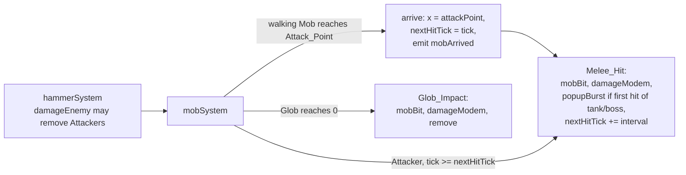

# Design Document: lane-melee

## Overview

lane-melee changes one rule in the connection lane. A Mob that reaches the modem no longer bites
once and leaves. It stops at its Attack_Point, lands a Melee_Hit at once and then one Melee_Hit
every Hit_Interval until the player kills it. Globs keep the old one-shot rule (Glob_Impact).

The change is small and local:

- `src/game/balance/lane.ts` gains a `melee` table (Hit_Interval per Melee_Kind) and new damage
  defaults. The existing `EnemyStats.damage` field is the Hit_Damage.
- `src/game/laneTypes.ts` gives melee Mobs two plain fields and adds the `mobArrived` event.
- `src/game/mobs.ts` replaces step 4 of `mobSystem` (the bite) with arrival and timed hits, and
  `addMob` never places a melee Mob left of its Attack_Point.
- `src/render/laneDrawList.ts` picks `attack` / `idle` for Attackers and spreads them out by a
  few pixels. `src/render/laneSounds.ts` adds a groan for `mobArrived`.

No new system is added. The system order stays `[ensureLane, hammerSystem, mobSystem, spawner]`,
which already resolves weapon damage before Melee_Hits in a Tick (Requirement 3.3): a Mob killed
by the hammer is spliced out of the Enemy list inside `hammerSystem`, so `mobSystem` never sees
it.

## Architecture



Order inside `mobSystem` for each Enemy, in ascending id order (unchanged loop):

1. Move, unless it is a stopped ranged Mob or an Attacker.
2. Ranged arrival and spit (unchanged).
3. Melee arrival: a walking melee Mob with `x <= attackPoint + POSITION_EPSILON` becomes an
   Attacker on this Tick.
4. Melee_Hit: an Attacker with `tick >= nextHitTick` lands one Melee_Hit.
5. Glob_Impact: a Glob with `x <= POSITION_EPSILON` deals its damage and is removed.

Steps 3 and 4 run in the same pass, so the arrival Tick also lands the first hit
(Requirement 1.2). Because the loop is in ascending id order and each Enemy lands at most one
hit per Tick, same-Tick hits and impacts resolve in id order (Requirement 2.3).

## Components and Interfaces

### Balance (`src/game/balance/lane.ts`)

```ts
export type MeleeKind = 'default' | 'fast' | 'tank' | 'boss';
export const MELEE_KINDS: readonly MeleeKind[]; // in laneTypes.ts, frozen

export interface MeleeStats {
  /** Seconds between two Melee_Hits; rounds to >= 1 tick. */
  readonly hitEverySeconds: number;
}

export interface LaneBalance {
  // ...existing fields...
  readonly melee: Readonly<Record<MeleeKind, MeleeStats>>;
}

export interface LaneBalanceOverrides {
  // ...existing fields...
  readonly melee?: { readonly [K in MeleeKind]?: Partial<MeleeStats> };
}

/** Attack_Point of a melee kind: half its Hit_Box width. */
export function attackPoint(balance: LaneBalance, kind: MeleeKind): number;
```

Defaults (Requirement 5.2, `docs/game-design.md` section 5):

| Kind | `damage` (Hit_Damage) | `hitEverySeconds` | Ticks | Attack_Point |
|---|---|---|---|---|
| default | 4 (was 10) | 1.5 | 90 | 22 |
| fast | 3 (was 8) | 1 | 60 | 17 |
| tank | 10 (was 20) | 2 | 120 | 36 |
| boss | 20 (was 40) | 2 | 120 | 56 |
| ranged | 0 (unchanged) | – | – | – |
| glob | 5 (unchanged) | – | – | – |

`resolveLaneBalance` merges `melee` field by field like `enemies`, and adds these problems to the
list it already collects (Requirement 5.3):

- `melee.<kind>.hitEverySeconds must be a finite number` when not finite;
- `melee.<kind>.hitEverySeconds must round to at least 1 tick` when `secondsToTicks(v) < 1`;
- the existing `enemies.<kind>.damage` rule (finite, `>= 0`) is kept and now covers Hit_Damage.

An unknown key under `melee` is dropped, as unknown keys are today.

### Types (`src/game/laneTypes.ts`)

```ts
interface MeleeFields {
  /** null while walking; the Tick of the next Melee_Hit while an Attacker. */
  readonly nextHitTick: number | null;
  /** Tick of the latest Melee_Hit, or null before the first. */
  readonly lastMeleeTick: number | null;
}

export type Enemy =
  | (EnemyBase & MeleeFields & { readonly kind: 'default' | 'fast' | 'tank' })
  | (EnemyBase & { readonly kind: 'ranged'; nextSpitTick; lastSpitTick })   // unchanged
  | (EnemyBase & MeleeFields & { readonly kind: 'boss'; readonly summonsDone: number })
  | (EnemyBase & { readonly kind: 'glob'; readonly sourceId: number });     // unchanged

export function isMeleeKind(kind: EnemyKind): kind is MeleeKind;
/** True for a melee Mob standing at its Attack_Point. */
export function isAttacker(enemy: Enemy): boolean; // nextHitTick !== null

// New event in LaneEventBody (Requirement 1.2):
| { readonly type: 'mobArrived'; readonly id: number; readonly kind: MeleeKind }
```

Both fields are `number | null`, so the Lane_State still survives a JSON round trip
(Requirement 6.1). "First hit" needs no extra field: it is the hit where `lastMeleeTick` is
`null` before the hit.

### Mob rules (`src/game/mobs.ts`)

`addMob` (connection-lane Requirement 3.5) changes in one way: for a melee kind the start x is
`clamp(x, attackPoint, laneLength)` instead of `min(x, laneLength)`, and `nextHitTick` and
`lastMeleeTick` start as `null`. This keeps "Enemies only move left" true: a melee Mob can never
start left of where it will stand. Boss summons already place Mobs at the boss's x or further
right, which is always at or right of a default Mob's Attack_Point (56 > 22).

`mobSystem`, replacing step 4:

```ts
if (isMeleeKind(enemy.kind)) {
  const point = attackPoint(balance, enemy.kind);
  if (enemy.nextHitTick === null && enemy.x <= point + POSITION_EPSILON) {
    enemy.x = point;
    enemy.nextHitTick = tick;
    ctx.emit({ type: 'mobArrived', id: enemy.id, kind: enemy.kind });
  }
  if (enemy.nextHitTick !== null && tick >= enemy.nextHitTick) {
    const first = enemy.lastMeleeTick === null;
    ctx.emit({ type: 'mobBit', id: enemy.id, kind: enemy.kind, damage: stats.damage });
    ctx.damageModem(stats.damage);
    if (first && (enemy.kind === 'tank' || enemy.kind === 'boss')) {
      ctx.emit({ type: 'popupBurst', count: balance.popupBurstCount,
                 cause: enemy.kind === 'tank' ? 'tankBite' : 'bossBite' });
    }
    enemy.lastMeleeTick = tick;
    enemy.nextHitTick += secondsToTicks(balance.melee[enemy.kind].hitEverySeconds);
  }
  survivors.push(enemy);
  continue;
}
// Glob_Impact: the old bite, now only reached by Globs (ranged Mobs never get here, their
// x stays at stopX > 0).
```

Movement skips Attackers: `const stopped = (ranged && nextSpitTick !== null) || isAttacker(enemy)`.

Hit timing: the k-th hit (k from 0) lands at `arrivalTick + k × intervalTicks`. Over the Ticks
from arrival to `arrivalTick + n` that is `floor(n / intervalTicks) + 1` hits (Requirement 2.4).

`damageModem` already floors integrity at 0 and emits `modemHit` and `integrityCritical`, so the
event order per hit stays `mobBit`, `modemHit`, (`integrityCritical`), (`popupBurst`).
`step()` already stops running systems once the phase is `won` or `lost` (game-core 3.9), which
covers Requirement 6.3.

### Drawing (`src/render/laneDrawList.ts`)

`enemyAnimation(enemy, tick)` gains an Attacker branch before the walking default
(Requirement 7.1):

1. `hit` for 6 Ticks after `lastHitTick` (unchanged rule, checked first);
2. `attack` while `lastMeleeTick !== null` and `tick - lastMeleeTick < ATTACK_TICKS` (12), age
   counted from `lastMeleeTick`;
3. `idle` otherwise, age from `nextHitTick - interval` (the latest hit or the arrival).

Attacker spread (Requirement 7.2): an Attacker's feet are drawn at
`laneToCanvas({ x: enemy.x + attackerOffset(enemy.id, hitPadding), y: 0 })` with

```ts
/** -p, 0 or +p by id, so up to three overlapping Attackers read as separate bodies. */
export function attackerOffset(id: number, hitPadding: number): number {
  return ((id % 3) - 1) * hitPadding;
}
```

The offset is at most the Hit_Padding (6), so the drawn body stays inside its padded Hit_Box and
clicks still land on it. The Hit_Box and Hit_Priority are not changed.

### Sounds (`src/render/laneSounds.ts`)

A new recipe `zombieGroan` (a low detuned sawtooth pair through a band-pass, 400 ms, falling
pitch), mapped from `mobArrived` in `soundFor`. `mobBit` keeps `modemCrunch`. The existing
once-per-frame rule (connection-lane Requirement 14.2) covers both (Requirements 7.3, 7.4).
The modem-hit lane shake already keys on `modemHit`, so it fires for every Melee_Hit and still
honours Screen_Shake (Requirement 7.5).

### Skill and docs

- `.kiro/skills/add-mob/SKILL.md`: in the "balance row" step, add "set `damage` (Hit_Damage per
  hit) and, for a melee kind, add a `melee.<kind>.hitEverySeconds` row and the kind to
  `MELEE_KINDS`" (Requirement 8.3). `tests/skills.test.ts` keeps checking every backticked path.
- `docs/kiro-log.md`: one dated note (Requirement 8.5).
- The connection-lane notes (Requirement 8.4) were added with the requirements.

## Data Models

| Field | Type | Walking | Attacker |
|---|---|---|---|
| `x` | number | `attackPoint < x <= laneLength` | `attackPoint` |
| `nextHitTick` | number \| null | `null` | Tick of the next hit, `> tick` after this Tick's hit |
| `lastMeleeTick` | number \| null | `null` | `null` only on the arrival Tick before the hit |

Invariants: `nextHitTick === null` ⇔ walking; an Attacker's x never changes; Globs and ranged Mobs
have neither field.

## Correctness Properties

Properties are checked with fast-check over random lane runs (`arbLaneRun` in
`tests/game/laneProperties.test.ts`, extended to spawn melee Mobs close to the modem so Attackers
appear in short runs). Each test is named `Feature: lane-melee, Property N`.

### Property 1: Attackers stand still at their Attack_Point

*For any* lane run and Tick, every melee Mob with `nextHitTick !== null` has `x` equal to its
Attack_Point, and every walking melee Mob has `x` greater than its Attack_Point.

**Validates: Requirements 1.1, 1.3, 1.4**

### Property 2: Hits follow the Hit_Interval

*For any* lane run, the `mobBit` events of each melee Mob fall exactly on its arrival Tick plus
whole multiples of its interval in Ticks, with no gaps while it is alive, so an Attacker alive
for n Ticks after arrival has `floor(n / intervalTicks) + 1` hits.

**Validates: Requirements 1.2, 2.1, 2.4, 2.5**

### Property 3: Killed Attackers stop hitting

*For any* lane run, no `mobBit` names an Enemy id on or after the Tick of its `mobKilled`, and
every melee Mob leaves the lane only through `mobKilled`.

**Validates: Requirements 3.1, 3.2, 3.3**

### Property 4: Every Enemy enters once and leaves once (replaces connection-lane Property 4)

*For any* lane run, ids are handed out 1, 2, 3...; each Enemy starts at full HP; each id leaves
the lane exactly once, Mobs only by `mobKilled` and Globs by `mobKilled` or one `mobBit`.

It also keeps connection-lane Requirements 3.5 and 8.2.

**Validates: Requirements 1.5, 3.2**

### Property 5: Modem damage equals the sum of hits

*For any* lane run, every `mobBit` is immediately followed by its `modemHit` and integrity is the maximum minus every hit so far, floored at 0. This is connection-lane Property 5, unchanged.

**Validates: Requirements 2.2**

### Property 6: One burst per tank or boss arrival

*For any* lane run, the number of `popupBurst` events with cause `tankBite` or `bossBite` equals
the number of `mobArrived` events of tanks and bosses whose first hit landed, and each such
burst comes right after the `modemHit` of that Mob's first hit.

**Validates: Requirements 4.1, 4.2, 4.3**

### Property 7: Same-Tick hits resolve in id order

*For any* lane run and Tick, the ids of that Tick's `mobBit` events are strictly ascending.

**Validates: Requirements 2.3**

### Property 8: Draw list keeps Attackers on their Hit_Box (amends connection-lane Property 13)

*For any* lane state, each Enemy item's feet are at `laneToCanvas({ x + offset, y: 0 })` where
offset is `attackerOffset(id, hitPadding)` for Attackers and 0 otherwise, `|offset| <=
hitPadding`, and the other Property 13 checks hold.

It also keeps connection-lane Requirements 11.2 and 11.3.

**Validates: Requirements 7.2**

Unchanged connection-lane properties that keep passing: 1 (determinism), 2 (JSON round trip),
3 (only move left), 5, 6, 7, 9–12, 14–18 (Requirements 6.1, 6.2, 8.2).

## Error Handling

- Invalid `melee` overrides throw `LaneBalanceError` with every problem (Requirement 5.3).
- `attackPoint` is only called with a melee kind; the type system enforces it.
- Nothing new can throw at runtime: hit damage is validated at balance time and `damageModem`
  already checks its amount.

## Testing Strategy

Example tests (Vitest, `tests/game/mobs.test.ts`):

- A default Mob from x = 800 arrives at x = 22 on Tick 1,167 (`ceil(778 / (40/60))`), emits
  `mobArrived`, then `mobBit` 4 / `modemHit` 96 on the same Tick, and hits again on Tick 1,257.
- A tank's first hit emits `popupBurst` `tankBite`; its second hit emits none. Same for the boss
  with `bossBite`.
- A hammer kill on the Tick of a scheduled hit cancels it (hammer runs first).
- A Glob at x = 1 still impacts for 5 and leaves the lane.
- `addMob` clamps a melee Mob to its Attack_Point; a ranged Mob or Glob is not clamped.
- Same-Tick hits from ids 1 and 3 plus a Glob impact (id 2) resolve as 1, 2, 3.
- `runHeadless` with no commands reaches `lost` from Melee_Hits alone (Requirement 6.4).

Balance tests (`tests/game/balance/lane.test.ts`): new defaults; `melee` merge; each new
validation problem; two problems listed together.

Render tests: `enemyAnimation` picks `hit`, `attack`, `idle` for an Attacker; `attackerOffset`
returns -6, 0, 6; `laneSoundsFor` maps `mobArrived` to `zombieGroan` once per frame.

### Replaced connection-lane tests (Requirement 8.1)

| File | Test | Why | Replacement |
|---|---|---|---|
| `tests/game/mobs.test.ts` | "walks a default Mob 40 / 60 units per tick and bites for 10 after 1,200 ticks" | Asserts the Mob leaves and deals 10. | Arrival at Tick 1,167, hit for 4, stays. |
| `tests/game/mobs.test.ts` | "requests a pop-up burst after the modem hit when a tank bites" | Uses x = 0.4 and asserts removal. | First-hit burst for a tank at its Attack_Point. |
| `tests/game/mobs.test.ts` | "requests a pop-up burst after the modem hit when the boss bites" | Same. | First-hit burst for the boss. |
| `tests/game/mobs.test.ts` | "requests no pop-up burst when a default Mob bites" | Same. | No burst on a default Mob's first hit. |
| `tests/game/mobs.test.ts` | "resolves same-tick bites in ascending id order" | Mobs at x < 1 leave. | Attackers 1 and 3 plus Glob 2 at the same Tick. |
| `tests/game/laneProperties.test.ts` | Property 4 "every Enemy enters once and leaves once" | Allows a Mob to leave by `mobBit`. | lane-melee Property 4. |
| `tests/render/laneDrawList.test.ts` | Property 13 feet position | No Attacker offset. | lane-melee Property 8. |
| `tests/game/balance/lane.test.ts` | "uses the section 5 mob table for HP, modem damage and KB drops" | Old damage values. | Same test with the new Hit_Damage values. |
| `tests/game/mobs.test.ts` | addMob "… caps x and emits mobSpawned" | Expected tank object lacks `nextHitTick: null, lastMeleeTick: null` (fixture shape only). | Same test with the two fields. |
| `tests/game/mobs.test.ts` | "places 2 summons of a boss at x 700 …" | Expected objects lack the two melee fields (fixture shape only). | Same test with the two fields. |
| `tests/game/mobs.test.ts` | "places 2 summons of a boss at x 790 …" | Same. | Same test with the two fields. |
| `tests/game/mobs.test.ts` | "places 4 summons of a boss at x 750 …" | Same. | Same test with the two fields. |
| `tests/helpers/lane.test.ts` | laneWith "fills Enemy defaults, sorts by id and sets nextId above the highest id" | Expected boss object lacks `nextHitTick: null, lastMeleeTick: null` (fixture shape only). | Same test with the two fields. |
| `tests/game/mobs.test.ts` | Property 10 (boss summons) | Bosses at x < 22 summon Mobs that `addMob` now clamps to the Attack_Point. | Expected summon x is `min(800, max(22, bossX + k × spacing))`. |
| `tests/game/lane.test.ts` | "runHeadless … ends lost, and the lane then stays frozen" | Loss tick changes (old 4,200, now about 2,727). Owned by task 2.6. | Same test with the new loss tick. |
| `tests/game/laneProperties.test.ts` | Property 3 "Enemies only move left, at their speed" | Attackers now stand still. Owned by task 2.5. | Speed check restricted to walking Mobs. |
| `tests/render/laneDrawList.test.ts` | "shows the modem `hit` after a bite, then `idle` again" | The Mob now stays as an Attacker. Owned by task 4.3. | Same check with the Mob kept on the lane. |

Any other test that fails is a bug in this change, not a test to edit. Test helpers in
`tests/helpers/lane.ts` gain `nextHitTick: null, lastMeleeTick: null` defaults for melee Mobs, a
fixture change only.
