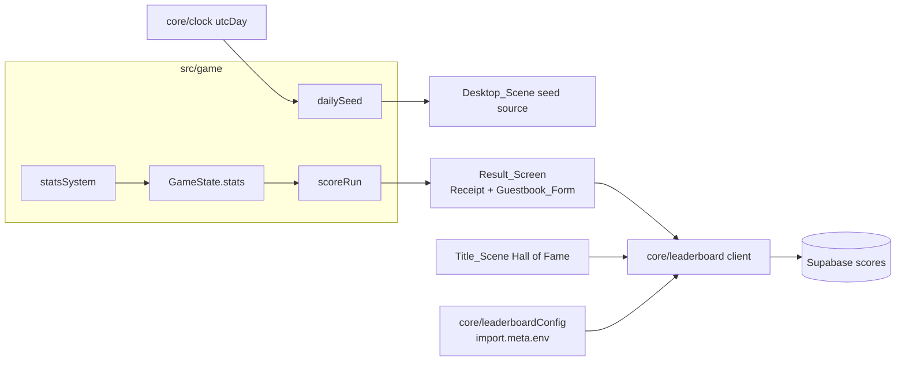

# Design Document: leaderboard

## Overview

Pure parts in `src/game/` (daily seed, stats, score), one network module in `src/core/`, and UI
in the Result_Screen and the Title_Scene.



## Components and Interfaces

### `src/game/dailySeed.ts`

```ts
const DAY = /^\d{4}-\d{2}-\d{2}$/;
export function dailySeed(day: string): number {
  if (!DAY.test(day)) throw new Error(`dailySeed: expected YYYY-MM-DD, got ${day}`);
  let h = 0x811c9dc5;
  for (const ch of `DEADLINE56K:${day}`) { h ^= ch.charCodeAt(0); h = Math.imul(h, 0x01000193) >>> 0; }
  return h >>> 0;
}
```

`src/core/clock.ts`: `utcDay(d: Date): string` → `d.toISOString().slice(0, 10)`.
`desktopScene.ts`: `const seedSource = deps.seedSource ?? (() => dailySeed(utcDay(new Date())))`.
The crypto seed helper stays for tests that want it.

### Stats (`src/game/stats.ts`)

```ts
export interface RunStats { readonly kills: number; readonly bossKilled: boolean; readonly adsClosed: number }
export const statsSystem: System = (draft, ctx) => { /* fold ctx.eventsSoFar() */ };
```

Appended last in `createGameSystems`, so it sees every event of the Tick. `GameState.stats?`.

### Score (`src/game/balance/score.ts`, `src/game/score.ts`)

```ts
export const SCORE_VERSION = 1;
export const SCORE_TABLE = { perPercent: 10, perKill: 10, boss: 200, perAd: 20, perCombo: 25,
  comboMin: 3, winBase: 1000, perIntegrity: 10, perSecondUnder: 5, parSeconds: 240 } as const;

export interface ScoreLine { readonly id: 'download' | 'kills' | 'boss' | 'ads' | 'combo' | 'win' | 'integrity' | 'speed'; readonly points: number }
export interface ScoreBreakdown { readonly lines: readonly ScoreLine[]; readonly total: number; readonly version: number }
export function scoreRun(final: GameState): ScoreBreakdown;
```

- download `floor(final.download) × 10`; kills `stats.kills × 10`; boss `200` if
  `stats.bossKilled`; ads `stats.adsClosed × 20`; combo `25 × bestCombo` if `≥ 3`.
- win only: `1000`, `ceil(integrity) × 10`, `5 × max(0, 240 − floor(tick / TICK_RATE))`.
- Missing `stats` or `economy` count as zeros.

### Leaderboard config and client (`src/core/leaderboardConfig.ts`, `src/core/leaderboard.ts`)

```ts
export interface LeaderboardConfig { readonly url: string; readonly key: string }
export function readLeaderboardConfig(env = import.meta.env): LeaderboardConfig | null;

export interface ScoreEntry { readonly name: string; readonly score: number; readonly outcome: 'won' | 'lost';
  readonly seconds: number; readonly download: number; readonly kills: number }
export interface ScoreRow extends ScoreEntry { readonly createdAt: string }
export type Result<T> = { readonly ok: true; readonly value: T } | { readonly ok: false; readonly reason: 'offline' | 'busy' | 'rejected' };

export interface LeaderboardClient {
  submit(entry: ScoreEntry): Promise<Result<void>>;
  topToday(day: string): Promise<Result<readonly ScoreRow[]>>;
  topAllTime(): Promise<Result<readonly ScoreRow[]>>;
  rankToday(day: string, score: number): Promise<Result<number>>;
  guestCount(): Promise<Result<number>>;
}
export function createLeaderboardClient(config: LeaderboardConfig | null, fetchFn?: typeof fetch, timeoutMs?: number): LeaderboardClient;
```

Requests (`H` = `{ apikey: key }`):

| Call | Method and path |
|---|---|
| submit | `POST /rest/v1/scores`, `Content-Type: application/json`, `Prefer: return=minimal`, body with the seven columns (`version` = `SCORE_VERSION`) |
| topToday | `GET /rest/v1/scores?select=name,score,outcome,seconds,download,kills,created_at&day=eq.<day>&order=score.desc,created_at.asc&limit=10` |
| topAllTime | same without `day` |
| rankToday | `HEAD /rest/v1/scores?select=id&day=eq.<day>&score=gt.<score>`, `Prefer: count=exact`; rank = count from `Content-Range` + 1 |
| guestCount | `HEAD /rest/v1/scores?select=id`, `Prefer: count=exact` |

Values go through `URLSearchParams`. `config === null` → `offline`; network error, timeout or
5xx → `busy`; 4xx → `rejected`. Rows are validated before use (types and ranges); bad rows are
dropped.

### Guestbook name (`src/ui/guestbook/guestbookName.ts`)

`normalizeName(raw)`: trim, collapse inner runs of spaces, then `/^[A-Za-z0-9 _-]{3,12}$/` or
`null`. `loadName(storage)` / `saveName(storage, name)` under `phantom98.guestbook` as
`{"v":1,"name":"..."}`, with try/catch fallback like `createSettingsStore`.

### Result_Screen (`src/ui/resultScreen.ts`, `src/ui/resultCopy.ts`, new `src/ui/guestbook/guestbookForm.ts`)

- `revealTail` adds the Receipt (`scoreRun(final)`) and the Guestbook_Form after the stats.
- `ResultScreenDeps` gains `leaderboard: LeaderboardClient` and `storage`; the Desktop_Scene
  passes the shared client built once in `scenes/index.ts`.
- The form is a `<form>` with an `<input maxlength="12" autocomplete="nickname">` and a submit
  button; `submit` handler calls `preventDefault`. Keydown in the input calls `stopPropagation` so
  the lane hotkeys and the power-confirm shortcuts never see it.
- States: `idle → signing → done | failed(retryLeft)`. After `done`: rank line and today's top 10,
  the new row marked `is-you` (matched by name and score, first match).
- Focus stays on Retry at the reveal (replay-flow Req 1.2).

### Hall of Fame (`src/scenes/title/hallOfFame.ts`, `titleModel.ts`, `titleCopy.ts`, `styles/title.css`)

- `TitleAction` gains `openHallOfFame` / `closeHallOfFame`; state `hallOfFame` behaves like
  `options` (Play ignored, menu inert).
- The window: title "NetSurfer - Guestbook", a counter "Guests signed: 000417" in a 7-segment
  style, two tables, a "Sign it yourself: finish a run!" note, and a static "under construction"
  stripe drawn in CSS. No blinking faster than 3 Hz.

### SQL (`docs/leaderboard.sql`)

Already written for the team to paste. The spec task checks it against this design.

## Correctness Properties

1. **Daily seed**: deterministic, a uint32, and different for consecutive Days in a sampled year.
   _Req 1.1, 1.2_
2. **Stats match events**: for random bot runs, `stats` equals a fold over all emitted events.
   _Req 2.1, 2.2_
3. **Score bounds**: whole number ≥ 0; monotonic in download, kills, ads and combo; a win beats the
   same state as a loss. _Req 3.1–3.4_
4. **Name normalization**: `normalizeName` is idempotent and every non-null result matches the
   database check. _Req 5.2_
5. **Client never throws**: for any fetch outcome (throw, timeout, any status, any JSON), every
   method resolves to a `Result`. _Req 6.1_

## Testing Strategy

- Unit and property tests for 1–5; `tests/core/leaderboard.test.ts` uses a fake `fetch` and
  asserts URLs, headers (`apikey` only, no `Authorization`) and encoded values.
- Result_Screen tests: receipt lines, form states, one submit per screen, Retry focus, offline
  text, hotkeys not leaking.
- Title tests: button order, Hall of Fame open/close, Play ignored while open.
- `tests/docs/secrets.test.ts`: no match for `sb_secret_[A-Za-z0-9_-]{16,}` in tracked files or,
  when it exists, in `dist/`.
