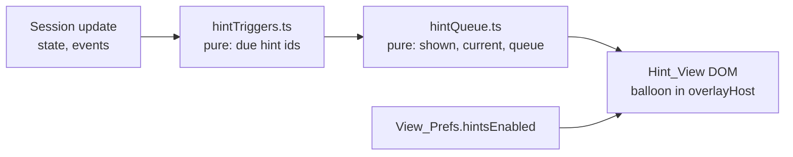

# Design Document: player-guide

## Overview

player-guide adds two read-only helpers:

- **Mission_Note**: a static DOM sticky note on the desktop wallpaper, built by the
  Desktop_Scene.
- **Hint_View**: a Session_View that watches each frame's state and events, decides which Hints
  are due with a pure function, and shows them as Hint_Balloons in the session overlay. It sends
  no commands, so the Run is the same with or without it.

Settings gain `hintsEnabled` (default true), shown as "Show hints" in Options and passed to views
through View_Prefs.

## Architecture



| File | Kind | Contents |
|---|---|---|
| `src/ui/guideCopy.ts` | data | Mission_Note text, Hint titles and bodies, the README lines. |
| `src/ui/hints/hintTable.ts` | data | `HINT_TABLE`: id, trigger, anchor, in display priority order. |
| `src/ui/hints/hintTriggers.ts` | pure | `dueHints(prev, state, events): HintId[]`. |
| `src/ui/hints/hintQueue.ts` | pure | `HintQueue`, `pushDue`, `tickQueue`, `dismiss`. |
| `src/ui/hints/hintPlacement.ts` | pure | `placeBalloon(anchor, size, avoid): { rect, tail }`. |
| `src/ui/hints/hintView.ts` | DOM | `createHintView(): SessionView`. |
| `src/desktop/missionNote.ts` | DOM | `createMissionNote()`. |

## Components and Interfaces

### Hint table (Requirement 2.1)

| Id | Trigger | Anchor |
|---|---|---|
| `lane` | first frame of the Session (phase `dialing`) | lane centre |
| `realLink` | `connected` event | Real_Link |
| `clutter` | first `adOpened` with kind `clutter` | that Ad |
| `interrupter` | first `adOpened` with kind `interrupter` | that Ad |
| `packet` | first `packetDropped` | the dropped Data_Packet (Lane_X from the event's `x`) |
| `shop` | first frame where `wallet >= min(price of each slot's next item)` | Shop_Tray centre, top-centre of the lane (holds the KB counter) |
| `critical` | first `integrityCritical` | integrity meter, bottom-right of the lane |

Triggers read optional state (`state.ads`, `state.economy`) defensively, so the guide works
before those specs are built. A missing piece just means that Hint never fires.

### Queue (Requirements 2.2–2.5)

```ts
interface HintQueue {
  readonly shown: readonly HintId[];      // ever shown this Run
  readonly current: { id: HintId; sinceTick: number; anchor: Anchor } | null;
  readonly queued: readonly { id: HintId; anchor: Anchor }[]; // max 2, oldest dropped
}
```

- `pushDue` skips ids already in `shown`, the current id and the queued ids. It becomes current
  if none is showing. Otherwise it is queued, and when the queue is over 2 the oldest is
  dropped.
- `tickQueue(q, tick)` closes the current hint after 360 Ticks and promotes the next one.
- `dismiss(q, tick)` does the same on a ✕ click.
- With `hintsEnabled` false the view never creates a queue.

### Placement (Requirements 3.1, 3.2)

`placeBalloon` tries above, below, left and right of the anchor, keeps the first rect inside the
Desktop_Area (0, 0, 1024, 480) that avoids the Real_Link rect (from `adBalance.realLink`, or the
default if ads are absent), and falls back to the top-right corner. The tail points from the
nearest balloon edge to the anchor centre. Lane anchors map to the Desktop_Area's bottom edge, so
the tail points down into the lane and the balloon never covers it. Balloon size is 260 × 84.

Anchor x values come from shared layout constants in `src/render/laneLayout.ts`, never literals
in `hintPlacement.ts`: the lane and Shop_Tray centre at `LANE_CANVAS_W / 2` (512), and the
integrity meter at `INTEGRITY_METER_CENTRE_X`, derived from the `.lane-hud` right offset, gap, bar
width and value width mirrored from `src/styles/lane.css`. A packet anchor's Lane_X maps to Screen
x through `laneToCanvas` with the Run's Lane_Length (lane canvas px equal Screen px). A test reads
`lane.css` and fails if the constants drift from the CSS.

### Hint_View DOM (Requirements 2.6, 3.3–3.6)

```
div.hint-layer (in overlayHost, z above .ad-layer, below the Result_Screen; pointer-events none)
  div.hint-balloon (pointer-events auto, absolutely placed)
    span.hint-title, p.hint-body, button.hint-close "✕", svg.hint-tail (constant markup)
```

The view rebuilds the balloon only when `current` changes. Text is set with `textContent`. A
synthesized `balloonPop` plays when a balloon opens. Unmount removes the layer and stops voices.

### Mission_Note (Requirement 1)

The Desktop_Scene appends `div.mission-note` to the wallpaper at top-right (x 780, y 24, 220 wide),
beneath the window layer, with `pointer-events: none`. It is styled as a yellow paper note with a
pin, and its text comes from `GUIDE_COPY.missionNote`. The README lines in `src/desktop/copy.ts`
gain the objective and the three controls (Requirement 1.4).

### Settings (Requirement 4)

- `Settings.hintsEnabled: boolean`, default true.
- The parser treats a missing or wrong-typed field as true and keeps the version at 1
  (Requirement 4.4).
- The Options_Dialog gets a "Show hints" checkbox after Screen shake (Requirements 4.2, 4.3).
- `ViewPrefs.hintsEnabled` is filled in `buildSceneFactories` (Requirement 4.6).

## Data Models

`HintQueue` is plain data held in the view closure, never in `GameState`. Invariants:
`queued.length <= 2`, ids are unique across `shown`, `current` and `queued`, and every shown id
appears once.

## Correctness Properties

### Property 1: Each Hint shows at most once per Run

*For any* sequence of frames with random trigger events, every Hint id becomes current at most
once, and never when it is already in `shown`.

**Validates: Requirements 2.2, 2.3**

### Property 2: Queue limit and timeout

*For any* frame sequence, the queue never holds more than 2 Hints, a dropped Hint is the oldest
queued one, and a current Hint closes exactly 360 Ticks after it opened unless dismissed sooner.

**Validates: Requirements 2.4, 2.5**

### Property 3: Balloons stay in the Desktop_Area and off the link

*For any* anchor in the Screen, `placeBalloon` returns a rect inside the Desktop_Area that does
not intersect the Real_Link or the Lane_Dock.

**Validates: Requirements 3.1**

### Property 4: Settings round trip with hints

*For any* valid Settings including `hintsEnabled`, serializing then parsing returns equal
Settings, and stored version-1 data without the field parses with `hintsEnabled` true.

**Validates: Requirements 4.1, 4.4, 4.5**

### Property 5: The guide never changes the Run

*For any* seed and command script, a Session with the Hint_View gives the same states and events
as one without it, and the Hint_View sends no commands.

**Validates: Requirements 3.4**

## Error Handling

- Missing `overlayHost` → the view mounts nothing and logs one warning.
- Missing optional state (ads or economy) → those triggers never fire.
- Bad stored settings → existing fail-safe defaults.

## Testing Strategy

- Pure tests for triggers, queue and placement (`tests/ui/hints/*.test.ts`), with Properties 1–3.
- `tests/core/settings.test.ts`: Property 4 and the default. Existing settings assertions
  unchanged.
- `tests/scenes/title/optionsDialog.test.ts`: the new checkbox toggles and saves.
- `tests/ui/hints/hintView.test.ts` (jsdom): a balloon appears on `connected`, ✕ closes it, hints
  off shows none, text uses `textContent`, unmount cleans up; Property 5 with a real Session.
- `tests/scenes/desktop/desktopScene.test.ts`: the Mission_Note is present, has its text and sits
  below windows.
