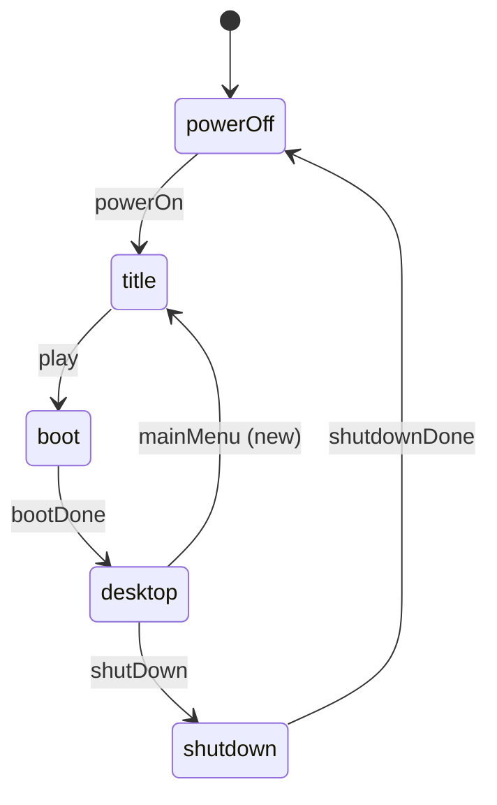
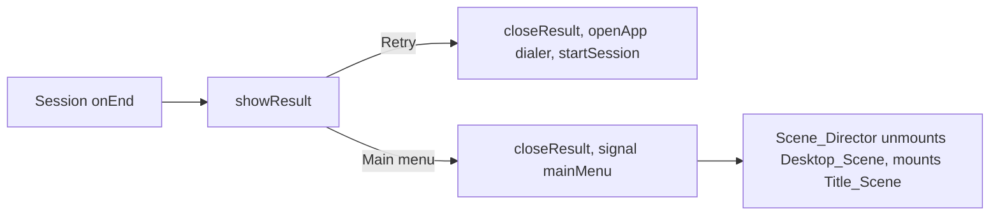

# Design Document: replay-flow

## Overview

replay-flow replaces the Result_Screen's single "Back to Desktop" button with two buttons:

- **Retry** closes the Result_Screen and starts a new Session at once, as if the player had
  opened the Dialer and clicked Connect. The 20 s dial-up and the raid play in full.
- **Main menu** closes the Result_Screen and sends a new `mainMenu` signal. The Scene_Director
  switches from the Desktop_Scene to the Title_Scene.

The change touches four places:

| File | Change |
|---|---|
| `src/core/scene.ts` | New `mainMenu` signal and one new transition `desktop → title`. |
| `src/ui/resultScreen.ts`, `src/ui/resultCopy.ts` | Two buttons instead of one; the factory takes an actions object instead of `onClose`. |
| `src/scenes/desktop/desktopScene.ts` | `retry()` and `mainMenu()` handlers wired to the Result_Screen. |
| tests | The Back_Button tests move to the new buttons (list below). |

No game-core code changes. The Session already draws a fresh seed for every start
(retro-shell Requirement 10.1) and already unmounts every Session_View when it ends
(retro-shell Requirement 10.7).

## Architecture



Inside the Desktop_Scene:



The desktop can still only be entered from the boot (Requirement 3.5), so every path to the
desktop still goes through the BIOS and splash. Retry stays inside the mounted Desktop_Scene, so
it never re-enters the desktop.

## Components and Interfaces

### Scene director (`src/core/scene.ts`)

```ts
export type SceneSignal =
  | 'powerOn' | 'play' | 'bootDone' | 'shutDown' | 'shutdownDone' | 'mainMenu';

const TRANSITIONS = {
  powerOff: { powerOn: 'title' },
  title: { play: 'boot' },
  boot: { bootDone: 'desktop' },
  desktop: { shutDown: 'shutdown', mainMenu: 'title' }, // replay-flow Req 3.2, 3.3
  shutdown: { shutdownDone: 'powerOff' },
};
```

`nextScene` keeps ignoring unmatched signals, so `mainMenu` anywhere else is a no-op
(Requirement 3.6). The director's queue already handles a signal sent from inside a click
handler that leads to an unmount, as `shutDown` does today.

### Result_Screen (`src/ui/resultScreen.ts`)

```ts
export interface ResultActions {
  readonly onRetry: () => void;
  readonly onMainMenu: () => void;
}
export type ResultScreenFactory = (final: GameState, actions: ResultActions) => Mountable;
```

- `revealTail` appends `div.result-buttons` holding `button.result-retry` then
  `button.result-main-menu` (Requirement 1.1). Both are real `<button type="button">`
  elements, so click, Enter and Space all work with no extra key handling (Requirement 1.3).
- On reveal, focus moves to `.result-retry` (Requirement 1.2).
- A local `chosen` flag: the first activation sets it and calls its action; later activations
  of either button do nothing (Requirement 1.4). `unmount` keeps its current cleanup.
- `.result-back` and `RESULT_COPY.back` are removed.

Copy (`src/ui/resultCopy.ts`, Requirement 1.5):

```ts
retry: 'Retry',
mainMenu: 'Main menu',
```

The CSS for `.result-buttons` gains a gap between the two buttons; `.result-retry` uses the
existing default-button style, `.result-main-menu` the plain style.

### Desktop_Scene (`src/scenes/desktop/desktopScene.ts`)

```ts
const resultScreen: ResultScreenFactory =
  deps.resultScreen ??
  ((final, actions) => createResultScreen({ final, audio, startLoop: deps.startLoop, ...actions }));

function showResult(final: GameState): void {
  // ...as today...
  const screen = resultScreen(final, { onRetry: retry, onMainMenu: mainMenu });
}

/** Req 2.1–2.5: close the ending and dial again at once. */
function retry(): void {
  if (!result) return;
  closeResult();              // unmounts the overlay, stops its sounds, wakes the desktop
  openApp('dialer');          // the "Connect To" window, focused
  startSession();             // same path as Connect: fresh seed, Lane_Dock, current View_Prefs
}

/** Req 3.1: close the ending and go back to the title. */
function mainMenu(): void {
  if (!result) return;
  closeResult();
  signal('mainMenu');         // the director may unmount this scene synchronously
}
```

`startSession` already reads `viewPrefs()` on every start (Requirement 2.5) and draws
`seedSource()` (Requirement 2.2). It is called synchronously from the click handler, so the new
Session starts before the next loop frame (Requirement 2.1). Opening the Dialer before the
Session starts means the Dialer's Session_View finds its window open and shows the dial progress
view, exactly as after Connect (Requirement 2.3).

### Session_Windows cleanup (Requirements 2.4, 4.1)

Today the only Session_View that opens windows is the Dialer, and its window stays open on
purpose between runs. Later views (the browser front) open the NetSurfer_Window and ads. The
rule is put in the Session_View contract now so those specs follow it:

- `src/dialup/session.ts`: the `SessionView.unmount()` doc comment states "close every window
  this view opened through `ctx.windows`".
- A test-only Session_View in `tests/scenes/desktop/desktopScene.test.ts` opens a window on mount
  and closes it on unmount, and the Retry test checks that window is gone and reopened exactly
  once in the new Session.

### Superseded notes and docs

- The notes under title-and-endings Requirements 1.4 and 11 were added with the requirements
  (Requirement 5.1).
- `src/core/scene.ts`'s header comment and the transitions comment mention replay-flow.
- `docs/kiro-log.md`: one dated note (Requirement 5.3).

## Data Models

No new state. The Desktop_Scene keeps `session` and `result`; the invariant "at most one of each,
and never a Session while a Result_Screen is shown" already holds, and `retry()` keeps it by
closing the result before starting the Session.

## Correctness Properties

### Property 1: The desktop is only reached through the boot

*For any* sequence of scene signals, including `mainMenu`, every switch into `desktop` comes
from `boot`, every switch into `boot` comes from `title`, and every switch into `title` comes
from `powerOff` on `powerOn` or from `desktop` on `mainMenu`.

**Validates: Requirements 3.2, 3.3, 3.5, 3.6, 3.7**

### Property 2: Retry never stacks Sessions or Result_Screens

*For any* number n from 1 to 5 of Runs that each end (by a scripted lose) and are followed by
Retry, the Desktop_Scene holds at most one Session and at most one Result_Screen at every step,
mounts exactly one Result_Screen per Run end, and every Session gets a seed from the seed source
in order.

**Validates: Requirements 2.1, 2.2, 4.3**

### Property 3: One activation per Result_Screen

*For any* sequence of clicks and key presses on the two Result_Buttons after the reveal, exactly
one action is called, and it is the action of the first button activated.

**Validates: Requirements 1.3, 1.4**

## Error Handling

- If `startSession` throws during Retry (a view fails to mount), it already ends the Session and
  rethrows; the desktop is left idle with the Dialer open, which is the same as a failed Connect.
- `retry` and `mainMenu` return early when no Result_Screen is shown, so a stray call is a no-op.

## Testing Strategy

New example tests:

- `tests/ui/resultScreen.test.ts`: both buttons appear at the reveal in order with their copy;
  focus is on Retry; click and Enter/Space each call the right action; a second activation is
  ignored; no `.result-back` exists.
- `tests/scenes/desktop/desktopScene.test.ts`: Retry closes the overlay, stops its voices, opens
  the Dialer in progress view, shows the Lane_Dock and starts a Session with the next seed and
  the current View_Prefs; Main menu closes the overlay and sends `mainMenu` exactly once.
- `tests/scenes/index.test.ts`: full flow power on → title → boot → desktop → lose → Main menu →
  title → Play → boot → desktop; and lose → Retry → dialing again with no boot.
- `tests/core/scene.test.ts`: the transition table, with `mainMenu` ignored outside the desktop.

Property tests: Property 1 extends the existing scene director property (same file), Property 2
and Property 3 are new.

### Changed tests (Requirement 5.2)

Only the button they press changes; every other assertion stays.

| File | Test or helper | Change |
|---|---|---|
| `tests/ui/resultScreen.test.ts` | `onClose` in the test harness (line ~54) | Harness passes `onRetry` / `onMainMenu` counters. |
| `tests/ui/resultScreen.test.ts` | `REVEAL_PARTS` | `.result-back` → `.result-retry`, `.result-main-menu`. |
| `tests/ui/resultScreen.test.ts` | Back label test (~126) | Asserts the two labels. |
| `tests/ui/resultScreen.test.ts` | focus test (~180) | Focus is on `.result-retry`. |
| `tests/ui/resultScreen.test.ts` | reveal-once tests (~202, ~209) | Look for `.result-retry`. |
| `tests/ui/resultScreen.test.ts` | "calls onClose when Back is clicked" (~214) | Replaced by the Retry and Main menu action tests. |
| `tests/ui/resultScreen.test.ts` | sound-stop test (~249) | Clicks `.result-retry`. |
| `tests/scenes/desktop/desktopScene.test.ts` | `resultScreen` fixture (~103) | Passes the actions object. |
| `tests/scenes/desktop/desktopScene.test.ts` | close helper (~155–159) | Splits into `retryResult` and `mainMenuResult`. The two title-and-endings tests that reconnect or shut down use `retryResult` and expect the Session it starts. |
| `tests/scenes/desktop/desktopScene.test.ts` | overlay tests (~507, ~530–532) | Use `.result-retry`. |
| `tests/scenes/index.test.ts` | lose flow (~334–336) | Uses Main menu and ends on the title. |
| scene director tests | the exhaustive transition table | Gains the `desktop / mainMenu → title` row. |

The two tests "ends the Session when a registry system deals 100 damage at tick 5" and "can start
a new Session after one ends" keep their assertions. The second now starts its new Session through
Retry, because the idle desktop is no longer reachable from the Result_Screen.
