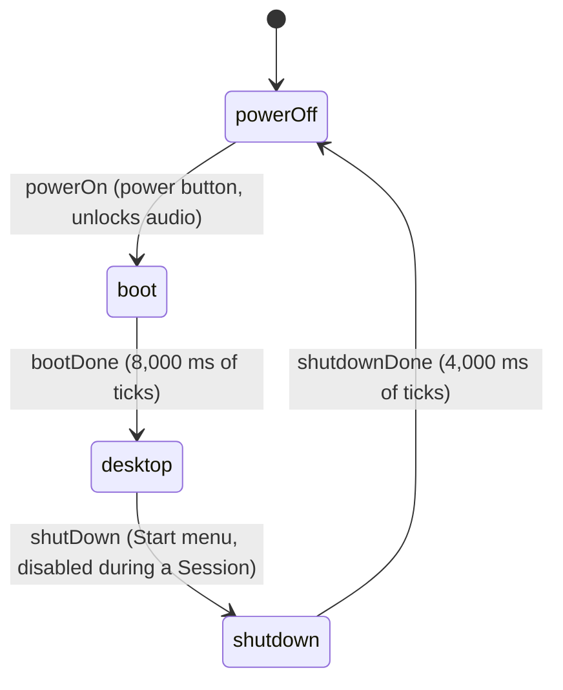

# Design Document: retro-shell

## Overview

retro-shell is the path from the power button to a live dial-up connection. It adds:

- a persistent **Monitor** (CRT bezel, power button, LED, scanlines) that scales a fixed
  1024 × 768 logical **Screen** to the viewport;
- a **Scene_Director** with four scenes: power off, boot (BIOS + splash), desktop, shutdown;
- a **desktop** made of a pure window-stack model plus thin DOM components: window manager,
  taskbar, start menu and icons;
- a **Session** that hosts one game-core Run in the browser on top of `startFixedLoop`, and a
  **Session_Registry** where the lane (milestone 3) and browser front (milestone 4) will plug in;
- the **Dialer**, the first Session_View, whose status text and modem audio are derived from the
  Run's tick, phase and balance;
- an **Audio_Engine** with one `AudioContext`, unlocked by the power-on click, plus synthesized
  boot and modem sounds.

Every timeline in this feature (boot, dial, shutdown) is measured in fixed-loop ticks, so hiding
the tab holds everything still and the 20-second dial stays in `src/game/balance/core.ts`.

### Research notes

- **Autoplay.** Browsers keep an `AudioContext` suspended until a user gesture, and the context
  must be created or resumed from inside that gesture's handler. MDN recommends one shared
  context per page. Source: [MDN AudioContext](https://developer.mozilla.org/en-US/docs/Web/API/AudioContext),
  [MDN Web Audio best practices](https://developer.mozilla.org/en-US/docs/Web/API/Web_Audio_API/Best_practices).
  Design consequence: the power button handler calls `audio.unlock()` synchronously before it
  signals the director.
- **What a dial-up call sounds like.** The sequence is dial tone (350 + 440 Hz), DTMF digits
  (rows 697/770/852/941 Hz, columns 1209/1336/1477 Hz), ringing, the answering modem's 2100 Hz
  answer tone with phase reversals, short V.21 FSK exchanges (channels near 980/1180 Hz and
  1650/1850 Hz), V.34 line probing (tones at 150 Hz steps up to about 3750 Hz) and then the
  noisy training "screech", after which the speaker goes quiet. Sources:
  [dialupsounds.com](https://dialupsounds.com/),
  [windytan: "The sound of the dialup, pictured"](https://www.windytan.com/2012/),
  [MagicalTux modem_decode README](https://github.com/MagicalTux/modem_decode_20260320/blob/master/README.md).
  Design consequence: the handshake recipe is built from those four parts, compressed into the
  10-second "negotiating" stage. Content was rephrased for compliance with licensing
  restrictions.

### Design decisions

| Decision | Choice | Why |
|---|---|---|
| Dial timing | Dialer derives its stage from `state.tick`, `state.phaseStartTick` and `state.balance.dialSeconds` | The 20 s lives only in balance config. The dialer can never drift from `step()`'s connect tick. |
| Dial tick rounding | New `dialTicks(balance)` helper in `src/game/balance/core.ts`, used by `step.ts` and the Dialer | One rounding rule for both. Behaviour of `step()` is unchanged. |
| UI timelines | Boot, shutdown and dial all count fixed-loop ticks | One pause rule for hidden tabs. Tests drive them with a manual loop. |
| Window manager | Pure `WindowStack` model plus a DOM layer that renders it | The z-order/focus rules are the part that can break silently, so they get property tests. |
| Lane and browser hook | `SessionView` interface + `src/dialup/sessionRegistry.ts` | Later specs add one line to the registry. The shell code does not change. |
| Screen | 1024 × 768 logical, CSS `transform: scale()` | Late-90s 4:3 look. One pointer conversion function handles the scale. |
| Icons and logos | Constant inline SVG strings and CSS | Original art, no files in `assets/sprites/` (team-owned). |

## Architecture

### Module layout

```
src/
  main.ts                       creates Monitor, Audio_Engine, Scene_Director; imports CSS
  scenes/index.ts               buildSceneFactories() (testable wiring used by main.ts)
  core/
    h.ts                        h() DOM helper
    scene.ts                    Mountable/Scene types, nextScene(), createSceneDirector()
    monitor.ts                  fitMonitor(), toScreenPoint(), createMonitor()
    audio.ts                    createAudioEngine(), Voice, SoundRecipe
    fixedLoop.ts                (game-core, unchanged)
  scenes/
    powerOffScene.ts
    boot/bootScript.ts          BIOS lines, cues, bootFrameAt(), cuesBetween()
    boot/bootSounds.ts          crtThunk, postBeep, diskSeek, startupChime recipes
    boot/bootScene.ts
    desktop/desktopScene.ts     wires desktop components, apps and the Session
    shutdown/shutdownScript.ts  shutdown copy and shutdownFrameAt()
    shutdown/shutdownScene.ts
  desktop/
    layout.ts                   sizes, desktopArea(), clampWindow(), cascadePosition()
    windowStack.ts              pure WindowStack model and applyStackOp()
    windowManager.ts            DOM windows, drag, close requests
    taskbar.ts                  Start button, window buttons, Tray
    startMenu.ts
    icons.ts                    icon grid
    iconArt.ts                  constant SVG markup
    copy.ts                     desktop copy (icons, README, wastebasket, start menu, clock)
    textWindow.ts               README and Wastebasket window contents
  dialup/
    dialScript.ts               Dial_Stages, dialer copy, dialStatusOf(), stageTimeLeftSeconds()
    session.ts                  SessionView, advanceTicks(), createSession()
    sessionRegistry.ts          SESSION_REGISTRY (empty lists for later milestones)
    dialer.ts                   Dialer App and its Session_View
    trayModemView.ts            Session_View that drives the Tray modem lamp
    modemSounds.ts              dialTone, dtmf, ringback, handshake, relayClick recipes
  styles/
    theme.css monitor.css boot.css desktop.css dialup.css
src/game/balance/core.ts        + dialTicks(balance)   (small game-core addition)
src/game/step.ts                uses dialTicks(balance) (no behaviour change)
```

### Scene flow



Any other (scene, signal) pair leaves the scene unchanged (Req 1.7). Desktop is reachable only
through boot (Req 1.6).

### One frame during a Session

```mermaid
sequenceDiagram
    participant Loop as startFixedLoop
    participant S as Session
    participant G as game-core step()
    participant V as Session_Views (Dialer, Tray lamp, later lane/browser)
    Loop->>S: onTicks(n)
    alt n > 0
        S->>S: take queued inputs
        loop up to n ticks, stop early on won/lost
            S->>G: step(state, first tick ? inputs : [], registry.systems)
            G-->>S: { state, events }
        end
    end
    S->>V: update(state, frameEvents)
    opt phase is won or lost
        S->>Loop: stop()
        S->>V: unmount() (reverse order)
        S->>S: onEnd(finalState) → Desktop_Scene ends the Session
    end
    V-->>S: send(command) (from DOM handlers, queued for the next tick)
```

### Screen layout

```
 ┌──────────────── Monitor bezel (power button + LED bottom right) ────────────────┐
 │ ┌──────────────────────── Screen 1024 × 768 ──────────────────────────────────┐ │
 │ │ Desktop_Area: wallpaper, icons, windows                                     │ │
 │ │   740 px tall idle / 480 px tall during a Session                           │ │
 │ ├─────────────────────────────────────────────────────────────────────────────┤ │
 │ │ Lane_Dock 260 px (only during a Session; lane views mount here)             │ │
 │ ├─────────────────────────────────────────────────────────────────────────────┤ │
 │ │ Taskbar 28 px: [Start] [window buttons...]            [modem][spk] 11:59 PM │ │
 │ └─────────────────────────────────────────────────────────────────────────────┘ │
 └─────────────────────────────────────────────────────────────────────────────────┘
```

## Components and Interfaces

### `src/core/h.ts`

```ts
export type Child = Node | string | number | null | undefined | false;
export interface Props {
  readonly className?: string;
  readonly attrs?: Readonly<Record<string, string>>;   // names starting with "on" throw
  readonly on?: { readonly [K in keyof HTMLElementEventMap]?: (e: HTMLElementEventMap[K]) => void };
}
export function h<K extends keyof HTMLElementTagNameMap>(
  tag: K, props?: Props | null, ...children: Child[]
): HTMLElementTagNameMap[K];
```

Strings and numbers become `Text` nodes (Req 14.3). `null`, `undefined` and `false` are
skipped. Listeners passed in `on` live on the element itself, so they go away with it.

### `src/core/scene.ts`

```ts
export interface Mountable { mount(root: HTMLElement): void; unmount(): void }
export type Scene = Mountable;
export type SceneId = 'powerOff' | 'boot' | 'desktop' | 'shutdown';
export type SceneSignal = 'powerOn' | 'bootDone' | 'shutDown' | 'shutdownDone';
export type SignalFn = (signal: SceneSignal) => void;

/** Pure transition table (Req 1.2–1.7). */
export function nextScene(current: SceneId, signal: SceneSignal): SceneId;

export interface SceneDirector {
  start(): void;              // mounts powerOff (Req 1.1)
  signal: SignalFn;
  current(): SceneId;
  stop(): void;               // unmounts the current scene
}
export function createSceneDirector(
  root: HTMLElement,
  factories: Readonly<Record<SceneId, (signal: SignalFn) => Scene>>,
): SceneDirector;
```

- Switching unmounts the old scene, clears `root`, then creates and mounts the new scene
  (Req 1.8).
- A signal raised while a switch is in progress is queued and handled after the switch, so a
  scene that signals from inside `mount()` or `unmount()` cannot cause re-entrant switches.

### `src/core/monitor.ts`

```ts
export const SCREEN_W = 1024;
export const SCREEN_H = 768;
export const BEZEL = { top: 36, side: 44, bottom: 84 } as const; // logical px
export const MONITOR_W = SCREEN_W + 2 * BEZEL.side;
export const MONITOR_H = SCREEN_H + BEZEL.top + BEZEL.bottom;

export interface Fit { readonly scale: number; readonly offsetX: number; readonly offsetY: number }
/** Largest uniform scale that fits the monitor in the viewport, centred (Req 2.2). */
export function fitMonitor(viewportW: number, viewportH: number): Fit;

export interface Rect { readonly left: number; readonly top: number; readonly width: number; readonly height: number }
/** Client → Screen coordinates from the Screen element's bounding rect (Req 2.3). */
export function toScreenPoint(clientX: number, clientY: number, screenRect: Rect): { x: number; y: number };
export function toClientPoint(x: number, y: number, screenRect: Rect): { x: number; y: number };

export type LedState = 'off' | 'standby' | 'on';
export interface Monitor {
  readonly screen: HTMLElement;          // scenes mount here
  setLed(state: LedState): void;
  setPowerHandler(fn: (() => void) | null): void;   // null → button does nothing (Req 3.5)
  toScreenPoint(clientX: number, clientY: number): { x: number; y: number };
  unmount(): void;
}
export function createMonitor(host: HTMLElement, win?: Pick<Window, 'innerWidth' | 'innerHeight' | 'addEventListener' | 'removeEventListener'>): Monitor;
```

- `fitMonitor`: `scale = min(vw / MONITOR_W, vh / MONITOR_H)`, offsets centre the monitor. Zero
  or negative viewport sizes give `scale = 0` with zero offsets (nothing to draw).
- `toScreenPoint` divides by `screenRect.width / SCREEN_W`. If the rect width is 0 (jsdom), the
  scale is treated as 1.
- The overlay (`.crt-overlay`) has `pointer-events: none` (Req 2.4).
- `resize` listener on `window` is removed in `unmount()`.

### `src/core/audio.ts`

```ts
/** Schedules nodes on `ac` into `out` starting at `at` for `durationSec`; returns a stop function. */
export type SoundRecipe = (ac: BaseAudioContext, out: AudioNode, at: number, durationSec: number) => () => void;
export interface Voice { stop(): void }

export interface AudioEngine {
  /** Call synchronously inside a user-gesture handler (Req 3.2). Returns false if audio is unavailable. */
  unlock(): boolean;
  isUnlocked(): boolean;
  play(recipe: SoundRecipe, durationSec: number): Voice;   // no-op Voice while locked (Req 3.4)
  setMuted(muted: boolean): void;
  isMuted(): boolean;
  stopAll(): void;
  unmount(): void;                                          // stops voices, closes the context
}
export interface AudioDeps {
  readonly createContext: () => AudioContext;
  readonly visibility: { readonly hidden: boolean; addEventListener(t: 'visibilitychange', f: () => void): void; removeEventListener(t: 'visibilitychange', f: () => void): void };
}
export function createAudioEngine(deps?: Partial<AudioDeps>): AudioEngine;
```

- `unlock()` creates the context on first call (inside the gesture), calls `resume()`, and builds
  `master` gain (0.6) → `destination`. If the constructor throws or `resume()` rejects, the
  engine marks itself unavailable and every `play()` returns a no-op voice (Req 3.3).
- `visibilitychange`: hidden → `ctx.suspend()`, visible → `ctx.resume()` (Req 10.8, 10.9).
  Because scheduled sounds follow the context clock, they pause and resume with the Run.
- Mute sets the master gain to 0 (Req 7.8).
- Active voices are tracked in a `Set`; a voice removes itself when stopped.

### `src/scenes/powerOffScene.ts`

`createPowerOffScene({ monitor, audio, signal })`. Mount: black screen with a faint reflection,
`monitor.setLed('standby')` (blinking amber), `monitor.setPowerHandler(() => { audio.unlock();
signal('powerOn'); })`. Unmount: `setPowerHandler(null)`, `setLed('on')`.

### Boot: `bootScript.ts`, `bootSounds.ts`, `bootScene.ts`

```ts
export interface BiosLine { readonly atMs: number; readonly text: string }
export type BootSoundId = 'crtThunk' | 'postBeep' | 'diskSeek';
export interface BootCue { readonly atMs: number; readonly sound: BootSoundId }
export interface BootScript {
  readonly header: readonly BiosLine[];       // before the memory line
  readonly memory: { readonly atMs: number; readonly endMs: number; readonly totalK: number; readonly stepK: number };
  readonly body: readonly BiosLine[];         // after the memory line
  readonly footer: string;                    // BIOS date string, bottom-left
  readonly cues: readonly BootCue[];
  readonly splashAtMs: number;                // 5,400
  readonly doneAtMs: number;                  // 8,000
  readonly splash: { readonly wordmark: string; readonly copyright: string };
}
export const BOOT_SCRIPT: BootScript;

export interface BootFrame {
  readonly stage: 'bios' | 'splash' | 'done';
  readonly lines: readonly string[];          // visible BIOS lines in order, memory line included
  readonly memoryK: number;                   // 0..totalK, multiple of stepK until the end
  readonly splashProgress: number;            // 0..1 within the splash stage
}
export function bootFrameAt(elapsedMs: number, script?: BootScript): BootFrame;
/** Cues with prevMs < atMs <= nowMs, in script order (Req 4.4). */
export function cuesBetween(prevMs: number, nowMs: number, script?: BootScript): readonly BootCue[];
```

BIOS copy (follows `retro-copy`: dry technical text with one horror leak):

| atMs | Line |
|---|---|
| 400 | `NightOwl BIOS v4.13  (C) 1985-1998 NightOwl Firmware, Inc.` |
| 700 | `Phantom-II CPU at 233 MHz` |
| 900–2,400 | `Memory Test: 34816K` counting up in 1024K steps, ending `Memory Test: 65536K OK` |
| 2,600 | `Detecting IDE Primary Master ... GRAVEDIGGER 2.1GB` |
| 2,900 | `Detecting IDE Primary Slave  ... None` |
| 3,200 | `Detecting IDE Secondary Master ... CD-ROM 24X` |
| 3,500 | `Keyboard ............ OK` |
| 3,650 | `Mouse ............... OK` |
| 3,800 | `Modem on COM2 ....... OK` |
| 4,300 | `Something on COM2 ... DETECTED` |
| 4,900 | `Starting Phantom 98...` |

Footer: `10/31/98-NOB-4.13`. Cues: `crtThunk` at 0, `postBeep` at 300, `diskSeek` at 2,600,
2,900 and 3,200. Splash: wordmark `Phantom 98`, copyright `Copyright (C) 1981-1998 Phantom
Software Corp.`, progress strip animated from `splashProgress`.

`createBootScene({ monitor, audio, signal, startLoop })`:

- Mount adds the `crt-on` animation class and starts the loop. Each frame:
  `ticks += n; now = ticks * TICK_MS;` play `cuesBetween(prev, now)` (with `prev = -1` on the
  first frame so the 0 ms cue fires), render `bootFrameAt(now)`, and when the stage is `done`
  stop the loop and call `signal('bootDone')` once (Req 4.6, 4.7).
- Rendering only rewrites changed lines (`textContent` of one `<div>` per line).
- No input listeners are attached (Req 1.9).
- Unmount stops the loop and any voices it started.

`bootSounds.ts` recipes: `crtThunk` (low-passed noise burst, 300 ms), `postBeep` (square wave
1000 Hz, 150 ms), `diskSeek` (three band-passed noise clicks), `startupChime` (original
four-note A-minor arpeggio on triangle oscillators with a detuned pad, about 2.5 s). The chime is
written for this game and does not imitate any real OS sound.

### `src/desktop/layout.ts`

```ts
export const TASKBAR_H = 28;
export const LANE_DOCK_H = 260;
export const TITLE_BAR_H = 20;
export const MIN_TITLE_VISIBLE = 48;
export const CASCADE_ORIGIN = { x: 120, y: 32 } as const;
export const CASCADE_STEP = 24;
export interface Size { readonly w: number; readonly h: number }
export interface Point { readonly x: number; readonly y: number }
export function desktopArea(sessionActive: boolean): Size;      // {1024, 740} or {1024, 480}
/** Req 6.7: title bar fully inside vertically, min(48, w) px inside horizontally. */
export function clampWindow(pos: Point, size: Size, area: Size): Point;
/** Req 6.12: n-th cascade slot; wraps to the origin when the slot would need clamping. */
export function cascadePosition(n: number, size: Size, area: Size): Point;
```

`clampWindow`: with `v = min(MIN_TITLE_VISIBLE, size.w)`,
`x ∈ [v − size.w, area.w − v]`, `y ∈ [0, max(0, area.h − TITLE_BAR_H)]`.

### `src/desktop/windowStack.ts` (pure)

```ts
export interface WindowStack {
  readonly opened: readonly string[];     // open order, for Taskbar buttons (Req 7.1)
  readonly order: readonly string[];      // z-order, bottom → top
  readonly minimized: readonly string[];  // sorted, unique, subset of order
  readonly focused: string | null;        // topmost non-minimized id, or null
}
export const EMPTY_STACK: WindowStack;
export type StackOp =
  | { readonly type: 'open'; readonly id: string }
  | { readonly type: 'close'; readonly id: string }
  | { readonly type: 'focus'; readonly id: string }
  | { readonly type: 'minimize'; readonly id: string }
  | { readonly type: 'taskbar'; readonly id: string };
export function applyStackOp(stack: WindowStack, op: StackOp): WindowStack;
export function topVisible(order: readonly string[], minimized: readonly string[]): string | null;
```

| Op | Effect |
|---|---|
| `open` | Already open → same as `focus`. Otherwise append to `opened` and `order`, focus it (Req 6.1). |
| `focus` | Unknown id → unchanged. Remove from `minimized`, move to the top of `order`, focus (Req 6.2, 7.3). |
| `close` | Unknown id → unchanged. Remove from all lists; others keep their order (Req 6.4). |
| `minimize` | Unknown or already minimized → unchanged. Add to `minimized` (Req 6.5). |
| `taskbar` | `id === focused` → `minimize`, otherwise `focus` (Req 7.2, 7.3). |

After every op, `focused = topVisible(order, minimized)` (Req 6.3).

### `src/desktop/windowManager.ts`

```ts
export interface WindowSpec {
  readonly id: string;
  readonly title: string;
  readonly icon: IconName;
  readonly content: HTMLElement;               // owned by the caller
  readonly size: Size;
  readonly position?: Point;                   // default: cascade slot
  readonly onCloseRequest?: () => boolean;     // false keeps the window (Req 6.10, 6.11)
  readonly onClosed?: () => void;
}
export interface WindowInfo { readonly id: string; readonly title: string; readonly icon: IconName }
export type WindowListener = (stack: WindowStack, windows: ReadonlyMap<string, WindowInfo>) => void;
export interface WindowManager extends Mountable {
  open(spec: WindowSpec): void;               // already open → focus
  requestClose(id: string): void;             // asks onCloseRequest
  close(id: string): void;                    // closes without asking
  focus(id: string): void;
  minimize(id: string): void;
  taskbarClick(id: string): void;
  setTitle(id: string, title: string): void;
  setContent(id: string, content: HTMLElement): void;
  isOpen(id: string): boolean;
  info(id: string): WindowInfo | undefined;   // title and icon of an open window
  stack(): WindowStack;
  setArea(area: Size): void;                  // re-clamps every window (Req 6.8)
  subscribe(listener: WindowListener): () => void;
}
export function createWindowManager(deps: { readonly toScreenPoint: Monitor['toScreenPoint']; readonly area: Size }): WindowManager;
```

- Each window: `div.window` > `div.title-bar` (icon, title, minimize `_` and close `✕`
  buttons) + `div.window-body` holding `spec.content`.
- Every state change goes through `applyStackOp`, then a single `render()` sets
  `style.zIndex = 10 + index`, toggles `.is-active` on the focused window (Req 6.9) and `hidden`
  on minimized ones, and notifies listeners.
- `pointerdown` on a window (capture phase) → `focus(id)` (Req 6.2).
- Drag: `pointerdown` on the title bar (not its buttons) records the Screen point and window
  position and calls `setPointerCapture` when available; `pointermove` sets
  `clampWindow(start + (point − startPoint))` (Req 6.6, 6.7); `pointerup`/`pointercancel` ends
  the drag. The drag listeners sit on the title bar (where pointer capture sends events) and,
  only while a drag is running, also on `document` in the capture phase as a fallback when
  capture is unavailable. The `document` listeners are removed when the drag ends, when the
  window closes or is minimized, and on unmount, so none remain between drags.
- jsdom has no `setPointerCapture`; the call is guarded with a `typeof` check and `try`/`catch`.

### `src/desktop/taskbar.ts`

```ts
export interface Taskbar extends Mountable {
  setStartPressed(pressed: boolean): void;
  setModem(state: 'off' | 'blink' | 'on'): void;   // Req 7.6, 7.7
  readonly startButton: HTMLButtonElement;
}
export function createTaskbar(deps: { windows: WindowManager; audio: AudioEngine; onStart: () => void }): Taskbar;
```

- Subscribes to the Window_Manager; rebuilds window buttons in `stack.opened` order, pressed
  style on `stack.focused` (Req 7.1, 7.4). A button click calls `windows.taskbarClick(id)`.
- Tray: modem lamp (`data-state`), speaker button toggling `audio.setMuted(!audio.isMuted())`
  and swapping its icon (Req 7.8), clock text from `DESKTOP_COPY.clock` = `11:59 PM` (Req 7.5).
- Unmount calls the unsubscribe function returned by `subscribe`.

### `src/desktop/startMenu.ts`

```ts
export type StartItemId = 'dialer' | 'readme' | 'wastebasket' | 'shutDown';
export interface StartMenu extends Mountable {
  toggle(): void; open(): void; close(): void; isOpen(): boolean;
  setDisabled(id: StartItemId, disabled: boolean): void;   // Req 8.5
}
export function createStartMenu(deps: { anchor: HTMLElement; onChoose: (id: StartItemId) => void; onOpenChange: (open: boolean) => void }): StartMenu;
```

- Items and the "Phantom 98" banner come from `DESKTOP_COPY.startMenu` (Req 8.2).
- While open, it adds a `pointerdown` and a `keydown` listener on `document`, removed on close
  and on unmount (Req 8.4, 14.2). Clicks on `anchor` (the Start button) are left to `toggle()`.
- Disabled items get `aria-disabled="true"` and the disabled style; choosing them does nothing.

### `src/desktop/icons.ts`, `iconArt.ts`, `textWindow.ts`, `copy.ts`

```ts
export type IconName = 'dialer' | 'text' | 'wastebasket' | 'file' | 'start' | 'speaker' | 'speakerMuted' | 'computer';
export const ICON_SVG: Readonly<Record<IconName, string>>;   // constant markup, 32×32 viewBox
export function iconEl(name: IconName): HTMLSpanElement;     // the only innerHTML use

export interface DesktopIconSpec { readonly id: AppId; readonly label: string; readonly icon: IconName }
export interface IconGrid extends Mountable { clearSelection(): void; selected(): AppId | null }
export function createIconGrid(deps: { icons: readonly DesktopIconSpec[]; onOpen: (id: AppId) => void }): IconGrid;

export function readmeContent(): HTMLElement;       // <pre> with DESKTOP_COPY.readme
export function wastebasketContent(): HTMLElement;  // file list + "4 object(s)" status bar
```

- Icons are `<button>`s in one column from (16, 16), 80 px apart (Req 5.2). `click` selects
  (Req 5.3), `dblclick` opens (Req 5.4), `keydown` Enter opens the focused icon (Req 5.5).
- `iconEl` only reads from the `ICON_SVG` constant, which keeps the tech rule "inline SVG only
  for our own compile-time constant markup".

`DESKTOP_COPY` (in `src/desktop/copy.ts`):

```
icons:        "Connect to MidnightNet", "README.TXT", "Wastebasket"
titles:       readme "README.TXT - Jotter", wastebasket "Wastebasket"
readme:
  Welcome to Phantom 98!

  To get on the Internet:
    1. Double-click "Connect to MidnightNet".
    2. Click Connect.
    3. Wait while the modem talks to the other modem.

  If you hear scratching on the phone line, that is normal.
  Everyone hears it.

  - The MidnightNet Team
wastebasket:  resume_FINAL_final.doc, old_modem_drv.zip, DO_NOT_DIAL.TXT, manhole_cover.bmp
              status "4 object(s)"
startMenu:    "Connect to MidnightNet", "README.TXT", "Wastebasket", "Shut Down...", banner "Phantom 98"
start:        "Start"
clock:        "11:59 PM"
```

### `src/scenes/desktop/desktopScene.ts`

```ts
export type AppId = 'dialer' | 'readme' | 'wastebasket';
export interface DesktopDeps {
  readonly monitor: Monitor;
  readonly audio: AudioEngine;
  readonly signal: SignalFn;
  readonly startLoop?: LoopStarter;            // default startFixedLoop
  readonly seedSource?: () => number;          // default crypto.getRandomValues
  readonly registry?: SessionRegistry;         // default SESSION_REGISTRY
}
export function createDesktopScene(deps: DesktopDeps): Scene;
```

Mount builds, in order: wallpaper (`div.wallpaper`, click → `icons.clearSelection()`, Req 5.6),
icon grid, Window_Manager layer, hidden Lane_Dock, Taskbar, Start_Menu; then plays
`startupChime` (Req 5.1).

- `openApp('readme' | 'wastebasket')` → `windows.open(...)`; a second open focuses (Req 5.7–5.9).
- `openApp('dialer')` → `dialer.open()` (Req 9.1, 9.4).
- Start menu choice `shutDown` → `signal('shutDown')` (Req 1.4).
- `startSession()` (Dialer's Connect, Req 9.2): ignored while a Session is active (Req 10.13).
  Shows the Lane_Dock (`.is-session` on the scene root), `windows.setArea(desktopArea(true))`,
  disables "Shut Down..." (Req 8.5), then creates the Session with views
  `[dialer.sessionView, trayModemView(taskbar), ...registry.views.map((f) => f())]` and starts
  it with `{ laneHost, windows, audio }` (Req 10.10, 10.12).
- `endSession()` (Session `onEnd`, or unmount): `session.stop()`, hide the Lane_Dock,
  `windows.setArea(desktopArea(false))`, enable "Shut Down..." (Req 10.7, 10.11).
- Unmount: `endSession()`, then unmount Start_Menu, Taskbar, Window_Manager, icons, stop voices.

### `src/dialup/session.ts`

```ts
export interface SessionContext {
  readonly laneHost: HTMLElement;
  readonly windows: WindowManager;
  readonly audio: AudioEngine;
  send(command: InputCommand): void;
}
export interface SessionView {
  mount(ctx: SessionContext): void;
  update(state: GameState, events: readonly GameEvent[]): void;
  unmount(): void;
}
export type SessionViewFactory = () => SessionView;
export interface SessionRegistry { readonly views: readonly SessionViewFactory[]; readonly systems: readonly System[] }
export type LoopStarter = (onTicks: (n: number) => void) => () => void;

export interface AdvanceResult { readonly state: GameState; readonly events: readonly GameEvent[] }
/** Pure: run up to n steps, inputs on the first step only; stops early at won/lost (Req 10.2, 10.6). */
export function advanceTicks(state: GameState, n: number, inputs: readonly InputCommand[], systems: readonly System[]): AdvanceResult;

export interface SessionOptions {
  readonly seed: number;
  readonly balance?: Partial<CoreBalance>;
  readonly systems: readonly System[];
  readonly views: readonly SessionView[];
  readonly startLoop?: LoopStarter;            // default startFixedLoop
  readonly onEnd?: (final: GameState) => void;
}
export interface Session {
  start(host: Omit<SessionContext, 'send'>): void;
  stop(): void;                                // idempotent
  state(): GameState;
  isActive(): boolean;
}
export function createSession(options: SessionOptions): Session;
```

- `start`: `createRun({ seed, balance })` (Req 10.1); mount views in array order with a context
  whose `send` pushes to the queue (Req 10.3); call `update(initial, [])` so the Dialer shows
  "Initializing modem..." at once; start the loop.
- `onTicks(n)`: if `n > 0`, take the whole queue and call `advanceTicks` (Req 10.2). Update every
  view with the state and the frame's events (Req 10.4). If the phase is `won` or `lost`: stop
  (Req 10.6) and call `onEnd(final)`.
- `stop`: stop the loop, unmount views in reverse order, clear the queue (Req 10.7). Hidden-tab
  pausing comes from `startFixedLoop` (Req 10.8).
- If a view throws in `update`, the error is logged with `console.error` and the other views
  still update, so one broken view can't freeze the demo.

### `src/dialup/sessionRegistry.ts`

```ts
/** Later milestones add their Session_Views and game-core systems here. */
export const SESSION_REGISTRY: SessionRegistry = { views: [], systems: [] };
```

The connection-lane spec will add its lane view (mounting into `ctx.laneHost`) and its systems;
the browser-front spec will add a view that opens a "NetSurfer" window through `ctx.windows` on
the `connected` event and sends `startDownload`.

### `src/dialup/dialScript.ts`

```ts
export type DialStageId = 'initializing' | 'dialing' | 'ringing' | 'negotiating' | 'verifying' | 'loggingOn';
export type DialSoundId = 'dialTone' | 'dtmf' | 'ringback' | 'handshake' | null;
export interface DialStage { readonly id: DialStageId; readonly start: number; readonly end: number; readonly status: string; readonly sound: DialSoundId }
export const DIAL_STAGES: readonly DialStage[];
export const DIALER_COPY: { /* see table below */ };

export type DialStatus =
  | { readonly kind: 'dialing'; readonly index: number; readonly stage: DialStage; readonly fraction: number }
  | { readonly kind: 'connected' }
  | { readonly kind: 'terminated' };
/** Reads only tick, phase, phaseStartTick and balance (Req 11.1, 11.3, 11.5, 11.6). */
export function dialStatusOf(state: GameState): DialStatus;
/** Seconds left in the current stage while dialing; 0 otherwise (Req 12.1). */
export function stageTimeLeftSeconds(state: GameState): number;
export function formatDuration(ticks: number): string;   // "000:00:07"
```

`fraction = min(elapsed / dialTicks(balance), 1 − 1e-9)` with
`elapsed = tick − phaseStartTick`. The stage is the one with `start ≤ fraction < end`.
Phases `connected`, `downloading` and `won` map to `connected`; `lost` maps to `terminated`.

| Stage | Share | At 20 s | Status text | Sound |
|---|---|---|---|---|
| initializing | 0.000–0.075 | 1.5 s | `Initializing modem...` | dialTone |
| dialing | 0.075–0.150 | 1.5 s | `Dialing 555-0199...` | dtmf |
| ringing | 0.150–0.250 | 2.0 s | `Waiting for the remote computer to answer...` | ringback |
| negotiating | 0.250–0.750 | 10.0 s | `Negotiating with the remote computer...` | handshake |
| verifying | 0.750–0.900 | 3.0 s | `Verifying user name and password...` | none |
| loggingOn | 0.900–1.000 | 2.0 s | `Logging on to network...` | none |

Other dialer copy: window titles `Connect To` / `Connecting to MidnightNet Online` /
`Connected to MidnightNet Online`; form labels `User name:` `guest`, `Password:` `********`,
`Phone number:` `555-0199`, connection name `MidnightNet Online`; buttons `Connect`, `Cancel`;
connected `Connected at 28,800 bps.` and `Duration: 000:00:07`; terminated `The connection was
terminated by the remote computer.`; hang-up attempt `Unable to hang up. Something is holding
the line.`

### `src/dialup/dialer.ts`

```ts
export interface DialerApp {
  open(): void;                    // opens or focuses the "dialer" window
  readonly sessionView: SessionView;
  unmount(): void;
}
export function createDialerApp(deps: { windows: WindowManager; audio: AudioEngine; onConnect: () => void }): DialerApp;
```

- Idle: the window shows the form (Req 9.1). Connect → `onConnect()` (Req 9.2). Cancel or ✕ →
  close (Req 9.3).
- `sessionView.mount`: swap the window content to the progress view (computer–line–computer
  icons, status line, detail line) (Req 9.4). `onCloseRequest` now returns `false` and shows the
  hang-up message (Req 11.7). Cancel does the same.
- `sessionView.update(state, events)`:
  1. `status = dialStatusOf(state)`.
  2. If the stage id changed: stop the current voice; if the new stage has a sound, play it for
     `stageTimeLeftSeconds(state)` (Req 12.1, 12.4).
  3. A `connected` event stores `connectedAtTick = event.tick` and plays `relayClick` (Req 11.4,
     12.5).
  4. Text: stage status while dialing (Req 11.1); `Connected at 28,800 bps.` plus
     `Duration: formatDuration(state.tick − connectedAtTick)` (Req 11.4, 11.5); terminated text
     on `lost` (Req 11.6); the hang-up message while `state.tick < hangUpUntilTick`, where a
     click sets `hangUpUntilTick = lastTick + 180` (Req 11.7). Text nodes are only rewritten when
     the string changes.
- `sessionView.unmount`: stop the voice, swap back to the form, restore normal close behaviour
  (Req 10.11, 12.6).

### `src/dialup/trayModemView.ts`

`trayModemView(taskbar): SessionView`. `update` sets the lamp to `blink` while `dialing`, `on`
while `connected` or `downloading` (Req 7.6, 7.7); `unmount` sets `off`.

### `src/dialup/modemSounds.ts`

```ts
export const DIAL_TONE_HZ = [350, 440] as const;
export const RINGBACK_HZ = [440, 480] as const;
export const DTMF: Readonly<Record<string, readonly [number, number]>>; // '0'-'9', '*', '#'
export const PHONE_DIGITS = '5550199';
export interface HandshakeSegment { readonly kind: 'answerTone' | 'fsk' | 'probe' | 'training'; readonly start: number; readonly end: number }
/** Pure: segment times in seconds for a handshake of durationSec (Req 12.3). */
export function handshakePlan(durationSec: number): readonly HandshakeSegment[];
export const MODEM_SOUNDS: Readonly<Record<Exclude<DialSoundId, null> | 'relayClick', SoundRecipe>>;
```

| Recipe | Synthesis |
|---|---|
| dialTone | Two sine oscillators 350 + 440 Hz, gain 0.12, short fade in and out. |
| dtmf | For each digit of `5550199`: the row + column sines for `min(0.1, d / 7 × 0.55)` s, then a gap; spread across `d`. |
| ringback | 440 + 480 Hz sines, on for `min(1.6, 0.8 d)` s. |
| handshake | `handshakePlan(d)`: answer tone 0–25% (2100 Hz sine, gain dips every 450 ms for the phase reversals); FSK 25–45% (square oscillator jumping between 980/1180/1650/1850 Hz every 20–40 ms); probe 45–55% (sum of sines every 150 Hz from 150 to 3750 Hz at low gain); training 55–100% (white-noise buffer through a 1800 Hz band-pass with a slow sweep, plus a quiet sawtooth "screech" sweep). |
| relayClick | 15 ms noise burst through a high-pass filter. |

`handshakePlan` returns four contiguous segments from 0 to `durationSec` in that order. All
noise buffers are generated in code; there are no audio files (Req 12.7). Using `Math.random`
for noise is fine here because this is not simulation code.

### Shutdown: `shutdownScript.ts`, `shutdownScene.ts`

```ts
export const SHUTDOWN_COPY = { wait: 'Please wait while your computer shuts down...', safe: 'It is now safe to switch off your computer.' } as const;
export const SHUTDOWN_TIMES = { safeAtMs: 1500, collapseAtMs: 3500, doneAtMs: 4000 } as const;
export type ShutdownFrame = 'wait' | 'safe' | 'collapse' | 'done';
export function shutdownFrameAt(elapsedMs: number): ShutdownFrame;
```

The scene counts loop ticks like the Boot_Scene and calls `signal('shutdownDone')` once at
`done` (Req 13.1–13.3).

### `src/scenes/index.ts` and `src/main.ts`

```ts
export interface ShellDeps {
  readonly monitor: Monitor;
  readonly audio: AudioEngine;
  readonly startLoop?: LoopStarter;
  readonly seedSource?: () => number;
  readonly registry?: SessionRegistry;
}
/** The four scene factories for createSceneDirector. Side-effect free, so tests can use it. */
export function buildSceneFactories(deps: ShellDeps): Readonly<Record<SceneId, (signal: SignalFn) => Scene>>;
```

`main.ts` imports `@fontsource/vt323` (already a dependency) and the CSS files, creates the
Monitor in `#screen`, creates the Audio_Engine, calls `buildSceneFactories` and
`createSceneDirector(monitor.screen, factories).start()`. No other logic lives there.

### Styles

`theme.css` holds every colour and font as CSS custom properties: chrome grey `#c0c0c0` with
white/dark-grey bevels, wallpaper murky teal `#1e4a4a` with a faint CSS dither, active title bar
gradient `#3b1458 → #7a2f8f`, inactive `#7f7f7f → #a8a8a8`, BIOS text `#c8c8c8` on black in
VT323, desktop UI font `Tahoma, Verdana, sans-serif` at 12 px. `monitor.css` draws the bezel,
LED (`standby` blinks amber, `on` steady green), scanlines and vignette (`pointer-events: none`)
and the `crt-on` / `crt-collapse` keyframes. The Lane_Dock slides up with a 300 ms transition.

## Data Models

All models below are plain readonly data.

| Model | Shape | Notes |
|---|---|---|
| `WindowStack` | `{ opened, order, minimized, focused }` | Invariants: `order` unique; `opened` is the same set as `order`; `minimized` sorted, unique, ⊆ `order`; `focused = topVisible(order, minimized)`. |
| `BootScript` / `BootFrame` | see Boot section | `lines` of a later frame always start with the lines of an earlier frame. |
| `DialStage[]` | `{ id, start, end, status, sound }` | `start` of the first is 0, `end` of the last is 1, each `end` equals the next `start`, every share > 0. |
| `DialStatus` | `dialing { index, stage, fraction }` / `connected` / `terminated` | Derived; never stored in game state. |
| `HandshakeSegment[]` | `{ kind, start, end }` in seconds | Contiguous from 0 to the duration. |
| `SessionRegistry` | `{ views: SessionViewFactory[], systems: System[] }` | Empty in this milestone. |
| `Fit` | `{ scale, offsetX, offsetY }` | `scale ≥ 0`. |
| Copy modules | `DESKTOP_COPY`, `BOOT_SCRIPT`, `DIALER_COPY` + `DIAL_STAGES`, `SHUTDOWN_COPY` | All in-game text; scanned by the trademark test. |

UI-only state (selected icon, start menu open, drag in progress, `connectedAtTick`,
`hangUpUntilTick`, current voice) lives in component closures and never in `GameState`.

## Correctness Properties

*A property is a characteristic or behavior that should hold true across all valid executions of a system-essentially, a formal statement about what the system should do. Properties serve as the bridge between human-readable specifications and machine-verifiable correctness guarantees.*

PBT fits the pure parts of this feature: the scene transition table, the
monitor geometry, the boot and dial timelines, the window stack, window clamping, the Session's
tick driving and the `h()` helper. DOM rendering, CSS and sound timbre are covered by example
tests instead.

Reflection after the prework: the scene criteria 1.6 and 1.7 share one fold over signal
sequences; the boot line and memory criteria (4.2, 4.3) are one timeline property; the window
op criteria (6.1, 6.2, 6.4, 6.5, 7.2, 7.3) are postconditions of one op-sequence property, kept
apart from the invariant property (6.3, 7.1) because the invariant must hold after every op
while the postconditions are op-specific; `advanceTicks` (10.2) is implied by the Session
property (10.3–10.6), so it has no property of its own; the dial status criteria 11.1, 11.3 and
11.5 are one property.

### Property 1: The desktop is only reachable through the boot

*For any* sequence of scene signals applied with `nextScene` starting from `powerOff`, every
transition into `desktop` comes from `boot`, every transition that changes the scene is one of
the four table entries, and every other (scene, signal) pair leaves the scene unchanged.

**Validates: Requirements 1.6, 1.7**

### Property 2: The monitor fits the viewport as large as possible

*For any* viewport width and height greater than 0, `fitMonitor` returns a scale where
`scale × MONITOR_W ≤ width` and `scale × MONITOR_H ≤ height` (within 1e-9), at least one of the
two is equal within 1e-9, and the offsets centre the scaled monitor in the viewport.

**Validates: Requirements 2.2**

### Property 3: Client and Screen coordinates round-trip

*For any* Screen rectangle with positive width and height and any Screen point,
`toScreenPoint(toClientPoint(p, rect), rect)` equals `p` within 1e-6 pixels.

**Validates: Requirements 2.3**

### Property 4: The boot timeline only moves forward

*For any* two elapsed times `t1 ≤ t2`, `bootFrameAt(t2)` has a stage no earlier than
`bootFrameAt(t1)` (bios, splash, done), shows at least as many BIOS lines with every non-memory
line of `t1` unchanged at the same index, has `memoryK(t1) ≤ memoryK(t2) ≤ 65536`, and shows a
BIOS line exactly when the line's `atMs ≤ t`.

**Validates: Requirements 4.2, 4.3**

### Property 5: Every boot cue fires exactly once

*For any* increasing sequence of frame times `t0 < t1 < … < tk` with `t0 = -1`, concatenating
`cuesBetween(t(i-1), t(i))` over consecutive pairs gives exactly the cues with `atMs ≤ tk`, each
once, in script order.

**Validates: Requirements 4.4**

### Property 6: The window stack invariants hold after every operation

*For any* sequence of stack operations (open, close, focus, minimize, taskbar) over a small pool
of window ids, after every operation `order` has no duplicates, `opened` holds the same ids as
`order` in first-open order, `minimized` is sorted, unique and a subset of `order`, and `focused`
equals the topmost id of `order` that is not minimized, or `null` if there is none.

**Validates: Requirements 6.3, 7.1**

### Property 7: Window operations have their stated effects

*For any* reachable window stack and any operation on an id, the result satisfies that
operation's rule: `open` and `focus` leave the id on top, focused and not minimized, with the
other ids in their previous relative order; `close` removes the id and leaves the remaining
`order` equal to the previous `order` without it; `minimize` adds the id to `minimized` and keeps
it in `opened`; `taskbar` behaves as `minimize` when the id was focused and as `focus`
otherwise; operations on unknown ids (other than `open`) return an equal stack.

**Validates: Requirements 6.1, 6.2, 6.4, 6.5, 7.2, 7.3**

### Property 8: Clamped windows keep their title bar reachable

*For any* window position, window size with positive width, and Desktop_Area at least
`MIN_TITLE_VISIBLE` wide and `TITLE_BAR_H` tall, `clampWindow` returns a position with
`0 ≤ y ≤ area.h − TITLE_BAR_H` and `min(48, w) − w ≤ x ≤ area.w − min(48, w)`; clamping that
result again returns the same position; and a position that already satisfies the bounds is
returned unchanged.

**Validates: Requirements 6.7, 6.8**

### Property 9: The Session matches tick-by-tick stepping for any frame grouping

*For any* seed, any damage schedule system (including schedules that drop integrity to 0), any
total tick count, any split of those ticks into frames (including zero-tick frames) and any
`startDownload` commands sent between frames, a Session driven by a manual loop produces the
same final state, and its recording view receives the same events in the same order, as a
reference that calls `step` once per tick with each command delivered on the first tick after
it was sent. Once the phase is `won` or `lost`, no further ticks run and `onEnd` is called
exactly once.

**Validates: Requirements 10.2, 10.3, 10.4, 10.5, 10.6**

### Property 10: Dial status depends only on the Run's dial clock

*For any* valid dial duration and any Run state: while the phase is `dialing`, `dialStatusOf`
returns the stage whose `[start, end)` share contains
`(tick − phaseStartTick) / dialTicks(balance)` (capped just below 1), the stage index never
decreases as the tick grows, and changing integrity, download, rng, seed or pause sources does
not change the result; in `connected`, `downloading` and `won` it returns `connected`; in `lost`
it returns `terminated`.

**Validates: Requirements 11.1, 11.3, 11.5**

### Property 11: Stage sounds last exactly until the stage ends

*For any* valid dial duration and any tick within the `dialing` phase,
`stageTimeLeftSeconds(state)` is greater than 0 and equals
`(stage.end − fraction) × dialTicks(balance) / TICK_RATE` within 1e-9.

**Validates: Requirements 12.1**

### Property 12: The handshake plan covers its duration in order

*For any* duration in (0, 60] seconds, `handshakePlan(duration)` returns the segments
answerTone, fsk, probe and training in that order, each with `start < end`, the first starting at
0, each `end` equal to the next `start`, and the last ending at the duration.

**Validates: Requirements 12.3**

### Property 13: `h()` never turns strings into markup

*For any* list of strings (including ones that contain `<`, `>`, `&` and quotes), `h('div',
null, ...strings)` has no element children and its `textContent` equals the strings joined
together.

**Validates: Requirements 14.3**

## Error Handling

| Situation | Behaviour |
|---|---|
| `AudioContext` missing, constructor throws, or `resume()` rejects | `unlock()` returns `false`, the engine stays silent, every `play()` returns a no-op voice. Boot and play continue (Req 3.3). |
| A sound is requested before unlock | No-op voice (Req 3.4). |
| A Session_View throws in `update` | `console.error` with the view index; other views still update; the Run keeps going. |
| A Session_View throws in `mount` | The Session stops, unmounts the views mounted so far, rethrows. This is a bug in a later feature and should fail loudly in development. |
| Connect clicked while a Session is active | Ignored (Req 10.13). |
| Dialer close or Cancel during a Session | Close refused, hang-up message shown (Req 11.7). |
| Scene signal that doesn't match the mounted scene | Ignored (Req 1.7). |
| Signal raised during a scene switch | Queued and handled after the switch completes. |
| Window op on an unknown id | Stack unchanged. |
| Viewport of size 0 (minimized browser) | `fitMonitor` returns scale 0; the next `resize` fixes it. |
| `setPointerCapture` missing (jsdom, old browsers) | Skipped; the `document` listeners added for the drag still see every move. |
| `h()` attrs with a name starting with `on` | Throws `Error`, so inline handlers can never be set from strings. |
| Invalid balance overrides passed to a Session | `createRun` throws `BalanceError`; the Session is not started (game-core behaviour). |

## Testing Strategy

### Tools and configuration

- Vitest with jsdom (`npm test`), fast-check for properties. No new dependencies.
- Each property is **one** fast-check test with at least `{ numRuns: 100 }`.
- Each property test carries two comments: the testing steering format
  `// Property: Req X.Y <short rule>` and the spec tag
  `// Feature: retro-shell, Property N: <property title>`.
- Tests mirror `src/` paths, e.g. `src/desktop/windowStack.ts` →
  `tests/desktop/windowStack.test.ts`.

### Test helpers (new, in `tests/helpers/`)

- `loop.ts`: `createManualLoop()` returns a `LoopStarter` plus `frame(n)` to deliver `n` ticks,
  `isRunning()` and a count of stop calls.
- `audio.ts`: `createFakeAudioContext()` that records created oscillators (type, frequency),
  buffer sources, filters, `start`/`stop`, `suspend`/`resume` and `close`, and
  `createFakeAudioEngine()` that logs `play(recipeName, duration)` and `stop` calls.
- `dom.ts`: `trackListeners(target)` that wraps `addEventListener`/`removeEventListener` and
  reports listeners still attached; `fakeVisibility()`; `fakeMonitor()` with identity
  `toScreenPoint` (or a given scale).
- Existing `tests/helpers/game.ts` (`stepN`, `scheduledDamage`) is reused by Property 9.

### PBT test files

| # | File |
|---|---|
| P1 scene flow | `tests/core/scene.test.ts` |
| P2 fit, P3 coordinate round trip | `tests/core/monitor.test.ts` |
| P4 boot timeline, P5 boot cues | `tests/scenes/boot/bootScript.test.ts` |
| P6 stack invariants, P7 op effects | `tests/desktop/windowStack.test.ts` |
| P8 clamp | `tests/desktop/layout.test.ts` |
| P9 Session vs reference | `tests/dialup/session.test.ts` |
| P10 dial status, P11 stage time left | `tests/dialup/dialScript.test.ts` |
| P12 handshake plan | `tests/dialup/modemSounds.test.ts` |
| P13 `h()` text safety | `tests/core/h.test.ts` |

### Example and edge-case tests

- **Scene director:** starts in power off; unmount-before-mount call order; signal from inside
  `mount` is queued.
- **Monitor:** DOM structure (1024 × 768 screen, power button, LED, overlay); power handler
  `null` makes the button inert; `resize` listener removed on unmount.
- **Audio engine:** locked `play` creates no nodes; throwing factory and rejecting `resume` give
  a silent engine; hidden → `suspend`, visible → `resume`; mute sets gain 0; `unmount` stops all
  voices and closes the context.
- **Power off scene:** LED `standby`; handler calls `unlock` before `signal('powerOn')`.
- **Boot scene:** first frames play `crtThunk` and `postBeep`; 480 ticks signal `bootDone`
  exactly once; zero-tick frames change nothing; clicks and keys change nothing; unmount stops the
  loop.
- **Desktop:** three icons in a column; select, wallpaper deselect, double-click and Enter open;
  README and Wastebasket content; reopening focuses; startup chime played.
- **Window manager (DOM):** z-index and `.is-active` follow the stack; drag with a scale-2
  `toScreenPoint` moves by half the client delta; `setArea` re-clamps; ✕ asks the owner and a
  refusal keeps the window; cascade slots 0, 1, 2.
- **Taskbar:** buttons in open order, pressed style on focus, click toggles minimize/restore;
  clock text; speaker toggles mute and icon; unmount unsubscribes.
- **Start menu:** toggle, item order and banner, choose closes and acts, Escape and outside press
  close, document listeners removed when closed, disabled "Shut Down..." ignored.
- **Dialer:** form content; Connect calls `onConnect`; idle Cancel closes; during a Session the
  progress view shows; hang-up message visible at tick +179 and gone at +180 with the window still
  open; terminated text on `lost`; voice switching (stop previous, play new, none for verifying
  and logging on); relay click on `connected`; unmount stops the voice and restores the form.
- **Dial script table:** stage ids in order, shares contiguous from 0 to 1; DTMF pairs for
  `5550199`; `formatDuration(420) === "000:00:07"`.
- **Shutdown:** `shutdownFrameAt` boundaries at 0, 1,499, 1,500, 3,499, 3,500, 3,999, 4,000;
  scene signals `shutdownDone` once.
- **Session:** fixed seed reaches `state().seed`; `stop()` unmounts views in reverse order and is
  idempotent; a throwing `update` is logged and other views still update.
- **Integration (`tests/scenes/desktop/desktopScene.test.ts`):** with a manual loop, fake audio,
  seed 1 and the default balance: double-click "Connect to MidnightNet", click Connect, the Lane_Dock
  is visible and a registry test view got `laneHost`; after 300 ticks the status is
  `Negotiating with the remote computer...`; after 1,200 ticks it is `Connected at 28,800 bps.`
  and the tray lamp is steady; a registry system that deals 100 damage ends the Session, hides
  the Lane_Dock and shows the form again; Connect twice starts one Session.
- **Full flow (`tests/scenes/index.test.ts`):** `buildSceneFactories` with fakes: power button
  → 480 boot ticks → desktop → Start → Shut Down... → 240 ticks → power off.
- **Cleanup:** for each scene and component, `trackListeners(document)` and
  `trackListeners(window)` report nothing left after `unmount()`, the manual loop is stopped and
  the fake audio has no running voices.
- **Copy and markup scans (`tests/copy.test.ts`):** every string in `DESKTOP_COPY`,
  `BOOT_SCRIPT`, `DIALER_COPY`, `DIAL_STAGES` and `SHUTDOWN_COPY` is checked case-insensitively
  against a banned list (windows, microsoft, netscape, aol, america online, internet explorer,
  notepad, pentium, intel, amd, phoenix, award software, american megatrends, hayes,
  us robotics, compuserve, prodigy, energy star); `src/` contains `innerHTML` only in
  `src/desktop/iconArt.ts`; `src/` imports no `.mp3`, `.wav` or `.ogg` files.
- **game-core regression:** existing `tests/game/step.test.ts` still passes after `step.ts`
  switches to `dialTicks(balance)`; a new example checks `dialTicks(DEFAULT_CORE_BALANCE) === 1200`.

### What is not automated

Visual polish (bevels, CRT glow, animation feel) and how the synthesized audio sounds are
checked by ear and eye in `npm run dev`, and later by the `playtester` agent in milestone 8.
