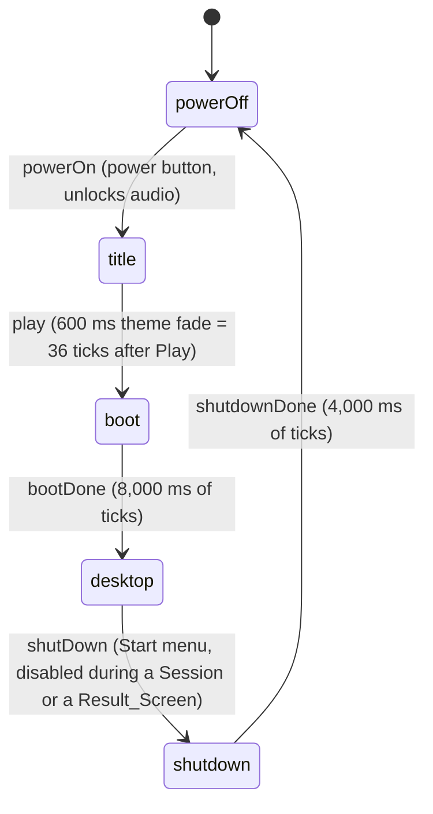

# Design Document: title-and-endings

## Overview

title-and-endings adds a front door and an exit to the game:

- a **Title_Scene** between the Power_Off_Scene and the Boot_Scene with the wordmark
  "DEAD LINE 56K", the subtitle "a Phantom 98 nightmare", a "Play game" button, an "Options"
  button and an original looping **Theme_Song** synthesized from a data table of notes;
- an **Options_Dialog** on the title screen for master volume, music, sound effects and screen
  shake, backed by a **Settings_Store** that persists to `localStorage` under
  `phantom98.settings` and falls back to defaults on any storage problem;
- **Audio_Engine** changes: a Music_Channel and an Sfx_Channel under the master gain, a volume
  scale on the master gain, and `Voice.fadeOut()`;
- **View_Prefs** handed to every Session_View, so the Lane_View can draw without screen shake
  while the simulation stays untouched;
- a **Result_Screen** overlay inside the Desktop_Scene that shows the win or lose ending for the
  Session's final state and returns the player to the idle desktop.

Every timeline in this feature (theme passes, the 600 ms theme fade, the result reveal) is
measured in fixed-loop ticks, like the boot, dial and shutdown timelines, so a hidden tab holds
everything still.

### Research notes

- **`localStorage` can fail in two places.** Reading the `window.localStorage` property can
  throw a `SecurityError` when the browser is set to block site data, and `setItem()` can throw
  a `QuotaExceededError` when storage is full or disabled (private modes in some browsers).
  Sources: [MDN Window.localStorage](https://developer.mozilla.org/en-US/docs/Web/API/Window/localStorage),
  [MDN Storage.setItem()](https://developer.mozilla.org/en-US/docs/Web/API/Storage/setItem).
  Design consequence: the Settings_Store takes a storage *getter*, wraps the getter, `getItem`
  and `setItem` in `try`/`catch`, and never lets a storage error escape. Content was rephrased
  for compliance with licensing restrictions.
- **Fading a Web Audio gain.** `linearRampToValueAtTime()` ramps from the time of the previous
  scheduled event, so a fade needs an anchor `setValueAtTime(current, now)` first; otherwise the
  ramp can start from an old event time and jump. `cancelScheduledValues()` clears later events
  first. `cancelAndHoldAtTime()` would be neater but is not available in every browser.
  Sources: [MDN linearRampToValueAtTime()](https://developer.mozilla.org/docs/Web/API/AudioParam/linearRampToValueAtTime),
  [MDN cancelAndHoldAtTime()](https://developer.mozilla.org/en-US/docs/Web/API/AudioParam/cancelAndHoldAtTime).
  Design consequence: each Voice gets its own gain node that sits at a constant 1 until a fade,
  so the fade is always "cancel, anchor at 1, ramp to 0". Content was rephrased for compliance
  with licensing restrictions.
- **`inert` for content behind an overlay.** The global `inert` attribute removes an element
  and its descendants from focus, clicks and the accessibility tree, and has been supported in
  all major browsers since 2023. Sources:
  [MDN inert](https://developer.mozilla.org/en-US/docs/Web/HTML/Reference/Global_attributes/inert),
  [web.dev: The inert attribute](https://web.dev/articles/inert). Design consequence: the
  Result_Screen covers the Screen and the Desktop_Scene also marks its other children `inert`,
  so neither a click nor the Tab key reaches the desktop behind it. Content was rephrased for
  compliance with licensing restrictions.
- **Autoplay.** The power-off scene already unlocks the Audio_Engine synchronously inside the
  power-button click (retro-shell research notes). The Scene_Director mounts the Title_Scene
  inside that same click handler, so the Theme_Song can start on mount without a second gesture.

### Design decisions

| # | Decision | Choice | Why |
|---|---|---|---|
| D1 | Title in the scene flow | New `SceneId` `'title'` and `SceneSignal` `'play'`; `powerOff --powerOn--> title --play--> boot` | The director's pure transition table stays the single place that enforces "boot only from the title" and "desktop only from the boot" (Req 1.1–1.5). `powerOn` keeps its name, so the Power_Off_Scene does not change. |
| D2 | Title input rules | A pure `TitleModel` reducer plus a thin DOM scene | "One Play, nothing while Options is open, finish exactly 600 ms after Play" can break silently, so it gets a property test without a DOM (Req 2.4, 2.5, 3.5). Same pattern as `WindowStack`. |
| D3 | Theme looping | One Voice per Theme_Pass, started when the tick count crosses a pass boundary; no new pass once Play is pressed | Req 3.2 asks for tick-measured passes. One Voice per pass keeps every recipe finite and inside its window, as the recipe rules require. |
| D4 | Theme length | 32 beats at 80 BPM: 24.000 s = exactly 1,440 ticks | The tick-measured loop and the audio pass have the same length, so there is no drift or gap at the seam (Req 3.3). |
| D5 | Fades | Engine feature: per-Voice gain node, linear ramp to 0, stop by an injected timer after the fade | Every caller gets the same click-free fade (Req 6.7). The scene measures its own 600 ms in ticks (36) before signalling `play`, and does not stop a fading Voice on unmount (Req 3.5, 3.6, 12.2). |
| D6 | Mixing graph | `voice gain → music or sfx gain → master gain → destination`; master is created first | The master gain stays `gains[0]` and keeps its 0.6 level at volume 100, so the retro-shell audio tests keep passing unchanged (Req 6.1–6.5, requirements decision 5). |
| D7 | Settings storage | `src/core/settings.ts`: pure `parseSettings` / `serializeSettings` plus a store over an injected storage getter | Pure functions get the round-trip and never-throws properties; the store gets a model-based property over failing storage (Req 5). |
| D8 | After a storage failure | Read failure → memory only for the page; write failure → keep in memory and try again on the next change | Req 5.9 says "keep later changes in memory" after a failed read. A failed write may be a full disk that frees up, so retrying costs nothing. |
| D9 | Settings → audio wiring | `bindAudioSettings(audio, store)` called in `main.ts` before `director.start()` | Req 5.11 timing. `buildSceneFactories` does not bind, so the shell-flow test's audio log still starts with `unlock` and tests opt in to the binding. |
| D10 | View_Prefs delivery | Optional `prefs` on `SessionContext`, filled by the Session from its host; default `{ screenShake: true }` | Existing fixtures that build a `SessionContext` literally keep compiling with no edits (requirements decision 8). The Session never reads `prefs`, so the Run cannot depend on it (Req 7.4). |
| D11 | Where shake is turned off | `laneShake(enabled, tick, shakeUntilTick)` in `laneEffects.ts`, used by the Lane_View draw | Effects still fold every `modemHit`, so the modem's `hit` animation, sounds and HUD are unchanged; only the canvas transform loses its offset (Req 7.2, 7.3). |
| D12 | Result_Screen hook | **On by default.** `DesktopDeps.resultScreen?: ResultScreenFactory` is a test seam only; without it the Desktop_Scene uses the real `createResultScreen` with its own `audio` and `startLoop`. `buildSceneFactories` passes nothing for it | The product requires that every win and loss shows the ending. An opt-in factory would make the desktop's default in tests differ from what ships, so tests would cover a configuration players never see. Injection stays for tests that need their own loop. This supersedes retro-shell decision 8 ("After a Run ends the desktop returns to its idle state"): the desktop is back to its usable idle state once the player closes the Result_Screen. Two existing desktop tests gain a dismiss step in their setup; their assertions are unchanged (see "Existing tests that change"). |
| D13 | Blocking the desktop | Full-Screen overlay above the Start_Menu (z-index 6) plus the `inert` attribute on the desktop's other children; the Start_Menu is closed first | Pointer and keyboard both stop at the overlay (Req 8.3). `inert` is an attribute, so jsdom tests can check it. |
| D14 | Result timing | The Result_Screen runs its own fixed loop and stops it at the reveal | Req 8.5. Nothing animates in JS after the reveal; CSS handles the static and the blinking. |
| D15 | Result statistics | Time `floor(tick / 60)` as `m:ss`; integrity through the Lane_HUD's `integrityView` (rounded up); download `floor`, clamped to 0..100 | The result and the HUD agree on integrity, and "100%" only shows for a finished download (Req 8.6). |
| D16 | Options keyboard | Escape is handled by a `document` keydown listener that exists only while the dialog is open | Same pattern as the Start_Menu; works even if focus fell to `body` after a click on the backdrop (Req 4.6, 12.2). |

## Architecture

### Module layout

```
src/
  main.ts                         + createSettingsStore, bindAudioSettings, title.css, result.css
  core/
    audio.ts                      + Channel, AudioMix, mixGains, setMix/mix, play(..., channel), Voice.fadeOut
    settings.ts                   NEW Settings, parse/serialize/normalize, createSettingsStore, bindAudioSettings
    scene.ts                      + 'title' scene id, 'play' signal, new transitions
  scenes/
    index.ts                      + title factory, settings dep, viewPrefs for the desktop
    powerOffScene.ts              comment only (power-on now leads to the title)
    title/
      titleModel.ts               NEW pure TitleModel, titleStep, THEME_FADE_TICKS
      themeScore.ts               NEW THEME_SCORE, midiHz, passSeconds, passTicks, themeSchedule, passesBetween
      themeSong.ts                NEW themeSong SoundRecipe and the four instruments
      titleCopy.ts                NEW TITLE_COPY, OPTIONS_COPY
      optionsDialog.ts            NEW createOptionsDialog
      titleScene.ts               NEW createTitleScene
    desktop/desktopScene.ts       + viewPrefs, result overlay (on by default, injectable), lifecycle
  dialup/
    session.ts                    + ViewPrefs, DEFAULT_VIEW_PREFS, SessionContext.prefs
  render/
    laneEffects.ts                + laneShake
    laneView.ts                   reads ctx.prefs, draws with laneShake
  ui/
    resultScript.ts               NEW RESULT_SCRIPT, resultModel, resultStageAt, formatRunTime
    resultCopy.ts                 NEW RESULT_COPY
    resultSounds.ts               NEW handshakeChime, modemScreech, staticHiss recipes
    resultScreen.ts               NEW createResultScreen, ResultScreenFactory
  styles/
    theme.css                     + title screen, options, result and static tokens
    title.css                     NEW
    result.css                    NEW
```

### Scene flow



Every other (scene, signal) pair leaves the scene unchanged (Req 1.7). The Title_Scene can only
be left with `play` (Req 1.6): Options, Escape and the power button raise no signal.

### Title_Scene timeline

```mermaid
sequenceDiagram
    participant P as Player
    participant T as Title_Scene
    participant M as titleStep (pure)
    participant A as Audio_Engine
    participant D as Scene_Director
    T->>A: play(themeSong, 24 s, 'music')  (pass 0, on mount)
    loop every frame
        T->>T: ticks += n; passesBetween(prev, ticks, 1440)
        T->>A: play(themeSong, 24 s, 'music') for each new pass (only while menu/options)
        T->>M: titleStep(model, ticks n)
    end
    P->>T: click Play
    T->>M: titleStep(model, play) → startFade
    T->>A: voice.fadeOut(0.6)
    Note over A: gain ramps 1 → 0 over 600 ms, stops the voice by timer
    T->>M: titleStep(model, ticks) ... after 36 ticks → finish
    T->>D: signal('play')
    D->>T: unmount (fading voice left to the engine)
    D->>D: mount Boot_Scene (crtThunk, POST beep...)
```

### Result_Screen on run end

```mermaid
sequenceDiagram
    participant S as Session
    participant DS as Desktop_Scene
    participant R as Result_Screen
    participant A as Audio_Engine
    S->>DS: onEnd(finalState)
    DS->>DS: endSession() (Lane_Dock hidden, full area, Shut Down enabled)
    DS->>DS: startMenu.close(); inert on wallpaper, icons, windows, dock, taskbar, menu
    DS->>R: resultScreen(final, closeResult).mount(scene root) (real createResultScreen unless a test injects one)
    R->>A: won: handshakeChime / lost: modemScreech + staticHiss
    loop fixed loop until reveal
        R->>R: ticks += n; resultStageAt(outcome, ticks × TICK_MS)
    end
    R->>R: reveal: headline / dialog, file, stats, Back button (focused); stop loop
    Note over R: player clicks "Back to Desktop"
    R->>DS: onClose()
    DS->>R: unmount() (stops sounds, removes elements)
    DS->>DS: remove inert; desktop idle (retro-shell decision 8 now holds from here), Dialer can Connect again
```

### Mixing graph

```
recipe nodes ─▶ voice gain (1, fades to 0) ─▶ music gain (0 | 1) ─┐
recipe nodes ─▶ voice gain (1, fades to 0) ─▶ sfx gain   (0 | 1) ─┴─▶ master gain ─▶ destination
                                                                     muted ? 0 : 0.6 × volume / 100
```

## Components and Interfaces

### `src/core/audio.ts` (changed)

```ts
export type SoundRecipe = (ac: BaseAudioContext, out: AudioNode, at: number, durationSec: number) => () => void;
export type Channel = 'music' | 'sfx';

export interface Voice {
  /** Stop now. Safe to call more than once; cancels a pending fade (Req 6.8). */
  stop(): void;
  /** Ramp this voice's gain linearly to 0 over durationSec, then stop it (Req 6.7). */
  fadeOut(durationSec: number): void;
}

/** Player volume and channel switches, as the Settings_Store knows them. */
export interface AudioMix {
  readonly volume: number;   // 0..100
  readonly music: boolean;
  readonly sfx: boolean;
}
export const DEFAULT_MIX: AudioMix;          // { volume: 100, music: true, sfx: true }
export interface Gains { readonly master: number; readonly music: number; readonly sfx: number }
/** Pure (Req 6.2–6.5). Volume is clamped to 0..100; a non-finite volume counts as 100. */
export function mixGains(mix: AudioMix, muted: boolean): Gains;

export interface AudioEngine {
  unlock(): boolean;
  isUnlocked(): boolean;
  /** `channel` defaults to 'sfx' (Req 6.1). No-op Voice while locked or unavailable. */
  play(recipe: SoundRecipe, durationSec: number, channel?: Channel): Voice;
  setMuted(muted: boolean): void;
  isMuted(): boolean;
  /** Stored at once, applied to the gains now or at unlock (Req 6.6). */
  setMix(mix: AudioMix): void;
  mix(): AudioMix;
  stopAll(): void;
  /** Stops every voice, cancels every pending fade, closes the context (Req 6.9). */
  unmount(): void;
}

export interface Timers {
  setTimeout(fn: () => void, ms: number): unknown;
  clearTimeout(handle: unknown): void;
}
export interface AudioDeps {
  readonly createContext: () => AudioContext;
  readonly visibility: { /* unchanged */ };
  /** Defaults to globalThis.setTimeout / clearTimeout. Tests inject fakes. */
  readonly timers: Timers;
}
export const MASTER_GAIN = 0.6;   // unchanged
```

- `mixGains`: `master = muted ? 0 : MASTER_GAIN × clamp(volume, 0, 100) / 100`;
  `music = mix.music ? 1 : 0`; `sfx = mix.sfx ? 1 : 0`.
- `unlock()` builds, in this order, `master` (connected to `destination`), `musicBus` and `sfxBus`
  (both connected to `master`), then applies `mixGains(currentMix, muted)` by assigning
  `gain.value` on all three (Req 6.6). `master` stays the first gain node created, so retro-shell
  tests that read `fake.gains[0]` keep working.
- `setMix(mix)` and `setMuted(m)` store the value and, once unlocked, re-assign the three gain
  values at once (Req 4.5: same input event).
- `play(recipe, d, channel = 'sfx')`: creates a `voiceGain` (value 1) connected to the chosen bus
  and calls `recipe(ctx, voiceGain, at, d)`. `stop()` runs the recipe's stop function, then
  disconnects `voiceGain`. A recipe that throws still returns the no-op Voice, and the
  `voiceGain` is disconnected.
- `fadeOut(d)`: ignored if the Voice is stopped or already fading. If `d` is not a positive
  finite number, the Voice stops at once. Otherwise:
  `g.cancelScheduledValues(now); g.setValueAtTime(g.value, now); g.linearRampToValueAtTime(0, now + d)`
  on `voiceGain.gain`, and `timers.setTimeout(() => voice.stop(), d × 1000)`. The handle is kept
  in a `fades` map; `stop()` clears it (Req 6.8); `stopAll()` and `unmount()` clear every handle
  and stop every Voice (Req 6.9).
- Pruning of finished voices on `play` skips voices with a pending fade, so their timer is always
  reachable from `stopAll()`.
- While the page is hidden the context is suspended but the timer still runs, so a fade that
  spans a hide can stop its Voice early. The Voice is already on its way to silence, so nothing
  audible changes.
- `NOOP_VOICE.fadeOut` does nothing (Req 3.9).

### `src/core/settings.ts` (new)

```ts
export interface Settings {
  readonly masterVolume: number;    // integer 0..100
  readonly musicEnabled: boolean;
  readonly sfxEnabled: boolean;
  readonly screenShake: boolean;
}
export const SETTINGS_VERSION = 1;
export const STORAGE_KEY = 'phantom98.settings';
export const DEFAULT_SETTINGS: Settings;   // frozen { 100, true, true, true }
export const VOLUME_STEP = 10;

/** Round to the nearest integer and clamp to 0..100; non-finite → 100; never returns -0 (Req 5.7, 5.8). */
export function normalizeVolume(value: number): number;
/** Slider value (string or number) → nearest multiple of VOLUME_STEP in 0..100 (Req 4.3). */
export function volumeFromSlider(raw: string | number): number;
export function isValidSettings(value: unknown): value is Settings;
/** JSON with the version first: {"v":1,"masterVolume":..,"musicEnabled":..,"sfxEnabled":..,"screenShake":..} */
export function serializeSettings(settings: Settings): string;
/** Never throws. null → defaults; bad JSON, non-object or v ≠ 1 → defaults; per-field fallback (Req 5.4–5.8). */
export function parseSettings(raw: string | null): Settings;
/** Applies a patch field by field with the same rules; a field of the wrong type keeps `current`'s value. */
export function mergeSettings(current: Settings, patch: Partial<Settings>): Settings;
export function mixOf(settings: Settings): AudioMix;

export type StorageLike = Pick<Storage, 'getItem' | 'setItem'>;
export interface SettingsDeps {
  /** Defaults to () => globalThis.localStorage. May return null/undefined or throw. */
  readonly storage?: () => StorageLike | null | undefined;
  /** Defaults to console.warn. Called at most once per store. */
  readonly warn?: (message: string, error: unknown) => void;
}
export type SettingsListener = (settings: Settings) => void;
export interface SettingsStore {
  get(): Settings;
  /** Merges, and when anything changed: writes (unless memory-only) and notifies synchronously. */
  update(patch: Partial<Settings>): Settings;
  subscribe(listener: SettingsListener): () => void;
  /** False after a failed or impossible read (Req 5.9). */
  isPersistent(): boolean;
}
export function createSettingsStore(deps?: SettingsDeps): SettingsStore;
/** Applies store.get() now and on every change; returns the unsubscribe function (Req 4.5, 5.11). */
export function bindAudioSettings(audio: Pick<AudioEngine, 'setMix'>, store: SettingsStore): () => void;
```

`parseSettings` rules, in order:

1. `raw === null` → `DEFAULT_SETTINGS` (Req 5.4).
2. `JSON.parse` throws, or the result is not a plain object (null, array, number, string,
   boolean), or its `v` is not exactly the number `1` (missing counts as "other") →
   `DEFAULT_SETTINGS` (Req 5.5).
3. Per field: `masterVolume` of type `number` → `normalizeVolume(value)` (Req 5.7, 5.8: a
   non-finite number cannot come out of `JSON.parse`, but `normalizeVolume` handles it for
   `mergeSettings`); any other type or missing → default. The three flags: `boolean` → kept,
   anything else → default (Req 5.6). Unknown fields are ignored.

`createSettingsStore`:

- On creation: call the getter inside `try`. A throw, `null` or `undefined` → memory only,
  `DEFAULT_SETTINGS`. Else `getItem(STORAGE_KEY)` inside `try`; a throw → memory only, defaults;
  otherwise `parseSettings(raw)` (Req 5.1, 5.4, 5.9). A failed read calls `warn` once.
- `update(patch)`: `next = mergeSettings(current, patch)`; if every field is equal, return
  `current` without writing or notifying. Else set `current = next`; unless memory only,
  `setItem(STORAGE_KEY, serializeSettings(next))` inside `try` (a throw calls `warn` once and the
  store stays persistent, Req 5.2, 5.10); then call every listener in subscription order, each in
  its own `try`/`catch` with `console.error`, so one broken listener does not block the audio
  binding.
- The store never writes the defaults on creation; the key only appears after the first change.

### `src/core/scene.ts` (changed)

```ts
export type SceneId = 'powerOff' | 'title' | 'boot' | 'desktop' | 'shutdown';
export type SceneSignal = 'powerOn' | 'play' | 'bootDone' | 'shutDown' | 'shutdownDone';

const TRANSITIONS = {
  powerOff: { powerOn: 'title' },     // Req 1.1 (was 'boot': retro-shell Req 1.2)
  title: { play: 'boot' },            // Req 1.2
  boot: { bootDone: 'desktop' },
  desktop: { shutDown: 'shutdown' },
  shutdown: { shutdownDone: 'powerOff' },   // Req 1.8
};
```

The director code does not change. The doc comments move from "four" to "five" scenes.

### `src/scenes/title/titleModel.ts` (new, pure)

```ts
export const THEME_FADE_MS = 600;
export const THEME_FADE_TICKS: number;   // Math.round(THEME_FADE_MS / TICK_MS) = 36
export type TitleMode = 'menu' | 'options' | 'fading' | 'done';
export interface TitleModel { readonly mode: TitleMode; readonly fadeTicksLeft: number }
export const INITIAL_TITLE: TitleModel;  // { mode: 'menu', fadeTicksLeft: 0 }
export type TitleAction =
  | { readonly type: 'play' }
  | { readonly type: 'openOptions' }
  | { readonly type: 'closeOptions' }
  | { readonly type: 'ticks'; readonly n: number };
export type TitleEffect = 'openOptions' | 'closeOptions' | 'startFade' | 'finish';
export interface TitleStepResult { readonly model: TitleModel; readonly effects: readonly TitleEffect[] }
export function titleStep(model: TitleModel, action: TitleAction): TitleStepResult;
```

| Mode | Action | Result |
|---|---|---|
| menu | play | `fading`, `fadeTicksLeft = THEME_FADE_TICKS`, effect `startFade` (Req 3.5) |
| menu | openOptions | `options`, effect `openOptions` (Req 4.1) |
| options | closeOptions | `menu`, effect `closeOptions` (Req 4.6) |
| options | play | unchanged, no effect (Req 2.5) |
| fading | ticks n > 0 | `fadeTicksLeft -= n`; at ≤ 0 → `done`, effect `finish` |
| fading, done | play, openOptions, closeOptions | unchanged, no effect (Req 2.4) |
| any | anything else (ticks in menu/options, n ≤ 0 or non-finite) | unchanged, no effect |

`finish` is the only effect that leads to `signal('play')` (Req 1.6).

### `src/scenes/title/themeScore.ts` (new, pure data and maths)

```ts
export type ThemeInstrument = 'bass' | 'pad' | 'bell' | 'lead';
export interface ThemeNote {
  readonly beat: number;     // start, in beats from the pass start
  readonly beats: number;    // length in beats, > 0
  readonly midi: number;     // pitch as a MIDI note number
  readonly instrument: ThemeInstrument;
}
export interface ThemeScore { readonly bpm: number; readonly passBeats: number; readonly notes: readonly ThemeNote[] }
export const THEME_SCORE: ThemeScore;                       // 80 BPM, 32 beats
export function midiHz(midi: number): number;               // 440 × 2^((midi − 69) / 12)
export function passSeconds(score: ThemeScore): number;     // passBeats × 60 / bpm = 24
export function passTicks(score: ThemeScore): number;       // round(passSeconds × TICK_RATE) = 1440
export interface ScheduledNote { readonly instrument: ThemeInstrument; readonly hz: number; readonly start: number; readonly end: number }
/**
 * Pure (Req 3.4): note times in seconds from the start of a pass played for durationSec.
 * Notes starting at or after durationSec are dropped, later ends are clipped to durationSec, and
 * notes left with start ≥ end are dropped. Non-finite or non-positive durations give [].
 */
export function themeSchedule(score: ThemeScore, durationSec: number): readonly ScheduledNote[];
/** Pass indices k ≥ 1 with prevTicks < k × passTicks ≤ nowTicks, ascending (Req 3.2). */
export function passesBetween(prevTicks: number, nowTicks: number, passTicks: number): readonly number[];
```

**Theme_Score.** Original, in D minor, 80 BPM, 4/4, eight bars (one bar = 4 beats = 3 s). Four
bars of music box over a slow chord pad, then a theremin melody enters for four bars and the
pass loops. Bar 7 moves to E♭ major, a tritone away from the A major that follows, which is
where the creepiness comes from. The tune is written for this game and quotes no existing music.

| Bar | Beats | Chord | Bass (beat 0 and 2, 1.5 beats each) | Pad (whole bar) | Bell (beats 0–3, 1 beat each) |
|---|---|---|---|---|---|
| 1 | 0–4 | Dm | 38 | 50 53 57 | 62 65 69 65 |
| 2 | 4–8 | B♭ | 34 | 50 53 58 | 62 65 70 65 |
| 3 | 8–12 | Gm | 43 | 50 55 58 | 62 67 70 67 |
| 4 | 12–16 | A | 45 | 49 52 57 | 61 64 69 64 |
| 5 | 16–20 | Dm | 38 | 50 53 57 | 62 65 69 65 |
| 6 | 20–24 | B♭ | 34 | 50 53 58 | 62 65 70 65 |
| 7 | 24–28 | E♭ | 39 | 51 55 58 | 63 67 70 67 |
| 8 | 28–32 | A | 45 | 49 52 57 | 61 64 69 64 |

Lead (theremin) in bars 5–8:

| Beat | Beats | MIDI | Note |
|---|---|---|---|
| 16 | 2 | 69 | A4 |
| 18 | 1 | 74 | D5 |
| 19 | 1 | 73 | C♯5 |
| 20 | 1 | 74 | D5 |
| 21 | 1 | 77 | F5 |
| 22 | 1 | 76 | E5 |
| 23 | 1 | 74 | D5 |
| 24 | 1.5 | 79 | G5 |
| 25.5 | 0.5 | 77 | F5 |
| 26 | 2 | 75 | E♭5 |
| 28 | 1 | 73 | C♯5 |
| 29 | 1 | 76 | E5 |
| 30 | 2 | 69 | A4 |

That is 16 bass + 24 pad + 32 bell + 13 lead = 85 notes. `THEME_SCORE.notes` is a frozen flat
array; the source may build it with small `bar()` / `arp()` helpers at module load, but the
result is plain data sorted by `beat`, then instrument order bass, pad, bell, lead.

### `src/scenes/title/themeSong.ts` (new)

```ts
export const THEME_PASS_SEC: number;   // passTicks(THEME_SCORE) / TICK_RATE = 24
/** Plays themeSchedule(THEME_SCORE, d) into `out` (Req 3.1, 3.4, 3.8). */
export const themeSong: SoundRecipe;
```

Built with `src/core/soundKit.ts` and following its recipe rules (everything inside
`[at, at + d]`, one `outputGain(g, out, at, d, 1, 0.02)` that fades in and out, summed peak well
below 1, `return g.finish()`):

| Instrument | Synthesis | Peak |
|---|---|---|
| bass | triangle oscillator, `pluck` envelope (10 ms attack, exponential decay to the note end) | 0.16 |
| pad | two sawtooth oscillators detuned ±7 cents, through one shared low-pass at 900 Hz (Q 0.7), `hold` envelope with 0.3 s fades | 0.03 each |
| bell | sine at f plus sine at 2.76 f at 0.35 of the level (a music-box partial), `pluck` with 3 ms attack | 0.07 |
| lead | sine at f with a 5.5 Hz sine LFO into its frequency (depth f × 0.006), `hold` envelope with 80 ms fades | 0.08 |

Worst-case sum (one bass, three pad pairs, one bell, one lead) is about 0.5 before the master
gain. No noise, no files (Req 3.8). The pass is about 200 nodes, scheduled once per 24 s.

### `src/scenes/title/titleCopy.ts` (new)

```ts
export const TITLE_COPY = {
  wordmark: 'DEAD LINE 56K',
  subtitle: 'a Phantom 98 nightmare',
  play: 'Play game',
  options: 'Options',
  hint: 'Best viewed at 1024x768 with the lights off.',
  copyright: '(C) 1998 Graveyard Shift Software. All souls reserved.',
} as const;

export const OPTIONS_COPY = {
  title: 'Options',
  close: 'Close',
  volume: 'Master volume:',
  percentSuffix: '%',
  music: 'Music',
  sfx: 'Sound effects',
  shake: 'Screen shake',
  note: 'Changes take effect immediately.',
  ok: 'OK',
} as const;
```

Wordmark and subtitle are the placeholder from requirements decision 1; they live only here.

### `src/scenes/title/optionsDialog.ts` (new)

```ts
export interface OptionsDialogDeps {
  readonly settings: Pick<SettingsStore, 'get' | 'update'>;
  readonly onClose: () => void;    // OK, ✕ or Escape (Req 4.6)
}
export function createOptionsDialog(deps: OptionsDialogDeps): Mountable;
```

DOM (built with `h()`, text through text nodes):

```
div.options-backdrop
  div.window.is-active.options-dialog  role="dialog" aria-modal="true" aria-labelledby="options-title"
    div.title-bar > span.title-bar-text#options-title "Options"
                  + div.title-bar-controls > button.title-bar-button.title-bar-close aria-label="Close" "✕"
    div.window-body
      div.options-row > label[for=options-volume] "Master volume:"
                      + input#options-volume type=range min=0 max=100 step=10
                      + span.options-volume-value "80%"
      label.options-check > input[type=checkbox][data-setting=musicEnabled] + "Music"
      label.options-check > input[type=checkbox][data-setting=sfxEnabled]   + "Sound effects"
      label.options-check > input[type=checkbox][data-setting=screenShake]  + "Screen shake"
      p.options-note "Changes take effect immediately."
      div.options-buttons > button.btn.btn-default "OK"
```

- Mount reads `settings.get()` into the controls (Req 4.1) and focuses the slider (Req 4.2).
- Slider `input` event → `settings.update({ masterVolume: volumeFromSlider(slider.value) })`,
  then the value label and `aria-valuetext` show `${masterVolume}%` from the returned Settings
  (Req 4.3). A stored value that is not a multiple of 10 (hand-edited storage) is shown as stored
  until the slider moves.
- Checkbox `change` → `settings.update({ [key]: checkbox.checked })` (Req 4.4).
- Audio follows within the same event because `bindAudioSettings` is a synchronous listener
  (Req 4.5).
- A `keydown` listener on `document` exists only while mounted: Escape → `onClose()` (Req 4.6).
- Unmount removes the `document` listener and the elements (Req 12.2). Element listeners go with
  the elements.

### `src/scenes/title/titleScene.ts` (new)

```ts
export interface TitleDeps {
  readonly audio: Pick<AudioEngine, 'play'>;
  readonly settings: Pick<SettingsStore, 'get' | 'update'>;
  readonly signal: SignalFn;
  /** Defaults to startFixedLoop. Tests pass a manual loop. */
  readonly startLoop?: LoopStarter;
}
export function createTitleScene(deps: TitleDeps): Scene;
```

DOM (contract for `title.css`):

```
div.scene.scene-title.crt-on
  div.title-night  aria-hidden="true"      moon, two telephone poles and a sagging wire (CSS only)
  div.title-card
    h1.title-wordmark  data-text="DEAD LINE 56K"  "DEAD LINE 56K"
    p.title-subtitle   "a Phantom 98 nightmare"
    div.title-menu
      button.btn.title-button.title-play     type=button  "Play game"
      button.btn.title-button.title-options  type=button  "Options"
    p.title-hint       "Best viewed at 1024x768 with the lights off."
    p.title-copyright  "(C) 1998 Graveyard Shift Software. All souls reserved."
  (Options_Dialog mounts here while open)
```

- **mount**: builds the DOM, appends it, focuses `.title-play` (Req 2.1, 2.2), plays pass 0 with
  `audio.play(themeSong, THEME_PASS_SEC, 'music')` (Req 3.1), starts the loop.
- **Buttons** are native `<button type="button">`, so the browser turns Enter and Space on a
  focused button into `click` (Req 2.3). `click` on Play → `dispatch({ type: 'play' })`; on
  Options → `dispatch({ type: 'openOptions' })`.
- **dispatch(action)** runs `titleStep` and applies the effects:
  - `openOptions`: mount `createOptionsDialog({ settings, onClose })` into the scene, set the
    `inert` attribute on `.title-menu` (Req 2.5 on top of the model rule).
  - `closeOptions`: unmount the dialog, remove `inert`, focus `.title-options` (Req 4.6).
  - `startFade`: `theme.fadeOut(THEME_FADE_MS / 1000)` and mark the theme Voice as handed off
    (Req 3.5, 3.6).
  - `finish`: stop the loop and call `signal('play')`; nothing runs after that call.
- **onTicks(n)**: if `n > 0`, `ticks += n`; while the mode is `menu` or `options`, start one new
  pass Voice for each index in `passesBetween(prev, ticks, passTicks(THEME_SCORE))` (Req 3.2,
  4.7); then `dispatch({ type: 'ticks', n })`.
- The power button stays inert: the Power_Off_Scene cleared the handler on unmount and the
  Title_Scene never sets one (Req 2.6).
- **unmount**: stop the loop, unmount the dialog if open, stop the theme Voice unless it was
  handed off to a fade (Req 3.7, 12.2), remove the elements.
- If audio is unavailable every `play` returns the no-op Voice and the scene works the same
  (Req 3.9).

### `src/scenes/index.ts` (changed)

```ts
export interface ShellDeps {
  readonly monitor: Monitor;
  readonly audio: AudioEngine;
  readonly startLoop?: LoopStarter;
  readonly seedSource?: () => number;
  readonly registry?: SessionRegistry;
  /** Defaults to a memory-only store (storage getter returns null). main.ts passes the real one. */
  readonly settings?: SettingsStore;
}
export function buildSceneFactories(deps: ShellDeps): SceneFactories;
//   powerOff: unchanged
//   title:    (signal) => createTitleScene({ audio, settings, signal, startLoop })
//   boot:     unchanged
//   desktop:  (signal) => createDesktopScene({ ..., viewPrefs: () => ({ screenShake: settings.get().screenShake }) })
//   shutdown: unchanged
```

The desktop factory passes no `resultScreen`: the Desktop_Scene shows the real Result_Screen by
default (D12), built from the `audio` and `startLoop` it already receives.

### `src/main.ts` (changed)

```ts
import './styles/title.css';
import './styles/result.css';
const settings = createSettingsStore();
const audio = createAudioEngine();
bindAudioSettings(audio, settings);                 // before the first scene mounts (Req 5.11)
const director = createSceneDirector(monitor.screen, buildSceneFactories({ monitor, audio, settings }));
director.start();
```

The HMR dispose also calls the unbind function returned by `bindAudioSettings`.

### `src/dialup/session.ts` (changed)

```ts
/** Read-only display preferences, fixed for the length of one Session (Req 7.1). */
export interface ViewPrefs { readonly screenShake: boolean }
export const DEFAULT_VIEW_PREFS: ViewPrefs;           // frozen { screenShake: true }

export interface SessionContext {
  // ...unchanged fields...
  /** Always set by createSession (from the host, else DEFAULT_VIEW_PREFS). Optional for fixtures. */
  readonly prefs?: ViewPrefs;
}
// Session.start(host: Omit<SessionContext, 'send'>): ctx.prefs = host.prefs ?? DEFAULT_VIEW_PREFS
```

`advanceTicks`, the input queue and `onEnd` do not read `prefs` (Req 7.4).

### `src/render/laneEffects.ts` and `laneView.ts` (changed)

```ts
/** Pure (Req 7.2, 7.3): shakeOffset(tick, shakeUntilTick) when enabled, else { dx: 0, dy: 0 }. */
export function laneShake(enabled: boolean, tick: number, shakeUntilTick: number): { dx: number; dy: number };
```

The Lane_View stores `ctx.prefs?.screenShake ?? true` at mount and its draw step calls
`laneShake(shakeEnabled, tick, effects.shakeUntilTick)` where it called `shakeOffset` before.
`applyEvents`, the modem `hit` animation, the HUD and the sounds are unchanged.

### `src/scenes/desktop/desktopScene.ts` (changed)

```ts
export interface DesktopDeps {
  // ...unchanged fields...
  /** Read once per Session start (requirements decision 3). Defaults to () => DEFAULT_VIEW_PREFS. */
  readonly viewPrefs?: () => ViewPrefs;
  /**
   * Test seam only (D12). Defaults to the real Result_Screen:
   * (final, onClose) => createResultScreen({ final, audio, startLoop: deps.startLoop, onClose }).
   */
  readonly resultScreen?: ResultScreenFactory;
}
```

- `createDesktopScene` resolves `const resultScreen = deps.resultScreen ?? defaultResultScreen`
  once, so every Run that ends shows a Result_Screen whether or not a factory was injected.
- `startSession()`: returns early while a Result_Screen is shown (Req 8.4); passes
  `prefs: viewPrefs()` in `s.start(...)` (Req 7.1); `onEnd: (final) => onRunEnd(final)`.
- `onRunEnd(final)`: `endSession()` first (Req 8.1: Session stopped, Lane_Dock hidden, full
  Desktop_Area), then, if `resultModel(final)` is not `null`, `showResult(final)`. The `null`
  check only guards a Session that reports a phase other than `won` or `lost`.
- `showResult(final)`: `startMenu.close()`; set the `inert` attribute on every current child of
  the scene root; create `resultScreen(final, closeResult)` and mount it into the scene root,
  where it is the last child and covers the Screen (Req 8.1, 8.3).
- `closeResult()`: unmount the Result_Screen (stops its sounds, Req 11.2), remove `inert` from
  the children. The Dialer, icons and taskbar work again (Req 11.3).
- `onChoose('shutDown')` also returns early while a Result_Screen is shown.
- `unmount()`: unmount the Result_Screen first if one is shown (Req 11.4), then as before.
- The file header comment drops "Result screens come in a later milestone" and says that a Run's
  end always shows the Result_Screen, and that the desktop is idle again once it closes.

### `src/ui/resultScript.ts` (new, pure)

```ts
export type Outcome = 'won' | 'lost';
export type ResultStage = 'intro' | 'reveal';
export interface ResultScript { readonly won: { readonly revealMs: number }; readonly lost: { readonly revealMs: number } }
export const RESULT_SCRIPT: ResultScript;   // won 1,200 ms, lost 1,500 ms (Req 9.3, 10.3)

export interface ResultModel {
  readonly outcome: Outcome;
  readonly timeText: string;          // "2:31"
  readonly integrityText: string;     // integrityView(final).percentText, e.g. "0%"
  readonly downloadPercent: number;   // integer 0..100
  readonly downloadText: string;      // "37%"
}
/** Pure (Req 8.2, 8.6). Outcome from final.phase only; null unless the phase is won or lost. */
export function resultModel(final: GameState): ResultModel | null;
/** "m:ss" from floor(ticks / TICK_RATE) seconds; negative or non-finite → "0:00". */
export function formatRunTime(ticks: number): string;
/** 'reveal' exactly when elapsedMs ≥ script[outcome].revealMs (Req 9.2, 10.2). */
export function resultStageAt(outcome: Outcome, elapsedMs: number, script?: ResultScript): ResultStage;
```

`downloadPercent = Math.floor(clamp(final.download, 0, 100))`. Minutes are not padded and grow
past 59 (`61:05`); seconds are always two digits.

### `src/ui/resultCopy.ts` (new)

Follows `retro-copy`: dry dialog text, late-90s filenames, horror leaking through the boring
parts.

```ts
export const RESULT_COPY = {
  stats: { time: 'Session time:', integrity: 'Modem integrity:', download: 'Downloaded:' },
  back: 'Back to Desktop',
  percentSuffix: '%',
  won: {
    windowTitle: 'Download Complete',
    status: 'Download complete',
    savedTo: 'Saved to C:\\DOWNLOADS\\',
    headline: 'Welcome to the Internet!',
    file: 'funny_cats_1998.avi',
    fileNote: '2,048 KB received. No bite marks found.',
  },
  lost: {
    staticText: 'NO CARRIER',
    windowTitle: 'Connection Terminated',
    message: 'The connection was terminated by the remote computer.',
    file: 'SKELETON_DATING_SIM.EXE',
    fileNote: 'Estimated time left: forever',
  },
} as const;
```

### `src/ui/resultSounds.ts` (new)

```ts
export type ResultSoundId = 'handshakeChime' | 'modemScreech' | 'staticHiss';
export const RESULT_SOUND_SEC: Readonly<Record<ResultSoundId, number>>;  // 1.6, 1.2, 1.5
export const RESULT_SOUNDS: Readonly<Record<ResultSoundId, SoundRecipe>>;
/** won → ['handshakeChime']; lost → ['modemScreech', 'staticHiss'] (Req 9.1, 10.1). */
export function resultSoundsFor(outcome: Outcome): readonly ResultSoundId[];
```

All three follow the `soundKit.ts` recipe rules and use only oscillators, filters, gains and
seeded noise (Req 12.6):

| Recipe | Synthesis |
|---|---|
| handshakeChime | Two short sine blips at 1,200 and 2,400 Hz (the "carrier locked" beep), then an original rising D major arpeggio D5–F♯5–A5–D6, 110 ms apart, each a sine plus a 2.76 × partial with a long `pluck` decay. Written for this game; imitates no real OS sound. |
| modemScreech | Two sawtooth oscillators 9 cents apart sweeping exponentially from 3,200 to 400 Hz, a 23 Hz square LFO into their frequency for the warble, through a 1,800 Hz band-pass (Q 2), plus band-passed seeded noise. |
| staticHiss | Seeded noise through a 1,500 Hz high-pass; the output level jumps every 30 ms to a value from a seeded `mulberry32` stream for crackle, inside the recipe's fade in and out. |

`staticHiss` lasts 1.5 s, the same as the lose reveal, so the noise ends with the static effect.

### `src/ui/resultScreen.ts` (new)

```ts
export type ResultScreenFactory = (final: GameState, onClose: () => void) => Mountable;
export interface ResultScreenDeps {
  readonly final: GameState;
  readonly audio: Pick<AudioEngine, 'play'>;
  readonly onClose: () => void;
  readonly startLoop?: LoopStarter;   // default startFixedLoop
  readonly script?: ResultScript;     // default RESULT_SCRIPT
}
export function createResultScreen(deps: ResultScreenDeps): Mountable;
```

DOM (contract for `result.css`):

```
div.result-screen.is-won|is-lost  role="dialog" aria-modal="true" aria-labelledby="result-title"
  div.result-static  aria-hidden="true"     (lost only; hidden at the reveal)
    span.result-static-text "NO CARRIER"
  div.window.is-active.result-window
    div.title-bar > span.title-bar-text#result-title  ("Download Complete" | "Connection Terminated")
    div.window-body
      won:  p.result-status "Download complete"
            div.result-bar > div.result-bar-fill (style.width "100%") + span.result-bar-text "100%"
            p.result-detail "Saved to C:\DOWNLOADS\"
      lost: p.result-message "The connection was terminated by the remote computer."  (reveal)
            div.result-bar (fill width = downloadPercent %) + span "37%"                (reveal)
      reveal (both):
            h2.result-headline "Welcome to the Internet!"                               (won only)
            div.result-file > iconEl('file') + span.result-file-name + span.result-file-note
            dl.result-stats > (dt + dd) × 3
            div.result-buttons > button.btn.btn-default.result-back "Back to Desktop"
```

- **mount**: `model = resultModel(final)`; builds the DOM for the `intro` stage, appends it,
  plays `resultSoundsFor(model.outcome)` on the Sfx_Channel (Req 9.1, 10.1), starts the loop.
  For `lost`, the window is `hidden` during the intro and only the static shows (Req 10.1).
- **onTicks(n)**: `ticks += n`; when `resultStageAt(outcome, ticks × TICK_MS)` turns `reveal`:
  show the reveal parts (Req 9.2, 10.2), hide the static, stop the loop, focus `.result-back`
  (Req 11.1). Zero-tick frames do nothing.
- **Back** `click` → `onClose()`. The Desktop_Scene then unmounts this component.
- **unmount**: stop the loop, stop every Voice it started, remove its elements (Req 11.2, 11.4,
  12.2). It adds no `document` or `window` listeners.
- Stats `dd` text: `model.timeText`, `model.integrityText`, `model.downloadText` (Req 8.6).

### Styles

New tokens in `theme.css` (every colour lives there, Req 12.5). Names use `titlescreen` so they
do not clash with the existing window `--c-title-*` tokens.

| Token | Value | Use |
|---|---|---|
| `--c-titlescreen-sky-top` | `#030206` | night gradient |
| `--c-titlescreen-sky-bottom` | `#160a24` | night gradient |
| `--c-titlescreen-moon` | `rgba(232, 220, 138, 0.22)` | moon disc |
| `--c-titlescreen-pole` | `#0d0a08` | pole and crossbar silhouettes |
| `--c-titlescreen-wire` | `#000000` | sagging wire |
| `--c-titlescreen-wordmark` | `#9fe8a8` | phosphor green wordmark |
| `--c-titlescreen-wordmark-glow` | `rgba(109, 255, 122, 0.55)` | text-shadow |
| `--c-titlescreen-wordmark-ghost` | `rgba(255, 59, 59, 0.55)` | red glitch copy (`::after` with `attr(data-text)`) |
| `--c-titlescreen-subtitle` | `#b9a3d6` | subtitle |
| `--c-titlescreen-hint` | `#6f667c` | hint and copyright |
| `--c-options-backdrop` | `rgba(0, 0, 0, 0.45)` | dims the title behind the dialog |
| `--c-result-backdrop` | `rgba(4, 10, 10, 0.7)` | darkens the desktop behind the window |
| `--c-result-headline` | `#3b1458` | win headline |
| `--c-result-bar-fill` | `#3b1458` | download bar |
| `--c-static-light` | `#d8d8d8` | static grain |
| `--c-static-dark` | `#1a1a1a` | static grain |
| `--c-static-text` | `#f2f2f2` | NO CARRIER |

- `title.css`: `.scene-title` fills the Screen with the night gradient; `.title-night` draws the
  moon, two poles and a wire with borders and gradients (no images); the wordmark uses
  `--font-bios` at 96 px with a glow and a 4 s flicker animation, plus a red ghost copy offset by
  2 px that jitters for 120 ms every few seconds; the subtitle uses `--font-wordmark` in italics;
  the two buttons are 180 × 32 px chrome buttons stacked under the subtitle; `.options-backdrop`
  covers the Screen and centres the 320 px dialog.
- `result.css`: `.result-screen` is `position: absolute; inset: 0; z-index: 6` (the Start_Menu
  is 5) over the whole Screen including the Taskbar, with the result backdrop; `.result-window`
  is a 420 px centred window reusing the desktop chrome classes; `.result-static` layers
  repeating gradients of the two static tokens and moves them with a `steps(6)` animation at
  80 ms per step, with "NO CARRIER" blinking in the middle.
- Both files add `@media (prefers-reduced-motion: reduce)` blocks that stop the flicker, the
  jitter and the static movement (a still noise frame stays).
- `crt-on` on the title root reuses the existing keyframes in `monitor.css` (Req 2.1).

## Data Models

| Model | Shape | Invariants |
|---|---|---|
| `Settings` | `{ masterVolume, musicEnabled, sfxEnabled, screenShake }` | `masterVolume` is an integer in 0..100 (never `-0`); flags are booleans. Every value the store returns passes `isValidSettings`. |
| Stored settings | `{"v":1,"masterVolume":70,"musicEnabled":true,"sfxEnabled":true,"screenShake":false}` under `phantom98.settings` | `v` is `SETTINGS_VERSION` (1). Written only after a change. Any other `v` reads as the defaults. |
| `AudioMix` | `{ volume, music, sfx }` | Derived from Settings by `mixOf`; held by the engine. |
| `Gains` | `{ master, music, sfx }` | `0 ≤ master ≤ MASTER_GAIN`; `music`, `sfx` ∈ {0, 1}; `master = 0` while muted. |
| `ViewPrefs` | `{ screenShake }` | Read once at Session start; never in `GameState`. |
| `ThemeScore` | `{ bpm: 80, passBeats: 32, notes }` | Every note has `beats > 0`, `0 ≤ beat` and `beat + beats ≤ passBeats`; `passSeconds` in [16, 32]. |
| `ScheduledNote` | `{ instrument, hz, start, end }` seconds | `0 ≤ start < end ≤ durationSec`. |
| `TitleModel` | `{ mode, fadeTicksLeft }` | `fadeTicksLeft > 0` only in `fading`; `done` is final. |
| `ResultScript` | `{ won: { revealMs: 1200 }, lost: { revealMs: 1500 } }` | `revealMs > 0`. |
| `ResultModel` | `{ outcome, timeText, integrityText, downloadPercent, downloadText }` | Derived from the Final_State; `downloadPercent` integer 0..100. |
| Copy modules | `TITLE_COPY`, `OPTIONS_COPY`, `RESULT_COPY` | All new in-game text; scanned by the trademark test. |

UI-only state (dialog open, theme Voice, fade handed off, tick counters, reveal shown, result
Voices) lives in component closures, never in `GameState` or the Settings.

## Correctness Properties

*A property is a characteristic or behavior that should hold true across all valid executions of a system-essentially, a formal statement about what the system should do. Properties serve as the bridge between human-readable specifications and machine-verifiable correctness guarantees.*

PBT fits the pure parts of this feature: the scene transition table, the title input model, the
theme timing maths, settings parsing and storage, the gain mapping, the shake switch, the result
model and the result timeline. DOM structure, CSS, focus and how the music sounds are covered by
example tests and the playtester.

Reflection after the prework: the scene criteria 1.1–1.5 and 1.7 are one fold over signal
sequences, which extends retro-shell Property 1 in place. Criteria 1.6, 2.4, 2.5 and 3.5 are all
rules of the title model and become one action-sequence property. The parse criteria 5.4–5.6
share one property with a per-field oracle; 5.7 and 5.8 are about `normalizeVolume` itself and
join 4.3's slider snapping in a separate property because they test a different function. The
store criteria 5.1, 5.2, 5.9 and 5.10 are one model-based property over storage behaviours. The
gain criteria 6.2–6.6 are one engine-sequence property, since `mixGains` alone would not catch a
missed re-apply at unlock. 7.2 and 7.3 are both cases of one `laneShake` property. The result
timing criteria 8.5, 9.2 and 10.2 are one timeline property; 8.2 and 8.6 are one result-model
property. The round trip (5.3) stays separate from parsing, as the serializer rule asks.

### Property 1: The scene flow passes through the title screen

*For any* sequence of scene signals applied with `nextScene` (and to a director with logging
scene factories) starting from `powerOff`, every scene change is one of the five table entries,
every transition into `title` comes from `powerOff`, every transition into `boot` comes from
`title`, every transition into `desktop` comes from `boot`, and every other (scene, signal) pair
leaves the scene unchanged.

**Validates: Requirements 1.1, 1.2, 1.3, 1.4, 1.5, 1.7**

### Property 2: The title screen starts the game exactly once, 600 ms after Play

*For any* sequence of title actions (`play`, `openOptions`, `closeOptions`, `ticks n` with
`n` from 0 to 20) folded with `titleStep` from `INITIAL_TITLE`: `startFade` is emitted at most
once and only for a `play` received in `menu` mode; a `play` received in `options` mode changes
nothing; after `startFade` no action other than `ticks` changes the model; `finish` is emitted at
most once, only after `startFade`, and exactly on the action at which the ticks summed since
`startFade` first reach `THEME_FADE_TICKS` (36).

**Validates: Requirements 1.6, 2.4, 2.5, 3.5**

### Property 3: Every theme pass starts once, at its boundary

*For any* pass length `p ≥ 1` and any non-decreasing sequence of tick counts
`0 = t0 ≤ t1 ≤ … ≤ tk`, concatenating `passesBetween(t(i−1), t(i), p)` over consecutive pairs
gives exactly `1, 2, …, floor(tk / p)` in order, each once, and each index `j` appears in the
first frame whose tick count reaches `j × p`.

**Validates: Requirements 3.2**

### Property 4: The theme schedule stays inside its duration

*For any* duration in (0, 120] seconds, every note returned by
`themeSchedule(THEME_SCORE, duration)` has `0 ≤ start < end ≤ duration` and a positive finite
`hz`; and when the duration is at least `passSeconds(THEME_SCORE)`, the schedule holds every
score note unclipped, at `beat × 60 / bpm` to `(beat + beats) × 60 / bpm`.

**Validates: Requirements 3.4**

### Property 5: Settings survive a storage round trip

*For any* valid Settings (integer volume 0..100 and any three booleans),
`parseSettings(serializeSettings(s))` equals `s`, and the serialized JSON has `v` equal to 1.

**Validates: Requirements 5.3**

### Property 6: Parsing never throws and keeps every valid stored field

*For any* input string (arbitrary text, arbitrary JSON values, and objects with `v` set to 1 or
another value and with each settings field missing, of the right type or of a random wrong
type), `parseSettings` returns without throwing a value that passes `isValidSettings`; when the
input is not a JSON object with `v === 1` the result equals `DEFAULT_SETTINGS`; otherwise each
field equals the stored value (for the volume, `normalizeVolume` of it) when the stored value
has the right type, and the default value when it is missing or of the wrong type.

**Validates: Requirements 5.4, 5.5, 5.6**

### Property 7: Volume values are rounded, clamped and snapped

*For any* number (including `NaN`, `±Infinity`, `-0`, fractions and values far outside 0..100),
`normalizeVolume` returns an integer in 0..100 that is not `-0`, equals
`min(100, max(0, round(x)))` for finite `x` and 100 for non-finite `x`, and is unchanged by a
second `normalizeVolume`; and `volumeFromSlider` returns a multiple of 10 in 0..100 that equals
its input for every multiple of 10 in that range.

**Validates: Requirements 4.3, 5.7, 5.8**

### Property 8: The Settings_Store behaves like an in-memory model whatever storage does

*For any* storage behaviour (healthy, getter returns null, getter throws, `getItem` throws,
`setItem` throws), any initial stored string and any sequence of setting patches:
`createSettingsStore` and every `update` return without throwing; `get()` always equals the
model that starts at `parseSettings(initial)` (or `DEFAULT_SETTINGS` when reading failed) and
folds each patch with `mergeSettings`; listeners are called once per update that changed a
field and never otherwise; with healthy storage the stored string after each changing update
parses to `get()`; and after a failed read `setItem` is never called.

**Validates: Requirements 5.1, 5.2, 5.9, 5.10**

### Property 9: Engine gains follow the mix and the mute, before and after unlock

*For any* sequence of `setMix` (random volume including out-of-range and non-finite values,
random channel flags), `setMuted` and one `unlock` at a random position, on an engine with a
fake context: after every operation that follows the unlock, the master, music and sfx gain
values equal `mixGains(lastMix, lastMuted)`, and `mixGains` itself gives
`master = muted ? 0 : MASTER_GAIN × clamp(volume, 0, 100) / 100` (100 for non-finite volumes)
and channel gains of 1 for enabled and 0 for disabled channels.

**Validates: Requirements 6.2, 6.3, 6.4, 6.5, 6.6**

### Property 10: Turning screen shake off removes the offset and nothing else

*For any* tick and shake-until tick (integers, including ticks before, inside and after the
shake window), `laneShake(false, tick, until)` is `{ dx: 0, dy: 0 }` and
`laneShake(true, tick, until)` equals `shakeOffset(tick, until)`.

**Validates: Requirements 7.2, 7.3**

### Property 11: The screen shake setting never changes the Run

*For any* seed and any tick-aligned script of hammer commands (up to 600 ticks, in random frame
groupings), two Sessions with the lane systems, a script view that sends the commands and the
real Lane_View, one started with `prefs { screenShake: true }` and one with
`{ screenShake: false }`, produce equal state sequences and equal event sequences.

**Validates: Requirements 7.4**

### Property 12: The result screen reads its outcome and statistics from the final state

*For any* final state built from a real Run and then given a random phase, tick, integrity
(0..max) and download (0..100): `resultModel` returns `null` unless the phase is `won` or
`lost`; otherwise its outcome equals the phase, and changing any other field leaves the outcome
unchanged; `timeText` matches `m:ss` with `m × 60 + ss = floor(tick / 60)` and `ss < 60`;
`integrityText` equals `integrityView(final).percentText`; and `downloadPercent` is an integer
in 0..100 equal to `floor(download)`, with `downloadText` equal to `${downloadPercent}%`.

**Validates: Requirements 8.2, 8.6**

### Property 13: The ending reveals once, at its script time, and never goes back

*For any* outcome and any non-decreasing sequence of elapsed tick counts, mapping each count `t`
to `resultStageAt(outcome, t × TICK_MS)` gives a sequence of `intro` values followed only by
`reveal` values, and the first `reveal` is at the first count with `t × TICK_MS ≥
RESULT_SCRIPT[outcome].revealMs`.

**Validates: Requirements 8.5, 9.2, 10.2**

## Error Handling

| Situation | Behaviour |
|---|---|
| `localStorage` getter throws or is missing | Store uses `DEFAULT_SETTINGS`, stays memory only for the page, `warn` once (Req 5.9). The title screen and Options work normally. |
| `getItem` throws | Same as above. |
| Stored value is not JSON, not an object, or `v ≠ 1` | `DEFAULT_SETTINGS`; the bad value is left in place until the next change overwrites it (Req 5.5). |
| A stored field is missing or of the wrong type | That field falls back to its default; the other fields are kept (Req 5.6). |
| Stored volume out of range or fractional | Rounded and clamped (Req 5.7). |
| `setItem` throws (quota, private mode) | The new Settings stay in memory, `warn` once, later changes try again (Req 5.10). |
| A settings listener throws | `console.error`; other listeners (the audio binding) still run. |
| Audio unavailable or still locked | Every `play` returns the no-op Voice; `fadeOut` does nothing; title, Options and Result_Screen work silently (Req 3.9). |
| `fadeOut` with a non-positive or non-finite duration | The Voice stops at once. |
| `fadeOut` on a stopped or already fading Voice | Ignored. |
| Page hidden during a fade | The context suspends; the timer may stop the Voice while hidden. It was fading to silence, so nothing audible is lost. The title's 36-tick wait pauses with the loop. |
| Theme pass boundary drifts against the audio clock | Frames hand over whole ticks, so a new pass may start a few ms early or late. The pass's own fade in and out keep the seam click-free. |
| Play pressed while Options is open (e.g. by Enter on a stale focus) | The model ignores it and `.title-menu` is `inert` (Req 2.5). |
| Play pressed twice | The second press is ignored (Req 2.4). |
| Session reports a final state whose phase is not won or lost | `resultModel` returns `null`; the desktop returns to idle without a Result_Screen. This cannot happen with the current Session. |
| Connect or Shut Down while a Result_Screen is shown | Ignored (Req 8.4); the controls are also `inert`. |
| Desktop unmounted while a Result_Screen is shown | The Result_Screen unmounts first: loop stopped, Voices stopped, elements removed (Req 11.4). |
| Director stopped (HMR) during the theme fade | The Title_Scene leaves the fading Voice; the engine's timer stops it, or `audio.unmount()` does. |

## Testing Strategy

### Tools and configuration

- Vitest with jsdom (`npm test`), fast-check for properties. No new dependencies.
- Each property is **one** fast-check test with at least `{ numRuns: 100 }` (Property 11 uses
  100 runs of at most 600 ticks to keep the suite fast).
- Each property test carries two comments: the testing steering format
  `// Property: Req X.Y <short rule>` and the spec tag
  `// Feature: title-and-endings, Property N: <property title>`.
- Tests mirror `src/` paths, e.g. `src/core/settings.ts` → `tests/core/settings.test.ts`.

### Test helpers

- `tests/helpers/audio.ts` (changed, no existing log entry changes shape): `FakeAudioEngine`
  gains `setMix(mix)` / `mix()` (logged as `{ type: 'setMix', mix }`), an optional `channel`
  argument on `play` (stored on the `FakeVoice` as `channel`, default `'sfx'`), and
  `FakeVoice.fadeOut(d)` (logged as `{ type: 'fadeOut', id, name, durationSec }`). A new option
  `fades: 'instant' | 'manual'` (default `'instant'`) decides whether a fade stops the voice at
  once or waits for `finishFades()`. `'instant'` keeps shell-flow assertions such as "only the
  startup chime is active on the desktop" true.
- `tests/helpers/storage.ts` (new): `createFakeStorage({ mode, initial })` with modes `ok`,
  `nullGetter`, `getterThrows`, `readThrows`, `writeThrows`; returns the getter to inject, the
  current stored string and a log of `setItem` calls.
- `tests/helpers/timers.ts` (new): `createFakeTimers()` with `setTimeout`, `clearTimeout`,
  `advance(ms)` and `pending()`, for the engine's fades.
- Existing helpers reused: `createManualLoop`, `createFakeAudioContext`, `trackListeners`,
  `fakeMonitor`, `scheduledDamage`, `laneRunSystems` / `arbLaneRun` from `tests/helpers/lane.ts`.

### Property test files

| # | File |
|---|---|
| P1 scene flow | `tests/core/scene.test.ts` (extends the retro-shell Property 1 tests in place) |
| P2 title model | `tests/scenes/title/titleModel.test.ts` |
| P3 theme passes, P4 theme schedule | `tests/scenes/title/themeScore.test.ts` |
| P5 round trip, P6 parse, P7 volume, P8 store | `tests/core/settings.test.ts` |
| P9 engine gains | `tests/core/audio.test.ts` |
| P10 shake switch | `tests/render/laneEffects.test.ts` |
| P11 shake never changes the Run | `tests/render/laneView.test.ts` |
| P12 result model, P13 result timeline | `tests/ui/resultScript.test.ts` |

### Example and edge-case tests

- **Audio engine:** `play` without a channel reaches the sfx bus and not the music bus, and with
  `'music'` the reverse; `master` is still `gains[0]` at 0.6 with the default mix; `fadeOut(0.6)`
  schedules cancel, anchor at 1 and a linear ramp to 0 at `now + 0.6`, and the recipe's stop runs
  when the fake timer reaches 600 ms; `stop()` during a fade stops at once and clears the timer;
  `fadeOut(0)` stops at once; `unmount()` with two pending fades leaves no pending timers; the
  no-op Voice accepts `fadeOut`.
- **Settings:** `STORAGE_KEY === 'phantom98.settings'`; defaults are 100 / on / on / on;
  `parseSettings(null)`, `'{'`, `'[]'`, `'42'`, `'{"v":2,...}'` give defaults;
  `{"v":1,"masterVolume":"80"}` keeps the default volume; `bindAudioSettings` calls `setMix` once
  at bind time and once per change, and its unbind stops further calls; the first write happens
  only after the first change.
- **Theme:** `passSeconds(THEME_SCORE)` is 24 and `passTicks` is 1,440; the score has 85 notes,
  all inside 32 beats; `themeSong` run on `createFakeAudioContext()` creates nodes, schedules
  every source to stop by `at + d`, and survives a double stop; with `d = 5` no source starts at
  or after `at + 5`.
- **Title_Scene:** DOM order and texts from `TITLE_COPY`, `crt-on` on the root, focus on Play;
  first voice is `themeSong` on `'music'` with 24 s; a second pass starts at tick 1,440 and not
  at 1,439; Play calls `fadeOut(0.6)`, signals `play` after 36 ticks and not after 35; a second
  Play and an Options click during the fade do nothing; Play while Options is open does nothing;
  Options does not stop or fade the theme; unmount without a fade stops the theme, unmount during
  a fade (manual fades) does not; with an unavailable fake engine Play still signals after 36
  ticks; no `document` or `window` listeners remain after unmount.
- **Options_Dialog:** controls show a store holding 60 / off / on / off; focus on the slider;
  an `input` event with value `30` stores 30 and shows `30%`, and a bound fake engine's `mix()`
  has volume 30 right after the event; each checkbox `change` stores its flag; OK, ✕ and Escape
  call `onClose`; the `document` keydown listener exists only while mounted.
- **Shake prefs:** the Desktop_Scene with `viewPrefs` returning `{ screenShake: false }` gives a
  registry view `ctx.prefs` equal to that value; without `viewPrefs` the view gets
  `DEFAULT_VIEW_PREFS`; a Lane_View with shake off draws with a zero transform offset on the
  frame after a `modemHit` while the modem still shows its `hit` frame.
- **Result script and sounds:** `RESULT_SCRIPT` is 1,200 / 1,500 ms; `formatRunTime(0)` is
  `0:00`, `formatRunTime(9060)` is `2:31`, `formatRunTime(-5)` is `0:00`; `resultSoundsFor` maps
  each outcome; each recipe on the fake context stops by its end and survives a double stop.
- **Result_Screen:** won: intro shows "Download complete", a 100% bar and plays
  `handshakeChime`; at 71 ticks no headline, at 72 ticks the headline, `funny_cats_1998.avi`,
  stats and a focused Back button, and the loop stopped. Lost: intro shows the static with
  "NO CARRIER", plays `modemScreech` and `staticHiss`, hides the window; at 90 ticks the static
  is hidden and the dialog shows the termination text, a bar frozen at the final percentage,
  `SKELETON_DATING_SIM.EXE`, stats and a focused Back. Back calls `onClose`; unmount stops the
  loop and every Voice and removes the elements.
- **Desktop with results:** with the harness's result screen (below) and a system dealing 100
  damage at tick 5: after the end the Lane_Dock is hidden, the Result_Screen is the last child,
  every other child has `inert`, the Start_Menu is closed; Connect does nothing; "Shut Down..."
  signals nothing; Back removes the overlay and `inert`, and Connect then starts a new Session;
  unmounting the desktop while the overlay is shown stops its loop and sounds.
- **Default result screen:** a Desktop_Scene built with no `resultScreen` dep shows the real
  `.result-screen.is-lost` after the same loss, its loop runs on the desktop's `startLoop`
  (`loop.startCount()` is 2 right after the loss), and Back after 90 ticks returns to the idle
  desktop. This is the configuration that ships.
- **Shell flow (`tests/scenes/index.test.ts`):** the power button is ignored on the title
  screen; Options and Escape do not leave the title; a run that a registry system ends shows the
  lose screen, and Back to Desktop returns to an idle desktop that can dial again.
- **Copy and markup scans (`tests/copy.test.ts`):** `TITLE_COPY`, `OPTIONS_COPY` and
  `RESULT_COPY` join `COPY_TABLES`; the existing `innerHTML`, HTML-sink and audio-file scans
  cover the new files unchanged.
- **Styles (`tests/styles.test.ts`, new):** `src/styles/title.css` and `src/styles/result.css`,
  with comments stripped, contain no hex, `rgb()`/`rgba()` or `hsl()`/`hsla()` colour literals,
  and every `var(--c-…)` they use is defined in `theme.css` (Req 12.5).

### Existing tests that change

Two kinds of change, both named in requirements decision 8. The power-on step changes in the
scene-director and shell-flow tests. Two desktop tests gain one dismiss step in their setup
because the Result_Screen is on by default (D12). No assertion is loosened, removed or moved;
each changed expectation is as exact as before.

- `tests/core/scene.test.ts`: `IDS` and `SIGNALS` gain `'title'` and `'play'`;
  `EXPECTED_TRANSITIONS` maps `powerOff + powerOn → title` and adds `title + play → boot`; the
  `nextScene` example and the director examples that signalled `powerOn` and expected `boot` now
  expect `title`, then signal `play` where they need the boot (the "queue a signal from inside
  mount" example gets a title factory that signals `play`). Both Property 1 tests keep their
  desktop rule and gain the title and boot rules of Property 1 above.
- `tests/scenes/index.test.ts`: `powerOnToDesktop` and the inline full-flow test press power,
  expect `title` and the `.scene-title` element, click Play and deliver 36 ticks before expecting
  `boot`; the "ignores the power button during the boot" test reaches the boot the same way; the
  loop start counts include the title's loop (1 → 2 after the boot mounts, 2 → 3 after the
  shutdown mounts, 4 → 6 after two full flows); the boot cue check reads the two names after the
  theme (`played()` entries 1 and 2 instead of 0 and 1).
- `tests/helpers/audio.ts` gains the fake engine features listed above. It is a helper, and no
  existing helper behaviour changes.
- `tests/copy.test.ts` only gains three entries in `COPY_TABLES`.
- `tests/scenes/desktop/desktopScene.test.ts`:
  - **Harness.** `setup()` creates a second manual loop, `resultLoop`, returns it on the
    `Harness`, and passes `resultScreen: (final, onClose) => createResultScreen({ final, audio,
    startLoop: resultLoop.start, onClose })`. This is the real Result_Screen; only its loop is
    separate, so `loop` keeps counting Session loops alone and `loop.startCount()` and
    `loop.isRunning()` mean what they meant before. A new helper `backToDesktop(root,
    resultLoop)` delivers `resultLoop.frame(90)` (the lose reveal, 1,500 ms) and clicks
    `.result-screen .result-back`.
  - **"ends the Session when a registry system deals 100 damage at tick 5 (Req 10.6, 10.7,
    10.11)"**: one `backToDesktop(root, resultLoop)` call is inserted after the "No further ticks run" check and
    before the `// "Shut Down..." works again.` block. Without it, `onChoose('shutDown')` returns
    early while the Result_Screen is shown and `signals` stays `[]`. Every assertion, including
    `loop.isRunning()` being `false` and `signals` equalling `['shutDown']`, stays exactly as it
    is and in the same place.
  - **"can start a new Session after one ends"**: one `backToDesktop(root, resultLoop)` call is
    inserted after
    `expect(loop.isRunning()).toBe(false)` and before `connectButton(root).click()`. Without it,
    `startSession()` returns early while the Result_Screen is shown (Req 8.4). Every assertion,
    including `loop.startCount()` being `2` and `lane.contexts` having length 2, stays exactly as
    it is.
  - These two tests add `resultLoop` to the names they destructure from `setup(...)`; that is
    setup, not an assertion.
  - This supersedes retro-shell decision 8 ("After a Run ends the desktop returns to its idle
    state"): the usable idle desktop now comes after the Result_Screen is dismissed, which is
    what the dismiss step models.
  - **"shrinks the window area during a Session and grows it back after (Req 10.10, 6.8)"** also
    ends a Run but passes unchanged with no dismiss step: `endSession()` restores the full
    Desktop_Area before the overlay mounts, and its drag uses dispatched events, which reach
    `inert` elements in jsdom as in browsers. Its loop and audio checks are absent, so the result
    screen's sounds do not touch it.
  - Every other test in the file passes unchanged; no other test ends a Run.
- Every other existing test, including `tests/core/audio.test.ts`,
  `tests/render/laneView.test.ts` and `tests/dialup/*.test.ts`, passes unchanged; new examples
  are added beside the old ones. If any of these, or any desktop assertion above, fails, fix the
  code or stop and ask; never weaken the test.

### What is not automated

How the theme, chime, screech and static sound, how the title card and static look, and the
keyboard behaviour of native buttons (Enter and Space) are checked by ear and eye in
`npm run dev` and by the `playtester` agent's smoke run.
