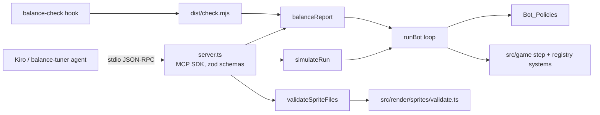

# Design Document: zombie-sim-mcp

## Overview

zombie-sim-mcp is a stdio MCP server, `zombie-sim`, that plays whole Runs headless with bot
players and reports balance numbers. It also checks sprite files. Three Tools:
`simulate_run`, `balance_report` and `validate_sprites`. A `balance-tuner` agent and a
`balance-check` hook use it.

Design choices:

- **Reuse, don't copy.** The server imports the real `step()`, the Session_Registry's systems,
  the balance resolvers and the final-art sprite validator from `src/`. A rule change in the game
  is a rule change in the simulator.
- **Bots play through commands.** `runHeadless` takes a fixed script, but a bot must react to
  the state. So the tool has its own loop: `state → policy(state) → commands → step`. It uses the
  same `step()` and systems, with no shortcuts (Requirement 2.1).
- **Handlers are plain functions.** `simulateRun(input)`, `balanceReport(input)` and
  `validateSpriteFiles(input)` take JSON and return JSON. The MCP layer only parses, calls them
  and wraps errors. Tests call the handlers directly (Requirement 8.1).
- **One build step, no new runtime.** The repo runs TypeScript only through Vite and Vitest.
  `npm run sim:build` uses Vite's existing library build in SSR mode to bundle
  `tools/mcp-sim/src/server.ts` into `tools/mcp-sim/dist/server.mjs`. Node 22 runs that file. The
  only new package is `@modelcontextprotocol/sdk` as a dev dependency (Requirement 8.2,
  approved).

## Architecture



Folder layout (new top-level `tools/`, listed in `structure.md` already):

```
tools/mcp-sim/
  src/server.ts        MCP wiring only
  src/check.ts         CLI for the hook
  src/runBot.ts        bot loop and Run_Summary
  src/policies.ts      idle, casual, competent, perfect
  src/report.ts        balanceReport and Target_Checks
  src/sprites.ts       validateSpriteFiles (reads assets/sprites only)
  src/schemas.ts       zod input schemas
  vite.config.ts       SSR library build → dist/
  dist/                build output, gitignored
```

## Components and Interfaces

### Run loop (`runBot.ts`)

```ts
export interface BotRunInput {
  readonly seed: number;
  readonly policy: PolicyName;
  readonly overrides?: BalanceOverrides;   // core, lane, ads, chapters, economy
  readonly maxSeconds?: number;            // default 300
}

export interface RunSummary {
  readonly seed: number; readonly policy: PolicyName;
  readonly outcome: 'won' | 'lost' | 'timeout';
  readonly endSeconds: number;
  readonly perSecond: readonly { s: number; integrity: number; download: number; wallet: number; earned: number }[];
  readonly chapterStarts: Readonly<Record<string, number>>;
  readonly purchases: readonly { item: string; s: number }[];
  readonly adMistakes: number; readonly fakeClicks: number;
  readonly criticalInPlotTurn2: boolean;
}

export function runBot(input: BotRunInput): RunSummary;
```

The loop builds the Run with `createRun`, using the same systems the Session_Registry uses,
built with the overrides. Each Tick it calls `policy.decide(state, memory, rng)` and passes the
returned commands to `step`, then folds the events into the summary. `earned` is wallet plus
spent. The run stops at `won`, `lost` or `maxSeconds` (Requirement 3.1). The overrides go into
this Run's balance only (Requirement 3.2). If `step` throws, `runBot` throws an error carrying
the seed (Requirement 1.4).

### Bot_Policies (`policies.ts`)

```ts
export interface Policy {
  decide(state: GameState, memory: BotMemory, rng: () => number): readonly InputCommand[];
}
```

Every bot gets its own mulberry32 RNG seeded from `seed ^ 0x9e3779b9`. The Run's RNG is never
touched, and `memory` is plain data, so results repeat exactly (Requirement 2.5).

| Policy | Reaction_Delay | Behaviour |
|---|---|---|
| idle | – | sends nothing (Requirement 2.2) |
| casual | 30 Ticks | one action per 18 Ticks; mistakes 20%, fake clicks 15% |
| competent | 15 Ticks | one action per 10 Ticks; mistakes 5%, fake clicks 3% |
| perfect | 0 | one action per Tick; no mistakes |

Each bot works through a priority list. Something counts as seen once it has existed for the
Reaction_Delay.

1. `startDownload` once `connected` (the Real_Link click).
2. The Correct_Control of an open interrupter, read from the close pattern table, or a wrong
   control on a mistake roll. Bots hover a runaway ✕ until it stops jumping.
3. Attack the Mob closest to the modem: a `hammer` at its Hit_Box centre on cooldown, or a
   held `lanePointer` with the saw or flame.
4. `lanePointer` over the nearest Data_Packet.
5. Close clutter Ads with their Correct_Control. A fake-click roll clicks a fake button instead.
6. `buy` the next slot in order 2, 3, 1, 5, 4 when affordable, and switch to the best weapon for
   the target (saw on tanks and the boss, flame on groups of 3 or more).

Bots only send commands a player can send (Requirement 2.1), and they read the state without
changing it. The mistake and fake rates sit in a `BOT_TABLE` constant (Requirement 2.4).

### `balanceReport` (`report.ts`)

```ts
export interface ReportInput {
  readonly seeds: number; readonly firstSeed?: number;     // default 1
  readonly policies: readonly PolicyName[];
  readonly overrides?: BalanceOverrides;
  readonly baseline?: BalanceOverrides;
}
export interface PolicyStats {
  readonly winRate: number; readonly medianWinSeconds: number | null;
  readonly median60KbSeconds: number | null; readonly median180KbSeconds: number | null;
  readonly criticalShare: number;
}
export interface ReportResult {
  readonly proposal: Readonly<Record<PolicyName, PolicyStats>>;
  readonly baseline?: Readonly<Record<PolicyName, PolicyStats>>;
  readonly targets: readonly TargetCheck[];   // competent, proposal
}
export interface TargetCheck {
  readonly target: string; readonly measured: number | null;
  readonly goal: string; readonly result: 'pass' | 'warn';
}
```

The report plays seeds `firstSeed … firstSeed + seeds − 1` for each policy (Requirement 4.1).
The 60 and 180 KB times are the first second at which `earned` reaches each amount
(Requirement 4.2). With a baseline, both sets run on the same seeds (Requirement 4.4).

The Balance_Targets come from the `game-balance` steering file and live in `TARGETS`
(Requirement 4.3):

| Target | Pass when |
|---|---|
| Winning run length | median win between 135 and 165 s |
| Saw affordable | median 60 KB time ≤ 75 s |
| Flamethrower affordable | median 180 KB time ≤ 95 s |
| Critical in Plot turn 2 | share ≥ 0.5 |
| Winnable | win rate between 0.4 and 0.9 |

Performance (Requirement 4.5): a Run is about 9,000 Ticks, so 150 Runs is about 1.35M Ticks. The
loop skips per-Tick summary work except once per second. The handler has a soft budget: a test
fails if 50 seeds × 3 policies takes over 60 s, and the handler reports its elapsed time.

### `validateSpriteFiles` (`sprites.ts`)

It reads only `assets/sprites/**` with `fs.readdir` and `fs.readFile`, rejecting any path that
resolves outside that folder. It runs `validateSprites` from final-art and adds `missing`: every
entity and animation in `ANIMATION_TABLE` with no team frames (Requirements 5.1–5.3).

### Server (`server.ts`)

- `McpServer` with `StdioServerTransport` (Requirement 1.1).
- Each Tool has a zod input schema from `schemas.ts`. Seeds are integers ≥ 0, `seeds` is 1 to 500,
  `maxSeconds` is 1 to 600, and policies come from the enum.
- A schema failure returns `isError: true` with one line per invalid field, and the server keeps
  running (Requirement 1.3).
- A thrown Run returns `isError: true` with the seed and the message (Requirement 1.4).
- There is no network code and no file writes. The only file reads are in `sprites.ts`, and a
  test checks the bundle for `fetch`, `http` and `writeFile` imports (Requirement 1.5).

Config (Requirement 1.2), in both `.kiro/settings/mcp.json` and `docs/mcp.example.json`:

```json
"zombie-sim": {
  "command": "node",
  "args": ["tools/mcp-sim/dist/server.mjs"],
  "autoApprove": ["simulate_run", "balance_report", "validate_sprites"]
}
```

### Balance tuner agent (`.kiro/agents/balance-tuner.md`, Requirement 6)

- **Tools:** `zombie-sim` Tools, read, and write limited to `src/game/balance/**` and
  `docs/balance/**`.
- **Workflow:**
  1. Run a baseline `balance_report` (50 seeds, all policies).
  2. Propose one change.
  3. Run the report again with `baseline`.
  4. Write `docs/balance/YYYY-MM-DD-<topic>.md` with the old value, the new value, the reason and
     both tables.
  5. Apply the change only when no Target_Check gets worse.

### Balance hook (`.kiro/hooks/balance-check.json`, Requirement 7)

- **Trigger:** a file save matching `src/game/balance/**`.
- **Action:** command `npm run sim:check`, which runs `sim:build` and then
  `node tools/mcp-sim/dist/check.mjs`.
- **What `check.ts` does:**
  - It first runs every balance resolver. If any throws, it prints the problems and exits 1.
  - Otherwise it plays 20 seeds with `competent` and prints at most 10 lines: win rate, median
    win time, then one `PASS`/`WARN` line per Target_Check.

## Data Models

All inputs and outputs are plain JSON. `BotMemory` holds plain data: last action Tick, the Ads
and Mobs seen with their first-seen Ticks, and runaway hover state. Nothing persists between
calls.

## Correctness Properties

### Property 1: Bot runs are deterministic

*For any* seed, policy and overrides, `runBot` called twice returns deep-equal Run_Summaries.

**Validates: Requirements 2.5, 3.1**

### Property 2: Bots only send player commands and never change state

*For any* seed and policy, every command a bot returns is a valid `InputCommand` a view can
send, and `decide` leaves the state it reads deep-equal to before.

**Validates: Requirements 2.1, 2.2**

### Property 3: Overrides apply to one Run only

*For any* two seeds, running seed A with overrides and then seed B without them gives B the same
summary as running B alone.

**Validates: Requirements 3.2**

### Property 4: Report statistics match the runs

*For any* small seed count (1–5) and policy list, each `winRate` equals wins ÷ runs from
individual `runBot` calls, each median equals the median of those summaries, and each Target_Check
result matches its rule.

**Validates: Requirements 4.1, 4.2, 4.3, 4.4**

### Property 5: Invalid input is reported, not thrown

*For any* JSON value that fails a Tool's schema, the server handler returns `isError: true` and
names every invalid field, and a following valid call still succeeds.

**Validates: Requirements 1.3, 1.4**

## Error Handling

- Schema errors and Run errors are returned as MCP tool errors and never crash the process.
- Invalid overrides go through the game's own resolvers, so their messages come back unchanged.
- A missing `assets/sprites/` is fine: there are no problems, and everything is listed as
  missing.
- A missing `dist/` makes Kiro fail to start the server. The README and the hook both run
  `sim:build` first.

## Testing Strategy

- `tests/tools/mcp-sim/runBot.test.ts`: Properties 1–3. An idle bot loses before 120 s. A
  perfect bot with a short-download override wins.
- `tests/tools/mcp-sim/report.test.ts`: Property 4, plus a baseline side-by-side example.
- `tests/tools/mcp-sim/server.test.ts`: Property 5 against the handler wrapper, with no stdio.
  A second test starts the built server over an in-memory transport and lists three Tools.
- `tests/tools/mcp-sim/sprites.test.ts`: path escape rejected, missing list, and the
  final-art validator results passed through.
- `tests/tools/mcp-sim/perf.test.ts`: 50 seeds × 3 policies in under 60 s. It is tagged slow
  and runs in `npm test` with a long timeout.
- `tests/tools/mcp-sim/check.test.ts`: output is at most 10 lines, and a bad balance prints its
  problems.
