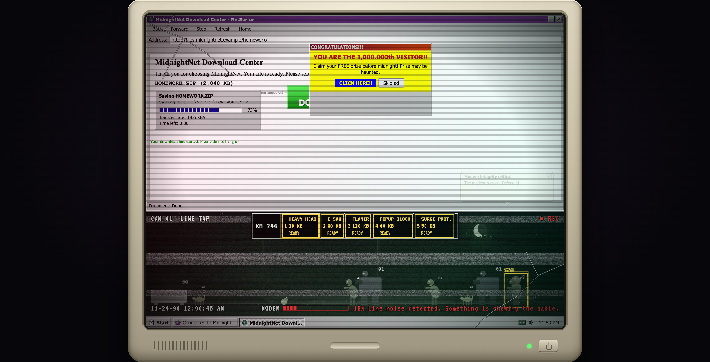
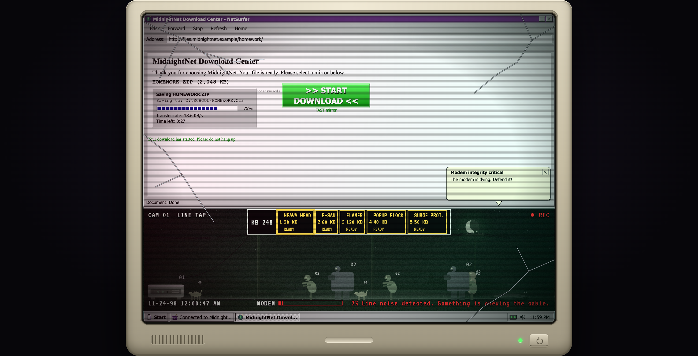
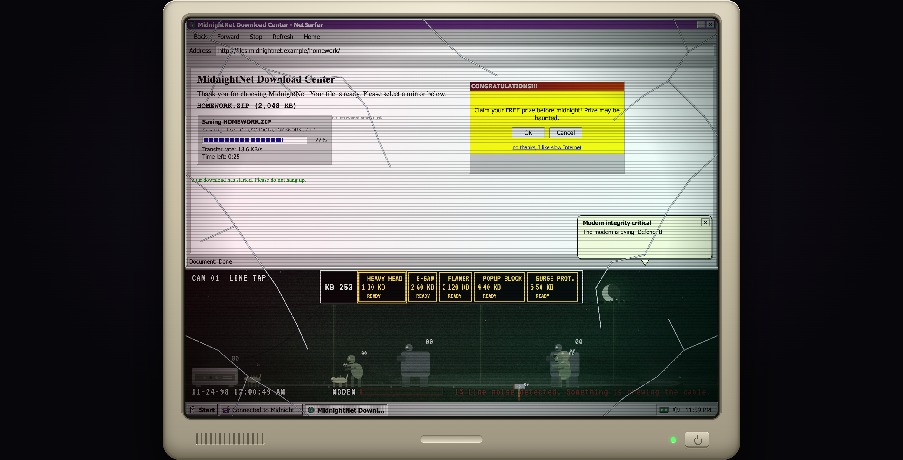
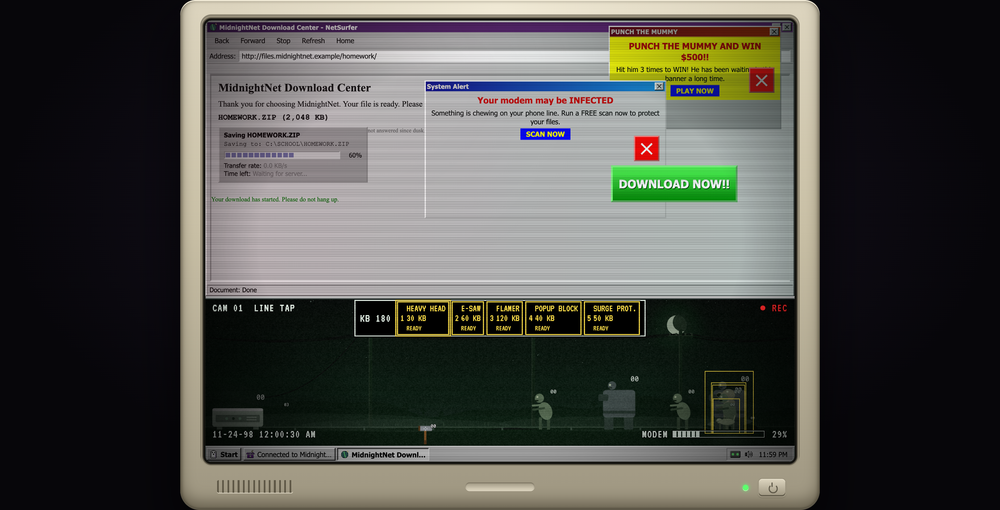
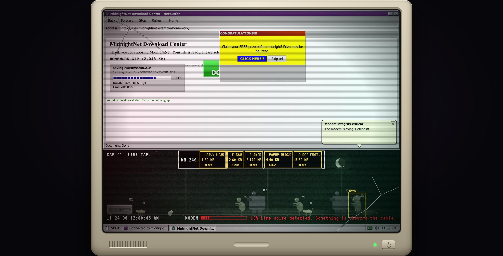
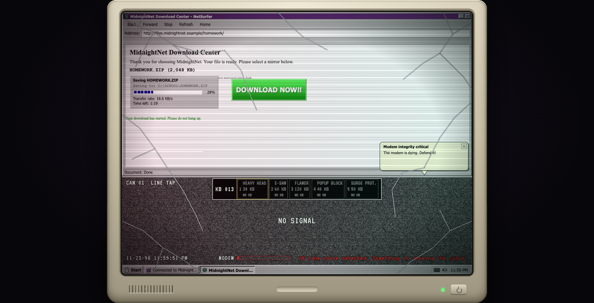
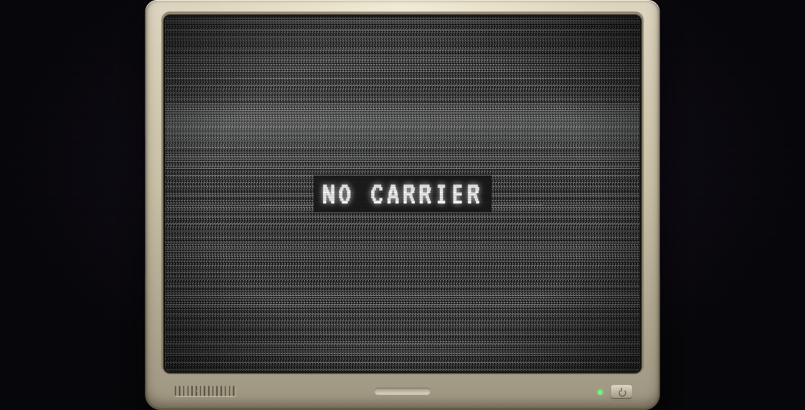

# Playtest: juice-and-endings (Req 8.4), 2026-11-23

Screenshots: `docs/playtests/2026-11-23-juice-and-endings/`. Times are seconds from clicking
**Connect** (or **Retry**). Played with a Playwright script that clicks the correct control of
each ad, clicks the real link, sweep-clicks the left half of the phone line with the hammer and
presses 1 and 5 to buy. For the loss runs the script stopped defending after 22 s.

Runs: run 1 (startup, lost at 1:50), run 4 (**won at 2:13**, used for the Plot turn 2 FPS),
run 6 (deliberate loss, used for the NO SIGNAL cut). Runs 2, 3 and 5 were lost while the
script was between tool calls or took screenshots too slowly. They are not used.

## Summary

Power → title → BIOS → desktop → dial-up all played; nothing was skipped
([title](2026-11-23-juice-and-endings/01-title.png),
[BIOS](2026-11-23-juice-and-endings/02-bios.png),
[desktop](2026-11-23-juice-and-endings/03-desktop.png)). All three crack stages appear at the
right thresholds and add cracks at each stage. The faint corruption starts at Pinch 2 (90.0 s).
The strong corruption covers both fronts once integrity is critical. On a loss the lane cuts to
"NO SIGNAL" for about half a second. Then the full-screen "NO CARRIER" static plays, then the
"Connection Terminated" window opens. The frame rate in Plot turn 2 held at the display's
120 fps with no dropped frames. No console errors or warnings came from the game. I could not
capture the win fade, because the winning run never reached a crack stage, and my screenshot
loop missed the half-second fade of the faint corruption.

## Crack overlay (Req 2)

`data-stage` changes logged by a MutationObserver in run 1: stage 1 at 105.33 s, stage 2 at
106.86 s and stage 3 at 108.33 s. Each change followed a hit that crossed 20, 10 and 5. Each
screenshot was taken about 0.7 s after the change, so the HUD can read a little lower than the
threshold.

| Stage | Threshold | Screenshot | Notes |
|---|---|---|---|
| 1 | ≤ 20 |  | A few thin lines from the top-left and right edges. |
| 2 | ≤ 10 |  | Adds cracks; stage 1 lines are still there. |
| 3 | ≤ 5 |  | Full web across both fronts. The download box, the ad buttons and the centre of the lane stay readable. |

The stage never went down. Ads under the cracks were still closed by the script's clicks, so
the cracks do not capture input.

## Corruption overlay (Req 3)

- Faint (level 1, `data-front="browser"`): starts at 90.0 s in run 1 and at 89.99 s in run 4,
  which is the Pinch 2 start. 
- Strong (level 2, `data-front="both"`): starts on the same tick as crack stage 1 (105.33 s,
  run 1), when integrity first drops to 20 or below.
  
- The script kept closing ads under both levels (swapped, decoy, countdown), so clicks pass
  through the overlay. I could not measure the 150 ms limit on hiding a control from
  screenshots.

## End transition (Req 7)

Loss, run 6, screenshots about every 0.2 s:

| Time | What is shown | Screenshot |
|---|---|---|
| 51.02 s | Integrity 4 %, crack stage 3, strong corruption | [30-loss-before-cut](2026-11-23-juice-and-endings/30-loss-before-cut.png) |
| 51.24–~51.75 s | **Lane only** cuts to noise with a centred "NO SIGNAL". REC is off and the timestamp is frozen at 11:59:51 PM. The browser and the cracks stay on screen. |  |
| ~51.85–53.4 s | Full-screen static with "NO CARRIER" (the result screen's lose intro) |  |
| 53.51 s | "Connection Terminated" with `SKELETON_DATING_SIM.EXE` | [33-loss-result](2026-11-23-juice-and-endings/33-loss-result.png) |

The NO SIGNAL cut lasts about 0.5 s, which matches 30 ticks. The final state looked unchanged:
integrity stayed 0 % and the download stayed at the same percentage on the result window.

Win, run 4: the bar reached 100 % at about 133.7 s, and "Download Complete / Welcome to the
Internet! / `funny_cats_1998.avi`" opened at 135.8 s
([41-win-result](2026-11-23-juice-and-endings/41-win-result.png)). Only the faint corruption
was on screen ([40-win-run-corruption](2026-11-23-juice-and-endings/40-win-run-corruption.png)),
because integrity never went below 81. I did not capture the 30-tick fade.

## Plot turn 2 FPS (Req 8.4)

**Method.** Before the run, a `requestAnimationFrame` loop was injected with
`browser_run_code_unsafe` / `page.evaluate`. It pushes every rAF timestamp into an array, and
`t0` is set when Retry is clicked. After the run, the frames between 115 s and 133 s
(1:55–2:13) were counted per whole second. The run won at about 2:13, so the window ends there.
The longest gap between two frames was also recorded. Environment: Playwright Chromium on macOS
on a 120 Hz display, headed, dev build from `npm run dev`. The Playwright script was clicking and
taking DOM snapshots the whole time, so this is a busy case.

| Window | Average FPS | Min FPS (1 s bucket) | Max FPS | Longest frame |
|---|---|---|---|---|
| **Plot turn 2, 115–133 s (run 4)** | **120.0** | **120** | 120 | 9.4 ms |
| Reference: Plot turn 1, 25–40 s | 120.0 | 120 | 120 | 9.4 ms |

All 18 seconds in Plot turn 2 had exactly 120 frames, which is the display cap. Two to three ads
were open, the faint corruption was running, and there were boss and flood mobs on the lane. The
winning run never reached critical, so this does not measure Plot turn 2 with cracks and strong
corruption on screen. Run 1 had both from 105 s but was lost at 1:50. Its frames between 105 and
110 s were also 120 per second, but I did not save a per-second breakdown for that run.

## Comfort (Req 8)

- **Flashes.** The observer logged every `data-flash` grant on `.juice-layer`. Run 1 had 4 `full`
  grants (105.33, 105.33, 106.86, 108.33 s), which is at most 2 in any 1 s window. Lane flashes on
  the canvas cannot be seen in the DOM, so I could not count them. Per `cctvTuning.ts`, the NO
  SIGNAL noise holds each frame for 20 ticks (3 changes per second) and asks the shared budget
  once. I saw nothing that looked like more than 3 flashes per second.
- **CSS and inline SVG.** The overlays are `div.crack-overlay[data-stage]` and
  `div.corruption-overlay[data-level][data-front]` inside `div.juice-layer`. Neither one is a
  canvas. The only canvas on screen is the lane. Clicks went through both overlays every time.
- Screen shake was on (the default). I did not test the `.is-still` path with shake turned off.

## Bugs

1. **Leftover ad text "not answered since dusk." (Low, still open from 2026-11-22).** It is
   visible at the right of the download box in every connected screenshot
   (`10-crack-stage1.png`, `31-no-signal.png`).
2. **Integrity froze at 81 % for 74 s in the winning run (needs a look, possibly not a bug).**
   Run 4: integrity was 81 from 60.7 s to the win at 133.7 s, through the tank, ranged and boss
   chapters, while a script swept only the left half of the lane. Either the hammer sweep near the
   modem killed everything (including globs), or ranged globs and the boss never reached the
   modem. It is worth checking with the zombie-sim tool whether the boss actually spawned at
   about 1:58 in that seed.

Console: 3 messages in total, 0 errors and 0 warnings.

## Design gaps (vs `docs/game-design.md`)

- **The run ended at 2:13 rather than about 2:30.** The script closed ads fast and never clicked
  a fake button.
- **Plot turn 2 "Integrity critical, crack overlay at maximum"** depends on the player. A good run
  (run 4) never got there. A poor run (run 1) got there in Pinch 2, at 1:45.
- **Loss timing.** With no defence after 22 s, the modem died at about 51 s. Integrity went from
  100 to 4 between 33 s and 50 s.

## Feel

- 105–110 s (run 1): three crack stages in 3 s, each with the strong corruption and the
  "Modem integrity critical" balloon. It reads as the machine breaking. It is also busy, but the
  ad buttons stayed legible.
- The NO SIGNAL cut is short and clear. The lane dies first, then the whole screen. The two-step
  ending works well.
- The faint corruption at 90 s is easy to miss under the scanlines. The pink colour bleed is
  only visible at the edges.

## Not covered

The win overlay fade (no cracks on the winning run, and the fade itself was not caught). Screen
shake turned off (`.is-still`). Audio (alarm, stings, rumble, roar, limiter), because the headless
check has no listening step. Strong corruption hiding controls for under 150 ms.
